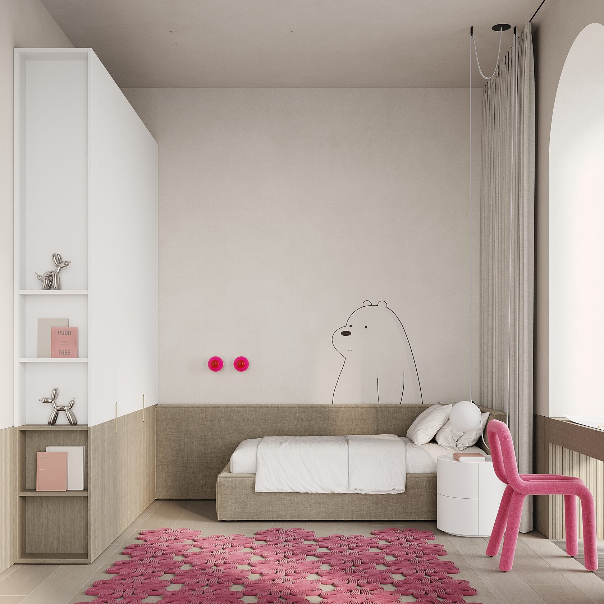
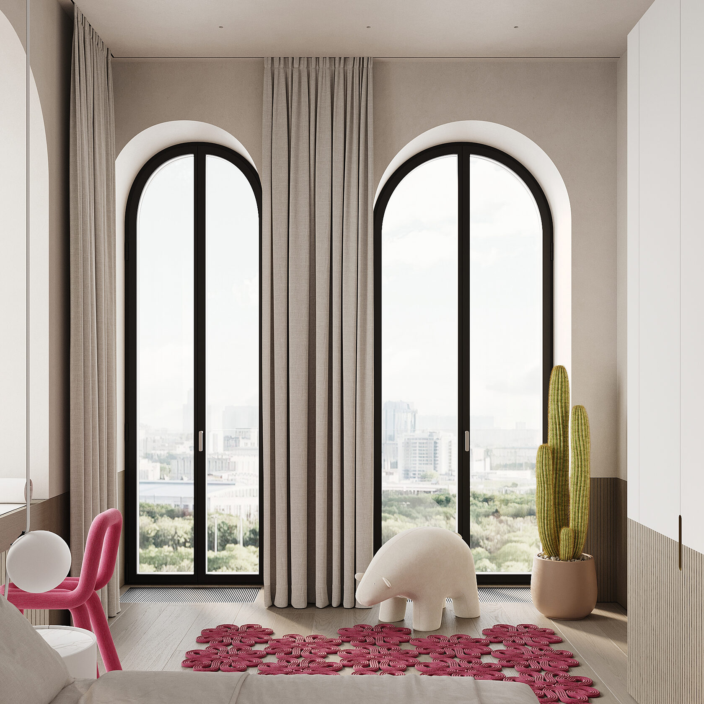
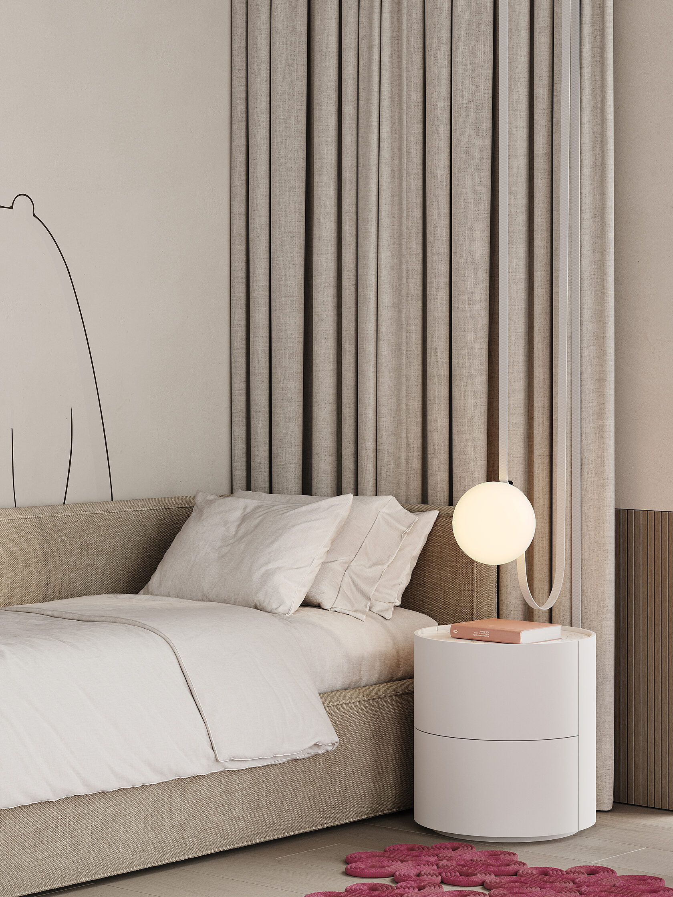
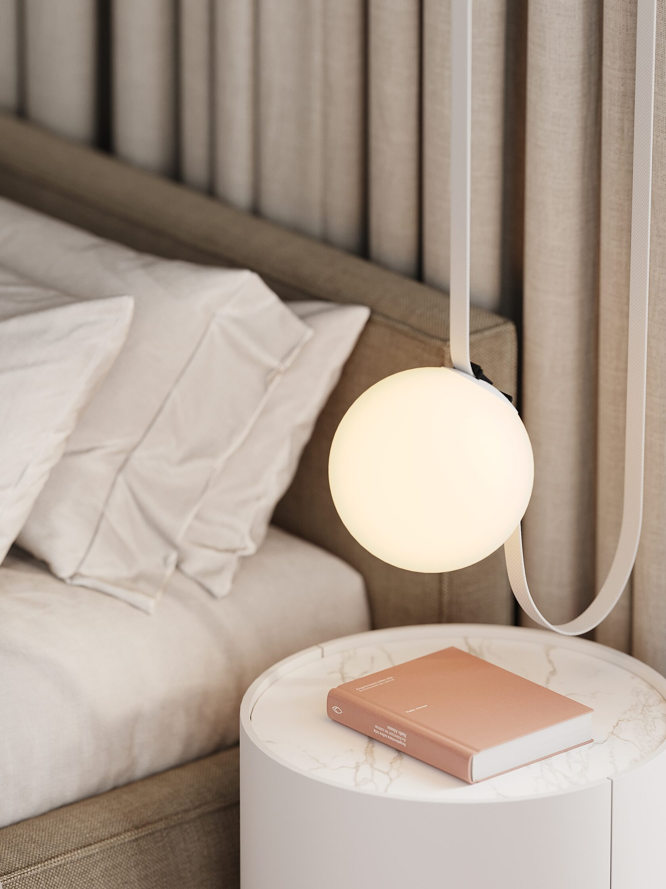

Дизайн детской комнаты чаще всего начинают с картинки: яркие обои, кровать-машина, тема «под мультфильм». На практике это комната, в которой ребёнок спит, играет, учится и хранит вещи — и которая должна выдержать несколько лет роста, а не один сезон декора. Если сначала не развести зоны и не заложить безопасную расстановку, тему со стен потом снимают, а тесноту и опасные углы уже не исправить отделкой.

В [Studio19.03](https://studio1903.ru/) с 2019 года проектируют и реализуют жилые интерьеры в Москве и других городах. Детскую студия делает не отдельно, а в составе квартиры или дома: 3D-концепцию обычно начинают с кухни-гостиной, утверждают стиль, материалы и свет и только потом визуализируют остальные помещения, в том числе детскую. Ниже — с чего начать дизайн детской комнаты, как заложить зоны и безопасность, какие решения видны в портфолио и как заказать проект.

## С чего начинается дизайн детской комнаты

Не с темы. Тема — способ собрать уже понятую задачу, и её как раз легче менять. Сначала нужно ответить, как комнатой пользуются сейчас и как ею будут пользоваться через несколько лет.

Сколько детей живёт в комнате и какого они возраста. Нужно ли место только для сна и игры или уже полноценный стол для учёбы. Будет ли кто-то из взрослых сидеть рядом вечером. Где хранятся одежда, игрушки, книги и вещи «на вырост». Должна ли комната через несколько лет превратиться почти во взрослую спальню — или это пока гостевая, которую заложили с запасом.

Ответы сразу меняют план. Для малыша важнее безопасная зона сна, место на полу для игры и закрытое хранение, до которого взрослый дотягивается первым. Школьнику нужен стол у света, полки под рукой и кровать, которую не приходится обходить каждый раз, когда садятся заниматься. Подростку чаще важны тишина, хранение и возможность сменить акценты, не делая ремонт заново.

Состав работы тоже стоит понять в начале. Дизайн детской комнаты в Studio19.03 не делается отдельно от квартиры: в [полный дизайн-проект](https://studio1903.ru/price) входят обмерный план и планировочные решения, 3D-визуализация всех помещений, рабочая документация и развёртки стен, мебель в 3D и спецификация материалов, оборудования и мебели. Что именно входит в альбом, разобрано в статье [«Дизайн-проект квартиры»](https://studio1903.ru/journal/dizajn-proekt-kvartiry). Отдельного тарифа «только на детскую» на сайте нет.

## Планировка и зонирование в дизайне детской комнаты

В одной комнате обычно собирают четыре роли: сон, игра, учёба и хранение. Их не обязательно разделять стенами. Достаточно, чтобы кровать не стояла в проходе, стол не смотрел в дверь, а игрушки не занимали место, которое нужно, чтобы подойти к шкафу или открыть окно.

Рабочий стол логично ставить ближе к окну: дневной свет падает на поверхность, а вечером его дополняет отдельный светильник, а не только общий свет по комнате. Зону сна лучше собрать так, чтобы её можно было приглушить: плотные шторы, свой локальный свет, меньше визуального шума над изголовьем. Игра может занимать свободный пол у окна или ковёр в центре — главное, чтобы этот участок не пересекался с основным проходом.

Закрытое хранение держит комнату спокойной. Открытые полки удобны для того, чем пользуются каждый день, но если выставить всё сразу, детская быстро перестаёт быть местом для сна. Высокие шкафы и вещи, которые не нужны каждый день, оставляют во встроенных корпусах; то, до чего ребёнок должен дотягиваться сам, ставят ниже.

В Studio19.03 на этапе планировки готовят несколько вариантов зонирования — мебель, перегородки, снос — в рамках действующих норм. Это важно и тогда, когда детская нужна сразу, и тогда, когда её только закладывают на будущее. В проекте [SQUARE 29](https://studio1903.ru/square29), квартире 86 м² в ЖК «Царская Площадь», студия собирала пространство для одного человека, но с перспективой на семью с детьми: в результате появились большая кухня-гостиная, мастер-спальня, гардеробная и гостевая комната, которая в будущем должна превратиться в детскую.

## Эргономика и безопасность в дизайне детской комнаты

Детская — одно из помещений, где ошибки в расстановке видны быстрее, чем в гостиной. Ребёнок пользуется комнатой иначе, чем взрослый: больше времени на полу, чаще тянется к ящикам и розеткам, опирается на мебель и оставляет вещи на пути к кровати и столу.

Высокие шкафы и стеллажи крепят к стенам. Для младшего возраста лучше избегать острых углов в зоне игры и прохода, не оставлять тяжёлые предметы на открытых верхних полках и закрывать розетки, до которых легко дотянуться. Подоконник, батарею и открывание окна проверяют на плане: если кровать или стол стоят вплотную, створку может быть некуда открыть, а радиатор оказывается слишком близко к спальному месту.

Свет лучше закладывать слоями, а не одной люстрой. Общий свет нужен, чтобы комната читалась целиком. Над столом — отдельный светильник, который не бьёт в глаза и не оставляет тень от руки. У кровати — мягкий локальный свет, которым можно пользоваться, не включая всю комнату. Для сна обычно нужны плотные шторы: иначе утренний свет будит раньше, чем нужно, особенно если стол стоит у того же окна.

Высоту стола и стула подбирают под рост, а не «на вырост» вслепую: если столешница слишком высока, ребёнок поднимает плечи, если слишком низка — сутулится. Удобнее закладывать регулируемый стул и запас по глубине столешницы, чем покупать взрослую пару сразу. Точные размеры проверяют на плане расстановки мебели и уже по конкретному росту.

Отделка должна выдерживать ежедневное использование: пол, на котором играют, легко моющиеся поверхности, составы, допустимые для жилых помещений. Яркие акценты имеют смысл там, где их можно сменить — текстиль, ковёр, стул, рисунок на стене — а не в капитальной отделке, которую придётся ломать через два-три года.

## Дизайн детской комнаты в проектах Studio19.03

В опубликованном портфолио студии детская наиболее явно собрана в проекте [BRODSKY-19](https://studio1903.ru/brodsky-19) — апартаментах 106 м² в Москве, в ЖК «Бродский». Задача, как сказано в карточке, — благородный, не «кричащий» интерьер для интеллигентной семьи с ребёнком. Решение — спокойная глубокая палитра, крупные горизонтали в отделке и мебели, точечный свет на деталях.

Детская здесь не выбивается из общего тона интерьера и не собрана как отдельная «тематическая» декорация. Спокойные стены и текстиль, встроенный шкаф с закрытыми фасадами и открытыми нишами, кровать с мягким основанием, стол у арочных окон. Акценты точечные и сменяемые: розовый ковёр и стул, рисунок на стене, локальный свет у изголовья. Такую комнату проще вести за ребёнком: меняется текстиль и декор, а планировка, хранение и свет остаются.

В [SQUARE 29](https://studio1903.ru/square29) детская заложена как следующий шаг, а не как текущий сценарий: гостевая комната должна с лёгкостью превратиться в неё, когда появится семья. В [ROCHE 82](https://studio1903.ru/roche82) на 82 м² студия вместила кухню-гостиную, две спальни, два санузла и большую гардеробную: вторую комнату в такой планировке можно отдать ребёнку, если это следует из технического задания, но в карточке проекта она названа именно второй спальней, без отдельного описания детской.

Это разные задачи, и дизайн детской комнаты в них получается разным. Где ребёнок живёт уже сейчас, комнату собирают целиком: сон, игра, хранение, свет. Где детская только предполагается, на плане оставляют место, проходы и возможность сменить мебель, не переделывая всю квартиру.

## Как заказать дизайн детской комнаты

Работа идёт по этапам, которые описаны на странице [«Этапы»](https://studio1903.ru/steps). Сначала заявка и встреча — в студии на Нагатинской или на объекте. Затем договор, обмеры с фото- и видеофиксацией и техническое задание, которое заполняют вместе. После этого — несколько вариантов планировки, 3D-концепция ключевого помещения (обычно кухни-гостиной), визуализации остальных комнат, в том числе детской, рабочая документация и спецификация с артикулами.

Если проект нужно довести до ремонта, студия сопровождает реализацию: бригады работают по документации Studio19.03, есть авторский надзор и комплектация. Руководитель студии Роман Ахмадуллин ведёт каждый проект лично, от обмеров до приёмки, и сам решает вопросы на стройке, не передавая их менеджеру. Как устроена работа над интерьером целиком — в статье [«Дизайн интерьера»](https://studio1903.ru/journal/dizajn-interera).

Готовый бриф не нужен: достаточно площади и телефона. По заявке студия отвечает в течение рабочего дня.

## Сколько стоит дизайн детской комнаты

На странице [«Цены»](https://studio1903.ru/price) Studio19.03 публикует ориентиры по форматам работы. Это стоимость проекта квартиры или дома, а не отдельная ставка за одно помещение.

Планировочный проект — 1 000 ₽ / м²: обмерный план, план расстановки мебели с размерами и перепланировочный план (снос и возведение перегородок). Для детской это уже ответ, где будут кровать, стол, проходы и хранение.

Полный дизайн-проект — от 6 000 ₽ / м², со шкалой по площади:

- 50–100 м² — 8 000 ₽ / м²;
- 100–200 м² — 7 000 ₽ / м²;
- свыше 200 м² — 6 000 ₽ / м².

Для квартиры вроде SQUARE 29 (86 м²) или ROCHE 82 (82 м²) в прайсе указано 8 000 ₽ / м². BRODSKY-19 (106 м²) попадает в диапазон 100–200 м² — 7 000 ₽ / м². Отдельной ставки для площади меньше 50 м² на сайте нет. Точную сумму лучше запросить расчётом: на сайте отвечают в течение рабочего дня.

Авторский надзор — от 50 000 ₽ в месяц: еженедельные выезды, отчётность с фотофиксацией, проверка соответствия проекту, консультации прораба и подрядчиков, оперативные корректировки в чертежах. Комплектация — по согласованию; все скидки и бонусы от поставщиков остаются заказчику (от 5 до 15%).

Студия работает с объектами, где бюджет отделки под ключ — от 200 000 ₽ за квадратный метр. Это ориентир по реализации, а не стоимость самого проекта. Срок разработки альбома в днях или неделях на сайте не опубликован; сроки в карточках проектов относятся к реализации объекта целиком.

Написать можно на [studio1903.ru](https://studio1903.ru/). Телефон +7 (966) 250-84-50, почта info@studio1903.ru, студия в Москве, Нагатинская набережная, 10А, корп. Б.

:::faq
С чего начать дизайн детской комнаты?

Со сценария и планировки. Сначала фиксируют, сколько детей будет жить в комнате, какого они возраста, где спят, играют, учатся и хранят вещи, и как комната должна измениться через несколько лет. Затем делают обмеры и несколько вариантов расстановки. Цвет стен, тему и декор выбирают уже под утверждённый план.

Как зонировать детскую без перегородок?

Кроватью и шкафами, столом у окна, отдельным светом над каждой зоной и свободным полом для игры, который не пересекается с проходом. Закрытое хранение помогает оставить зону сна спокойной, не убирая из комнаты игрушки и книги.

Нужно ли сразу делать комнату «на вырост»?

Имеет смысл закладывать запас в планировке, а не во взрослой мебели не по росту. Проходы, встроенные шкафы и место под стол остаются; высоту стола и стула подбирают под ребёнка, а акценты — ковёр, текстиль, декор — можно сменить без нового ремонта. В SQUARE 29 студия заранее предусмотрела гостевую, которая должна превратиться в детскую.

Какие требования к безопасности стоит заложить в проект?

Высокую мебель крепят к стенам, проверяют острые углы в зоне игры, розетки, открывание окон и положение кровати относительно батареи и прохода. Отделку выбирают так, чтобы её можно было мыть, и используют составы, допустимые для жилых помещений. Точные решения проверяют на плане и на объекте.

Сколько стоит дизайн детской комнаты?

Отдельного тарифа на одно помещение нет: проект делают для квартиры или дома целиком. Планировочный проект — 1 000 ₽ / м², полный дизайн-проект — от 6 000 ₽ / м² в зависимости от площади. Точный расчёт студия делает после заявки.
:::
