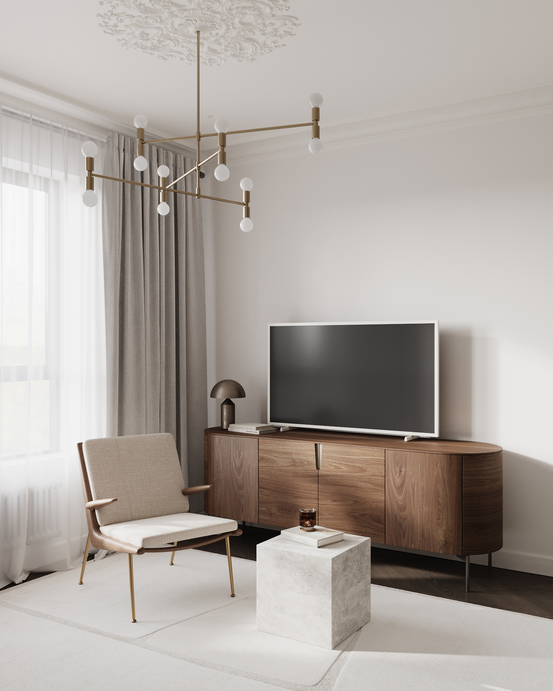
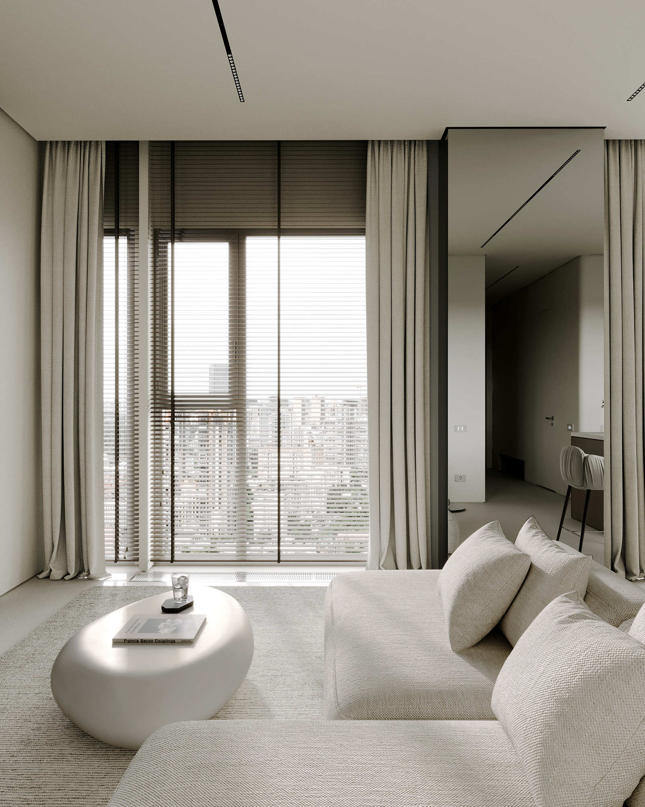
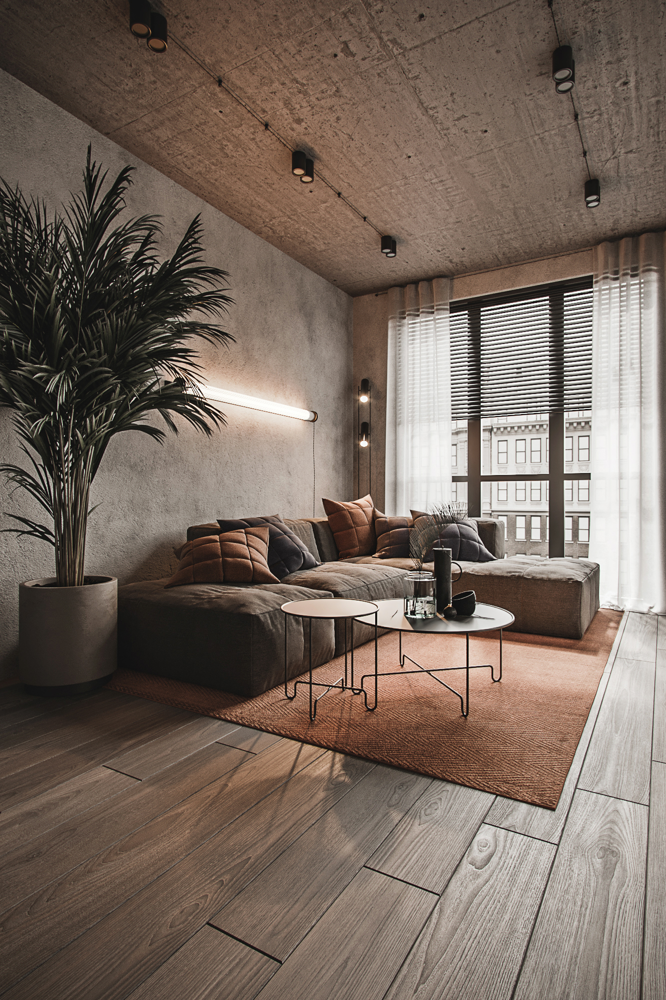
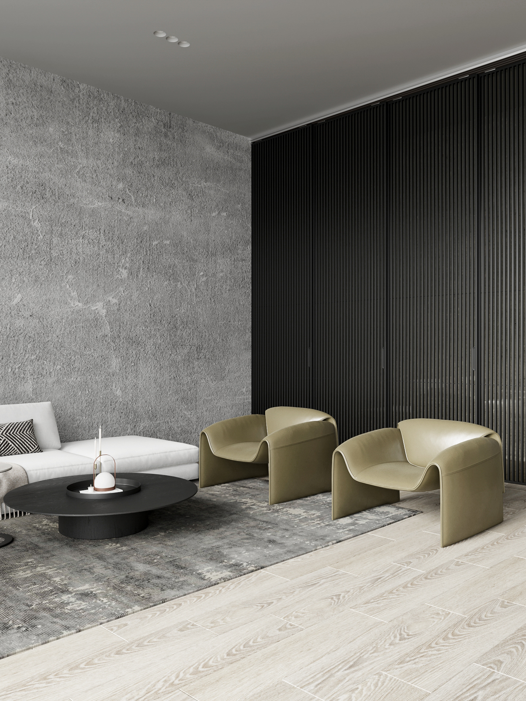

Дизайн гостиной чаще всего начинают с картинки: низкий диван, стена под телевизор, «как в журнале». На практике это зона, которой пользуются каждый день — отдых, гости, иногда стол или работа рядом с кухней. Если сначала не собрать сценарий и не понять, где именно будет гостиная на плане, мебель встанет в проход, а свет и хранение придётся подгонять уже на стройке.

В [Studio19.03](https://studio1903.ru/) с 2019 года проектируют и реализуют жилые интерьеры в Москве и других городах. Гостиную студия не делает отдельным «проектом одной комнаты»: 3D-концепцию обычно начинают с кухни-гостиной, утверждают стиль, материалы и свет уже после планировки и только потом визуализируют остальные помещения. Ниже — с чего начать дизайн гостиной, какие решения видны в портфолио и как заказать проект.

Этот текст — про гостиную как жилую зону: отдельную комнату или часть общего пространства. Как собирают кухню-гостиную целиком, разобрано в статье [«Дизайн кухни-гостиной»](https://studio1903.ru/journal/dizajn-kuhni-gostinoj). Как устроена квартира как жильё — в статье [«Дизайн квартиры»](https://studio1903.ru/journal/dizajn-kvartiry). Общий подход к интерьеру, в том числе в домах, — в статье [«Дизайн интерьера»](https://studio1903.ru/journal/dizajn-interera). Что входит в альбом, этапы и прайс — в статье [«Дизайн-проект квартиры»](https://studio1903.ru/journal/dizajn-proekt-kvartiry).

## С чего начинается дизайн гостиной

Не с дивана и не со стиля. Сначала нужно ответить, кто будет пользоваться этой зоной, как ей живут в обычный день и что должно произойти с планировкой.

На старте полезно зафиксировать: сколько человек живёт сейчас и бывают ли гости; нужна ли зона под телевизор, стол или работу; это отдельная комната или часть кухни-гостиной; как пространство связано с окнами, кухней и входом; какой ориентир по бюджету отделки. На странице [«Этапы»](https://studio1903.ru/steps) студия указывает, что работает с объектами, где бюджет отделки под ключ — от 200 000 ₽ за квадратный метр. Это ориентир по реализации, а не стоимость самого проекта.

Только после этого выбирают характер гостиной: спокойная классика, минимализм, лофт. В портфолио Studio19.03 у объектов стоят разные формулировки, и гостиная в них решает разные задачи. Общим остаётся порядок работы: сначала план, затем стиль, материалы и свет.

На этапе планировки студия делает несколько вариантов зонирования: мебель, перегородки, снос — в рамках действующих норм. Варианты смотрят после обмеров, а не «на глаз» по планировке застройщика. От этого зависит, будет ли в гостиной нормальный проход, где встанет диван и хватит ли места на хранение.

## Планировка в дизайне гостиной: отдельная зона или кухня-гостиная

Дизайн гостиной не равен дизайну кухни-гостиной, хотя в современных квартирах эти зоны часто совмещены. Кухня-гостиная — это общее пространство, где нужно развести готовку, стол и отдых. Гостиная — про то, как устроена именно зона отдыха: куда смотрит диван, как проходит свет, где хранение и как эта зона связана с остальной квартирой.

В открытом портфолио Studio19.03 это видно по составу помещений. В [SQUARE 29](https://studio1903.ru/square29) на 86 м² в ЖК «Царская Площадь» студия делала квартиру для одного человека с перспективой на семью с детьми; в карточке результат назван так: большая кухня-гостиная, мастер-спальня, гардеробная и гостевая комната, которая позже может стать детской. В [SAVIN HAUZ](https://studio1903.ru/savinhauz) на 38 м² кухня-гостиная с островом собрана вместе с полноценной спальней, рабочим столом вдоль окна и хранением. В [LEVEL-M](https://studio1903.ru/levelm) гостиная с диваном у окна связана с соседней зоной: с кадра виден проход дальше, в сторону кухни.

Отдельного тарифа «только на гостиную» на сайте нет. Полный дизайн-проект делают для объекта целиком: визуализируют все помещения и выпускают рабочую документацию на весь объект. Если на старте нужна только планировка, есть отдельный формат — планировочный проект.

## Дизайн гостиной в портфолио Studio19.03

Имеет смысл смотреть не общую «красивую гостиную», а близкий по задаче объект: площадь, состав помещений и то, как зона отдыха встроена в квартиру или дом. В открытом портфолио Studio19.03 — 18 проектов: квартиры, апартаменты и дома в Москве и других городах, в том числе в Казани. На сайте студия пишет, что с 2019 года реализовала более ста объектов от чертежа до финала.

Среди примеров:

В [ROCHE 82](https://studio1903.ru/roche82) на 82 м² в ЖК «Селигер Сити» задачу сформулировали как «собрать современный интерьер с классическими элементами и декором». На этой площади студия вместила кухню-гостиную, две спальни, два санузла и большую гардеробную. Стиль карточки — современная классика. На кадре гостиной — зона отдыха с телевизором, деревянной тумбой, креслом и лепниной на потолке: классические элементы собраны в повседневной комнате, а не вынесены в «парадный» интерьер. Результат студия формулирует так: квартира, в которой комфортно каждый день — и через годы интерьер не устареет.

В [LEVEL-M](https://studio1903.ru/levelm) на 49 м² в ЖК Level Мичуринский проектировали минималистичный интерьер для творческой девушки. Стиль проекта — современный минимализм. Решение карточки: чёткая навигация, монохромная база и акцентные материалы в зонах контакта. На кадре гостиной — светлый диван у окна с жалюзи и видом на город, низкий стол и проход в соседнюю зону. Результат, как написано на сайте: пространство считывается с порога и поддерживает единую стилистику во всех комнатах.

В [FLATT 50](https://studio1903.ru/flatt50) на 50 м² в Казани задачу сформулировали как квартиру-симбиоз «мужского брутального взгляда и нежно-розовых оттенков». Стиль карточки — современный минимализм, лофт. Решение студии — сочетание бетона и нежно-терракотовой палитры, антрацита и мягкого дерева. На кадре гостиной это читается прямо: бетонный потолок и стена, объёмный диван, терракотовый ковёр, низкие столики и пальма у окна. Результат студия формулирует так: интерьер, который попал в журналы и паблики по всему миру.

Гостиная бывает не только в квартире. В [U-CAVE 139](https://studio1903.ru/u-cave139) — дом 139 м² в лесу под Казанью. Задачу карточки сформулировали как дом в лесу для человека, который избегает людей и городской суеты. Стиль — современный минимализм, лофт: бетон как основа интерьера и сочетание холодных и тёплых материалов. На кадре гостиной — светлый диван, два кожаных кресла, круглый стол и стена из бетона рядом с чёрными рейками. Результат студия описывает так: масштаб пространства стал главным преимуществом интерьера — без пустоты.

Полный список — в [портфолио](https://studio1903.ru/portfolio). Если нужен не только проект, но и реализация, это стоит обсудить на первой встрече: студия сопровождает ремонт, авторский надзор и комплектацию до сдачи объекта.

## Сколько стоит дизайн гостиной и как заказать

Отдельного тарифа «дизайн гостиной» на сайте нет. Дизайн гостиной заказывают как планировочный или полный дизайн-проект объекта целиком: визуализируют все помещения и выпускают рабочую документацию на весь объект.

На странице [«Цены»](https://studio1903.ru/price) Studio19.03 публикует ориентиры по форматам работы. Это ориентиры, не финальный счёт: точный расчёт студия делает после заявки и отвечает в течение рабочего дня.

Планировочный проект — 1 000 ₽ / м².

Полный дизайн-проект — от 6 000 ₽ / м², со шкалой по площади:

- 50–100 м² — 8 000 ₽ / м²;
- 100–200 м² — 7 000 ₽ / м²;
- свыше 200 м² — 6 000 ₽ / м².

Отдельной ставки для площади меньше 50 м² на сайте нет, её лучше запросить расчётом. В шкалу 50–100 м² попадают, например, FLATT 50 (50 м²) и ROCHE 82 (82 м²) — в прайсе для этого диапазона указано 8 000 ₽ / м². U-CAVE 139 (139 м²) относится к шкале 100–200 м², в прайсе для неё указано 7 000 ₽ / м². LEVEL-M — 49 м², то есть меньше 50 м²: для такой площади точную сумму запрашивают отдельно.

Авторский надзор — от 50 000 ₽ в месяц: еженедельные выезды, отчётность с фотофиксацией, проверка соответствия проекту, консультации прораба и подрядчиков, оперативные правки в чертежах.

Комплектация — по согласованию. В неё входят выезды в салоны, коммерческие предложения, корректировка смет под бюджет, контроль заказа, организация изготовления индивидуальных позиций и закупка декора. Все скидки и бонусы от поставщиков, по данным студии, остаются заказчику (от 5 до 15%).

Путь работы на странице [«Этапы»](https://studio1903.ru/steps) описан в восьми шагах: заявка и встреча, подготовка с обмерами и ТЗ, планировка, 3D-концепция ключевого помещения (обычно кухни-гостиной), визуализация остальных комнат, рабочая документация, спецификация с артикулами, затем надзор и комплектация. Руководитель студии Роман Ахмадуллин ведёт каждый проект лично — от обмеров до приёмки.

Готовый бриф не нужен: на сайте достаточно площади и телефона. Первая встреча — в студии на Нагатинской или на объекте. Заявку можно оставить на [странице контактов](https://studio1903.ru/contacts): студия перезванивает в течение рабочего дня.

Написать можно на [studio1903.ru](https://studio1903.ru/). Телефон +7 (966) 250-84-50, почта info@studio1903.ru, студия в Москве, Нагатинская набережная, 10А, корп. Б.

:::faq
С чего начать дизайн гостиной?

Со сценария и планировки. Сначала фиксируют, кто пользуется зоной, бывают ли гости, нужна ли зона под телевизор, стол или работу, это отдельная комната или часть кухни-гостиной, и какой ориентир по бюджету отделки. Затем делают обмеры и несколько вариантов зонирования. Стиль, материалы и свет утверждают уже на 3D-концепции — обычно кухни-гостиной — и только после плана.

Можно ли заказать дизайн только гостиной?

Отдельного тарифа на одно помещение на сайте нет. Полный дизайн-проект делают для объекта целиком: визуализируют все помещения и выпускают рабочую документацию на весь объект. Если на старте нужна только планировка, есть отдельный формат — планировочный проект.

Чем дизайн гостиной отличается от дизайна кухни-гостиной?

Это связанные, но разные задачи. Дизайн кухни-гостиной — про общее пространство, где нужно развести готовку, стол и отдых. Дизайн гостиной — про саму зону отдыха и то, как она встроена в квартиру или дом: отдельной комнатой или частью кухни-гостиной. В портфолио Studio19.03 встречаются оба варианта. Как собирают кухню-гостиную целиком, разобрано в отдельной статье журнала.

Сколько стоит дизайн гостиной?

Отдельной ставки «за гостиную» нет. Планировочный проект — 1 000 ₽ / м², полный дизайн-проект — от 6 000 ₽ / м² в зависимости от площади: 8 000 ₽ / м² при 50–100 м², 7 000 ₽ / м² при 100–200 м² и 6 000 ₽ / м² свыше 200 м². Ставки для площади меньше 50 м² на сайте нет — её запрашивают расчётом. Авторский надзор — от 50 000 ₽ в месяц, комплектация — по согласованию.

Делает ли студия дизайн гостиной только в квартирах и только в Москве?

Нет. Studio19.03 проектирует и реализует жилые интерьеры в Москве и других городах, в том числе дома. В портфолио гостиная есть и в квартирах, и в доме U-CAVE 139 в Казани. Первая встреча — в студии на Нагатинской или на объекте.
:::
