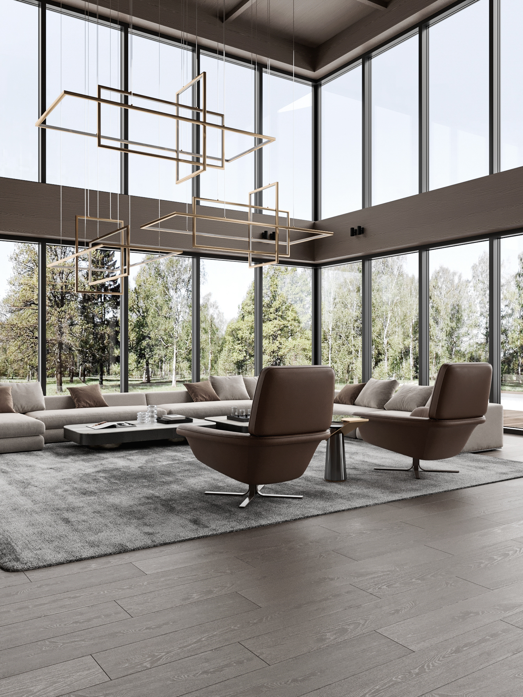
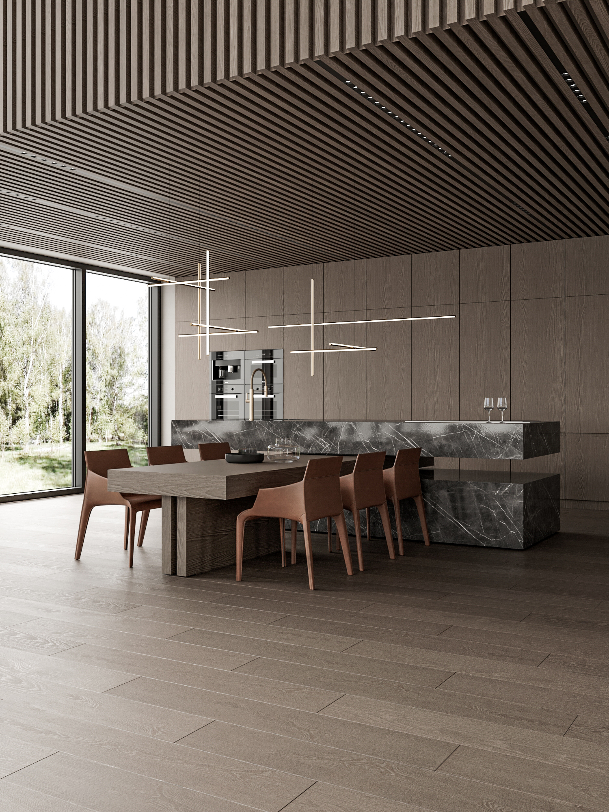
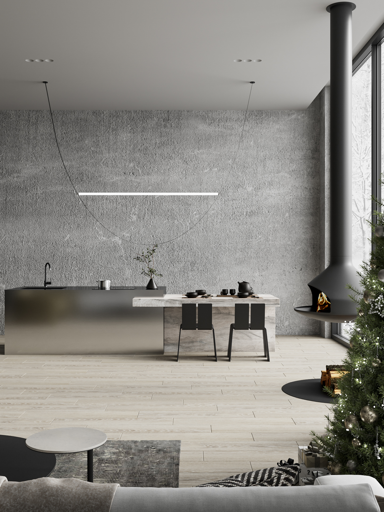
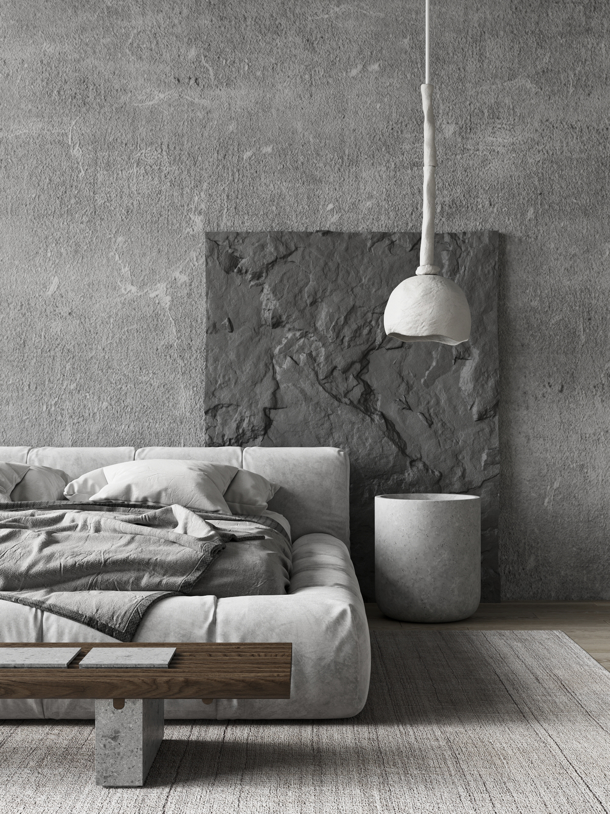

Дизайн интерьера дома часто ищут как «красивую гостиную на два света» или готовый стиль для загородного жилья. На практике это работа с целым объектом: как живут на разных этажах, где собираются, как связаны кухня, столовая и гостиная, куда ведёт лестница и как устроены спальни. Если начать со стиля и картинки, планировка этажей и сценарий так и останутся несобранными, а ремонт пойдёт по догадкам на объекте.

В [Studio19.03](https://studio1903.ru/) с 2019 года проектируют и реализуют жилые интерьеры в Москве и других городах — в том числе дома. В открытом [портфолио](https://studio1903.ru/portfolio) опубликованы 18 проектов; среди них три дома: T-HOUSE 03 в Москве, U-CAVE 139 и AIR HAUS в Казани. Ниже — с чего начать дизайн интерьера дома, какие решения видны в этих проектах и как заказать работу.

Общий подход студии к интерьеру, в том числе в домах, разобран в статье [«Дизайн интерьера»](https://studio1903.ru/journal/dizajn-interera). Как устроена квартира как жильё — в статье [«Дизайн квартиры»](https://studio1903.ru/journal/dizajn-kvartiry). Что входит в альбом, этапы и прайс — в статье [«Дизайн-проект квартиры»](https://studio1903.ru/journal/dizajn-proekt-kvartiry): отдельного «домашнего» тарифа на сайте нет, те же форматы и та же шкала по площади.

## С чего начинается дизайн интерьера дома

Не со стиля и не с выбранной картинки гостиной. Сначала нужно понять, как домом будут пользоваться, и собрать планировку.

На старте полезно зафиксировать: сколько человек живёт в доме сейчас и как сценарий может измениться; какие зоны обязательны на каждом уровне, а какие можно совместить; как общее пространство связано с кухней, столовой, лестницей и входом; какой ориентир по бюджету отделки. В доме эти ответы влияют на план сильнее, чем палитра: от них зависят связи между этажами, место для встреч и то, как собирается путь от входа к спальням.

Дальше — тот же порядок, что на странице [«Этапы»](https://studio1903.ru/steps). После заявки идёт подготовка: договор, обмеры с фото- и видеофиксацией и техническое задание. Затем студия разрабатывает несколько вариантов зонирования — мебель, перегородки, снос — в рамках действующих норм. Стиль, материалы и свет утверждают уже на 3D-концепции: в Studio19.03 её обычно начинают с кухни-гостиной и только после выбранной планировки визуализируют остальные помещения. Каждый проект ведёт основатель студии Роман Ахмадуллин.

Для дома это особенно важно: общее пространство и лестница задают, как объект будет ощущаться целиком, а не как набор красивых комнат.

## Дизайн интерьера дома в портфолио Studio19.03

В открытом портфолио домов немного, и у каждого своя задача. Это не «один и тот же современный стиль на разной площади».

[T-HOUSE 03](https://studio1903.ru/t-house03) — дом 460 м² в Москве, 2021, современный стиль. Его делали для пары, которая живёт на две страны: нужно было уютное пространство для встреч с друзьями и родственниками. В решении — единый материал пола на всех этажах, панорамный свет на лестнице и мягкие переходы между комнатами. На сайте результат сформулирован так: «Дом читается цельно — от входа до мастер-спальни наверху». Срок реализации — 24 месяца.

[U-CAVE 139](https://studio1903.ru/u-cave139) — дом 139 м² в Казани, 2020, современный минимализм и лофт. На сайте задача описана как дом в лесу, в стороне от городской суеты. Основу интерьера составляет бетон, в решении — сочетание холодных и тёплых материалов. Результат, как он сформулирован в карточке: масштаб пространства стал главным преимуществом интерьера — без пустоты. Срок реализации — 11 месяцев.

[AIR HAUS](https://studio1903.ru/airhaus) — дом 259 м² в Казани, 2025, современный минимализм. Задача — лёгкий воздушный интерьер загородного дома для последующей продажи. В решении — светлая нейтральная база, акцент на фактуру дерева и мягкий рассеянный свет по всему дому. На сайте результат описан так: «Пространство, которое дышит и не требует лишних вещей — интерьер под реальную жизнь». По карточке проекта команда Studio19.03 выполнила планировочное решение, дизайн-проект, авторский надзор и комплектацию. Срок реализации — 12 месяцев.

Три дома показывают разный масштаб и разные сценарии: большой московский дом для встреч, казанский дом в лесу, где главная тема — масштаб пространства, и загородный дом, который собирали как лёгкий интерьер под реальную жизнь и последующую продажу. При этом формат работы тот же, что для квартир: планировка, проект, при необходимости надзор и комплектация. Студия пишет о более чем ста объектах с 2019 года; в открытом портфолио опубликованы 18 проектов.

## Сколько стоит дизайн интерьера дома и как заказать

Отдельной ставки «за дом» на сайте нет. Дизайн интерьера дома заказывают в тех же форматах, что и квартиру. Актуальные цены — на странице [«Цены»](https://studio1903.ru/price).

Планировочный проект — 1 000 ₽ / м².

Полный дизайн-проект — от 6 000 ₽ / м², со шкалой по площади:

- 50–100 м² — 8 000 ₽ / м²;
- 100–200 м² — 7 000 ₽ / м²;
- свыше 200 м² — 6 000 ₽ / м².

Отдельной ставки для площади меньше 50 м² на сайте нет, её лучше запросить расчётом. В шкалу 100–200 м² попадает U-CAVE 139 (139 м²) — в прайсе для этого диапазона указано 7 000 ₽ / м². T-HOUSE 03 (460 м²) и AIR HAUS (259 м²) относятся к шкале свыше 200 м², в прайсе для неё указано 6 000 ₽ / м².

Авторский надзор — от 50 000 ₽ в месяц: еженедельные выезды, отчётность с фотофиксацией, проверка соответствия проекту, консультации прораба и подрядчиков, оперативные правки в чертежах.

Комплектация — по согласованию. В неё входят выезды в салоны, коммерческие предложения, корректировка смет под бюджет, контроль заказа, организация изготовления индивидуальных позиций и закупка декора. Все скидки и бонусы от поставщиков, по данным студии, остаются заказчику (от 5 до 15%).

На той же странице указан ориентир реализации: отделка под ключ — от 200 000 ₽ / м². Это не цена дизайн-проекта и не отдельный «домашний» тариф.

Чтобы заказать дизайн интерьера дома, достаточно оставить заявку на сайте или написать в студию. Первая встреча — в студии на Нагатинской набережной, 10А, корп. Б или на объекте. Телефон: +7 (966) 250-84-50, почта: info@studio1903.ru. Контакты также собраны на странице [«Контакты»](https://studio1903.ru/contacts).

:::faq
С чего начать дизайн интерьера дома?

Со сценария и планировки. Сначала фиксируют, как живут в доме, какие зоны нужны на каждом уровне, как связаны общее пространство, кухня, лестница и спальни, и какой ориентир по бюджету отделки. Затем делают обмеры с фото- и видеофиксацией, заполняют техническое задание и разрабатывают несколько вариантов зонирования в рамках действующих норм. Стиль, материалы и свет утверждают уже на 3D-концепции — обычно кухни-гостиной — и только после плана.

Делает ли студия дизайн интерьера дома только в Москве?

Нет. Studio19.03 проектирует и реализует жилые интерьеры в Москве и других городах. В открытом портфолио домов — T-HOUSE 03 в Москве, U-CAVE 139 и AIR HAUS в Казани. Первая встреча — в студии на Нагатинской или на объекте.

Можно ли заказать дизайн интерьера только одного этажа или одной зоны дома?

Отдельного тарифа на одно помещение или один этаж на сайте нет. Полный дизайн-проект делают для объекта целиком: визуализируют все помещения и выпускают рабочую документацию на весь объект. Если на старте нужна только планировка, есть отдельный формат — планировочный проект.

Сколько стоит дизайн интерьера дома?

Отдельной ставки «за дом» нет. Планировочный проект — 1 000 ₽ / м², полный дизайн-проект — от 6 000 ₽ / м² в зависимости от площади: 8 000 ₽ / м² при 50–100 м², 7 000 ₽ / м² при 100–200 м² и 6 000 ₽ / м² свыше 200 м². Для U-CAVE 139 (139 м²) в этой шкале указано 7 000 ₽ / м², для T-HOUSE 03 (460 м²) и AIR HAUS (259 м²) — 6 000 ₽ / м². Ставки для площади меньше 50 м² на сайте нет — её запрашивают расчётом. Авторский надзор — от 50 000 ₽ в месяц, комплектация — по согласованию.

Чем дизайн интерьера дома отличается от дизайна квартиры?

Форматы и прайс на сайте те же. Отличие — в задаче и масштабе объекта: в доме нужно собрать связи между этажами, общее пространство и путь от входа к спальням, а не только расстановку в одной квартире. Это видно по портфолио: в T-HOUSE 03 — единый пол на всех этажах и панорамный свет на лестнице, в U-CAVE 139 — масштаб пространства без пустоты, в AIR HAUS — лёгкий интерьер загородного дома. Как студия подходит к интерьеру в целом, разобрано в статье «Дизайн интерьера».
:::
