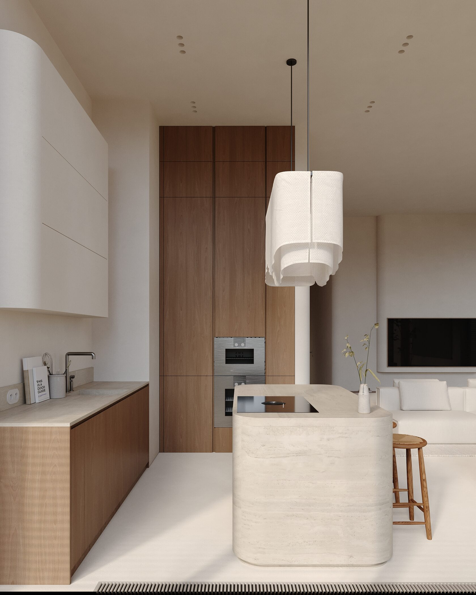
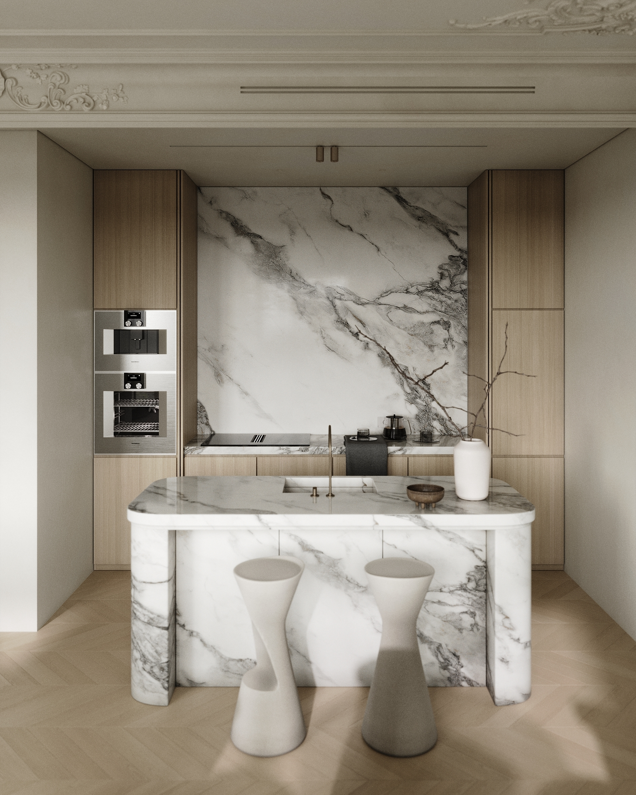
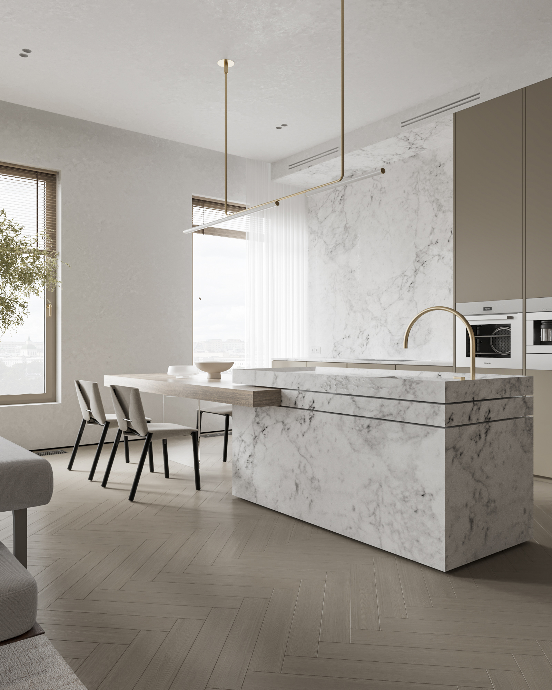
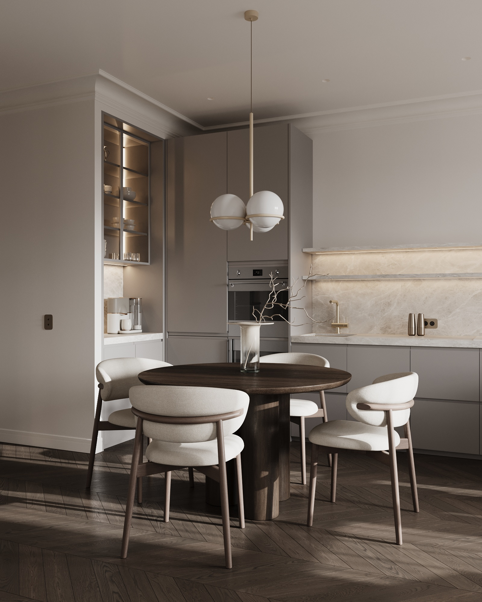

Дизайн интерьера кухни чаще всего начинают с картинки: цвет фасадов, камень на острове, «как в журнале». На практике это самое техническое помещение квартиры: здесь готовят, хранят продукты и посуду, моют, ставят технику и каждый день проходят одни и те же метры между мойкой, плитой и холодильником. Если сначала не собрать сценарий и не развести рабочие зоны, красивые фасады не спасут тесную столешницу и проход, в котором нельзя разойтись.

В [Studio19.03](https://studio1903.ru/) с 2019 года проектируют и реализуют жилые интерьеры в Москве и других городах. Кухню студия делает не отдельно, а в составе квартиры или дома: 3D-концепцию обычно начинают с кухни-гостиной, утверждают стиль, материалы и свет и только потом визуализируют остальные помещения. Ниже — с чего начать дизайн интерьера кухни, как заложить рабочие зоны, хранение и свет, какие решения видны в портфолио и как заказать проект.

## С чего начинается дизайн интерьера кухни

Не с фасадов. Сначала нужно ответить, как кухней пользуются в обычный день. Как часто и сколько человек готовит. Нужен ли полноценный обеденный стол или достаточно острова со стульями. Какая техника обязательна: духовой шкаф, посудомоечная машина, отдельный кофейный модуль, дополнительная морозильная камера. Где хранятся запасы, которые не нужны каждый день, и куда девается техника, которой пользуются редко.

Ответы сразу меняют план. Если готовят каждый день, кухне нужна полноценная рабочая поверхность, удобный треугольник и вытяжка, а не только красивый ряд шкафов. Если кухней пользуются редко, её можно собрать компактнее и отдать больше места столу или смежной комнате. Если за островом завтракают, столешнице нужен свес под колени, а не только варочная поверхность.

Отдельно стоит решить, кухня остаётся отдельным помещением или входит в кухню-гостиную. Во втором случае дизайн интерьера кухни всё равно начинается с рабочих зон, но появляется ещё одна задача — не мешать отдыху и проходу к дивану. Как развести кухню, стол и гостиную в одном объёме, разобрано в статье [«Дизайн кухни-гостиной»](https://studio1903.ru/journal/dizajn-kuhni-gostinoj). Здесь речь о самой кухне: сценарии, расстановке, хранении и свете.

Состав работы тоже стоит понять в начале. Дизайн интерьера кухни в Studio19.03 не делается отдельно от квартиры: в [полный дизайн-проект](https://studio1903.ru/price) входят обмерный план и планировочные решения, 3D-визуализация всех помещений, рабочая документация и развёртки стен, мебель в 3D и спецификация материалов, оборудования и мебели. Что именно входит в альбом, разобрано в статье [«Дизайн-проект квартиры»](https://studio1903.ru/journal/dizajn-proekt-kvartiry). Отдельного тарифа «только на кухню» на сайте нет.

## Планировка и зонирование в дизайне интерьера кухни

На кухне обычно собирают четыре роли: хранение, мойка, готовка и подача. Их не обязательно разделять стенами. Достаточно, чтобы холодильник, мойка и плита не стояли вразброс через весь проход, а рабочая столешница не обрывалась там, где режут и разбирают продукты.

Кухню привязывают к стоякам и вентиляции. Перенос мойки от стояка и вывод вытяжки решают на этапе планировки, а не на объекте. Линейная кухня вдоль одной стены удобна на узком плане. Угловая и П-образная дают больше столешницы и закрытого хранения. Остров добавляет рабочую поверхность и иногда место, чтобы поесть, — но только если вокруг него остаётся проход.

В портфолио Studio19.03 кухня чаще всего входит в кухню-гостиную, а не стоит закрытой комнатой. Это не отменяет зонирование самой кухни. В [SLOW 19](https://studio1903.ru/slow19) ряд шкафов с мойкой и колонна с техникой собраны вдоль стены, а остров с варочной поверхностью вынесен в центр. В [FRENCH 64](https://studio1903.ru/french64) и [TITUL 70](https://studio1903.ru/titul70) остров тоже держит рабочую зону, а за ним остаётся место для стола. В [ROCHE 82](https://studio1903.ru/roche82) острова нет: кухня собрана вдоль стен, а круглый обеденный стол стоит сразу перед ней. В [SAVIN HAUZ](https://studio1903.ru/savinhauz) на 38 м² кухня-гостиная с островом умещается вместе со спальней, рабочим столом и хранением, в том числе хозблоком.

На этапе планировки студия готовит несколько вариантов зонирования — мебель, перегородки, снос — в рамках действующих норм. Если в квартире газовая плита, объединение кухни с жилой комнатой ограничено нормами: это проверяют на плане, до начала ремонта.

## Эргономика в дизайне интерьера кухни

Красивая визуализация не отменяет сантиметры. Ниже — рабочие ориентиры по распространённым правилам планировки кухонь (рекомендации NKBA) и практике проектирования. Это памятка, не замена обмера и посадки на объекте.

**Рабочий треугольник.** Мойка, плита и холодильник — три точки, между которыми ходят чаще всего. Каждую сторону треугольника обычно держат в пределах примерно **1,2–2,7 м**, а сумму сторон — не больше **около 7,9 м**. Через треугольник не должен проходить основной маршрут через квартиру.

**Проход в рабочей зоне.** Между столешницей и островом или противоположным рядом шкафов — ориентир около **105–110 см** для одного человека и около **120 см**, если готовят вдвоём.

**Остров и барная стойка.** Если за островом сидят, столешницу делают со свесом примерно **30–40 см** под колени, а барные стулья подбирают по высоте столешницы.

**Обеденный стол.** Вокруг стола нужно **80–90 см**, чтобы отодвинуть стул и сесть, и около **110 см**, чтобы пройти за сидящим. Подробно размеры стола разобраны в статье [«Эргономика обеденного стола»](https://studio1903.ru/journal/ergonomika-obedennogo-stola).

Свет лучше закладывать слоями, а не одной люстрой над серединой комнаты. Общий свет нужен, чтобы кухня читалась целиком. Над столешницей и мойкой — отдельная подсветка, которая не оставляет тень от человека, стоящего у шкафов. Над островом или столом — свой светильник. Розетки, открывание посудомоечной машины, духовки и холодильника проверяют на плане: створка не должна перекрывать проход и соседнюю технику.

Итоговые размеры зависят от того, сколько человек готовит одновременно, какая техника стоит в колоннах и нужен ли стол в той же зоне. Поэтому в проекте их проверяют на плане расстановки мебели с размерами.

## Дизайн интерьера кухни в проектах Studio19.03

В опубликованном портфолио студии кухня почти всегда собрана как часть общего интерьера квартиры, а не как отдельная «тематическая» декорация. Решения при этом разные — по площади, сценарию и материалам.

[SLOW 19](https://studio1903.ru/slow19) — квартира 109 м² в Москве, в ЖК «Событие», в стиле джапанди. В карточке проекта основа интерьера — песочные тона, натуральный камень, дерево и льняной текстиль; среди материалов — натуральный лён, травертин, микроцемент и шпон дерева, а для кухни отдельно подписан «Травертин · остров». На визуализации ряд шкафов с мойкой и колонна с техникой стоят вдоль стены, остров с варочной поверхностью вынесен в центр, за ним читается зона отдыха. Проект, как сказано на сайте, реализован командой Studio19.03 под ключ.

[FRENCH 64](https://studio1903.ru/french64) — квартира 64 м² в ЖК Cameo Moscow. Задача — уместить всё необходимое в компактные 64 м² и сохранить ощущение парижской квартиры. Решение карточки — классические пропорции, высокие плинтуса, спокойная палитра и продуманное хранение. На кадре кухни — встроенные шкафы из светлого дерева, остров и фартук из камня, встроенная техника в колонне. Камень здесь описываем по тому, что видно на визуализации: в материалах проекта для кухни отдельной подписи нет.

[TITUL 70](https://studio1903.ru/titul70) — квартира 70 м² в ЖК «Титул». Задача — представительский интерьер в доме бизнес-класса с уважением к классической архитектуре: симметрия, благородные материалы, скрытые двери и архитектурный свет. Среди материалов проекта — «Мрамор · кухонный остров» и «Латунь · акценты». На визуализации мраморный остров с мойкой стоит перед рядом шкафов, к нему приставлен обеденный стол, смеситель и светильник поддержаны латунью.

[ROCHE 82](https://studio1903.ru/roche82) — 82 м² в ЖК «Селигер Сити», современная классика. На этой площади студия вместила кухню-гостиную, две спальни, два санузла и большую гардеробную. Кухня собрана без острова: шкафы и столешница вдоль стен, открытые полки с подсветкой, круглый обеденный стол сразу перед рабочей зоной. Такой приём экономит место, которое на другой площади отдали бы острову, и оставляет кухню связанной со столом.

Это разные задачи, и дизайн интерьера кухни в них получается разным. Где площадь позволяет, рабочую зону выносят на остров и собирают стол рядом. Где метров меньше или остров не нужен, кухню держат вдоль стен и ставят стол в проходе между шкафами и остальной комнатой. В обоих случаях кухню проектируют вместе с квартирой, а не как отдельный «набор фасадов».

## Как заказать дизайн интерьера кухни

Работа идёт по этапам, которые описаны на странице [«Этапы»](https://studio1903.ru/steps). Сначала заявка и встреча — в студии на Нагатинской или на объекте. Затем договор, обмеры с фото- и видеофиксацией и техническое задание, которое заполняют вместе. После этого — несколько вариантов планировки, 3D-концепция ключевого помещения (обычно кухни-гостиной), визуализации остальных комнат, рабочая документация и спецификация с артикулами.

Если проект нужно довести до ремонта, студия сопровождает реализацию: бригады работают по документации Studio19.03, есть авторский надзор и комплектация. Руководитель студии Роман Ахмадуллин ведёт каждый проект лично, от обмеров до приёмки, и сам решает вопросы на стройке, не передавая их менеджеру. Как устроена работа над интерьером целиком — в статье [«Дизайн интерьера»](https://studio1903.ru/journal/dizajn-interera).

Готовый бриф не нужен: достаточно площади и телефона. По заявке студия отвечает в течение рабочего дня.

## Сколько стоит дизайн интерьера кухни

На странице [«Цены»](https://studio1903.ru/price) Studio19.03 публикует ориентиры по форматам работы. Это стоимость проекта квартиры или дома, а не отдельная ставка за одно помещение.

Планировочный проект — 1 000 ₽ / м²: обмерный план, план расстановки мебели с размерами и перепланировочный план (снос и возведение перегородок). Для кухни это уже ответ, где будут шкафы, мойка, плита, проходы и стол.

Полный дизайн-проект — от 6 000 ₽ / м², со шкалой по площади:

- 50–100 м² — 8 000 ₽ / м²;
- 100–200 м² — 7 000 ₽ / м²;
- свыше 200 м² — 6 000 ₽ / м².

Для квартиры вроде FRENCH 64 (64 м²), TITUL 70 (70 м²) или ROCHE 82 (82 м²) в прайсе указано 8 000 ₽ / м². SLOW 19 (109 м²) попадает в диапазон 100–200 м² — 7 000 ₽ / м². Отдельной ставки для площади меньше 50 м² на сайте нет. Точную сумму лучше запросить расчётом: на сайте отвечают в течение рабочего дня.

Авторский надзор — от 50 000 ₽ в месяц: еженедельные выезды, отчётность с фотофиксацией, проверка соответствия проекту, консультации прораба и подрядчиков, оперативные корректировки в чертежах. Комплектация — по согласованию; все скидки и бонусы от поставщиков остаются заказчику (от 5 до 15%).

Студия работает с объектами, где бюджет отделки под ключ — от 200 000 ₽ за квадратный метр. Это ориентир по реализации, а не стоимость самого проекта. Срок разработки альбома в днях или неделях на сайте не опубликован; сроки в карточках проектов относятся к реализации объекта целиком.

Написать можно на [studio1903.ru](https://studio1903.ru/). Телефон +7 (966) 250-84-50, почта info@studio1903.ru, студия в Москве, Нагатинская набережная, 10А, корп. Б.

:::faq
С чего начать дизайн интерьера кухни?

Со сценария и планировки. Сначала фиксируют, как часто и сколько человек готовит, какая техника нужна, где хранятся запасы и нужен ли стол или только остров. Затем делают обмеры и несколько вариантов расстановки, учитывая стояки и вентиляцию. Цвет фасадов и камень столешницы выбирают уже под утверждённый план.

Чем дизайн интерьера кухни отличается от дизайна кухни-гостиной?

Дизайн интерьера кухни — про рабочие зоны, хранение, свет и технику самой кухни. Дизайн кухни-гостиной — про то, как кухня, стол и зона отдыха живут в одном помещении и не мешают друг другу. Если кухня объединена с гостиной, нужны оба уровня: сначала рабочие зоны кухни, затем связь с диваном и проходами.

Нужен ли остров в дизайне интерьера кухни?

Только если вокруг него остаётся проход и он закрывает реальную задачу — дополнительную столешницу, варочную поверхность или место, чтобы поесть. В SLOW 19, FRENCH 64 и TITUL 70 остров собран как рабочая зона. В ROCHE 82 кухня обошлась без него: шкафы вдоль стен и обеденный стол перед рабочей зоной.

Какие размеры заложить в дизайн интерьера кухни?

Рабочий ориентир для сторон треугольника «мойка — плита — холодильник» — примерно 1,2–2,7 м, сумма сторон — не больше около 7,9 м. Проход в рабочей зоне — около 105–110 см для одного человека и около 120 см, если готовят вдвоём. Точные размеры проверяют на плане расстановки мебели и на объекте.

Сколько стоит дизайн интерьера кухни?

Отдельного тарифа на одно помещение нет: проект делают для квартиры или дома целиком. Планировочный проект — 1 000 ₽ / м², полный дизайн-проект — от 6 000 ₽ / м² в зависимости от площади. Точный расчёт студия делает после заявки.
:::
