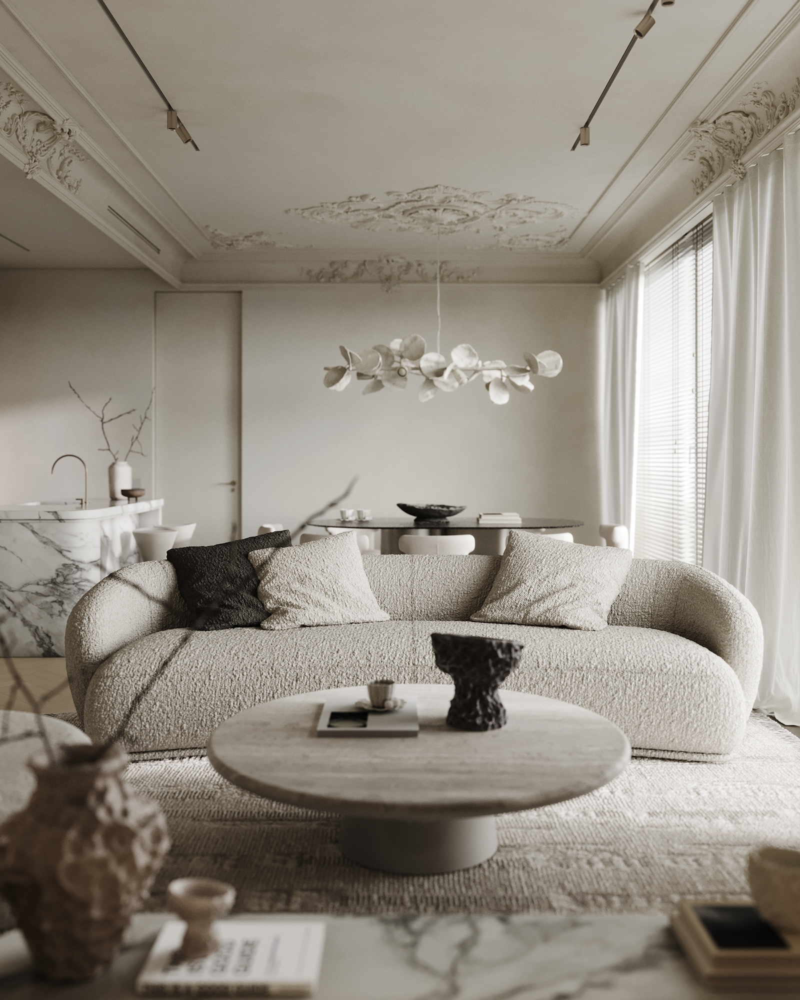
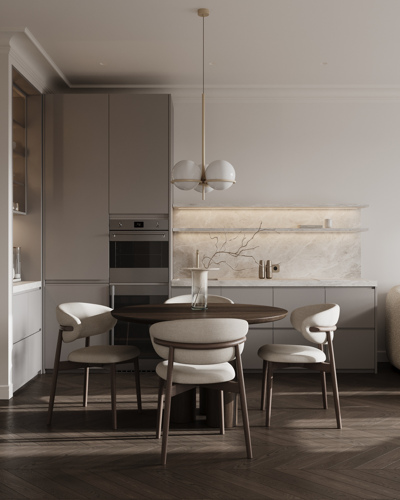
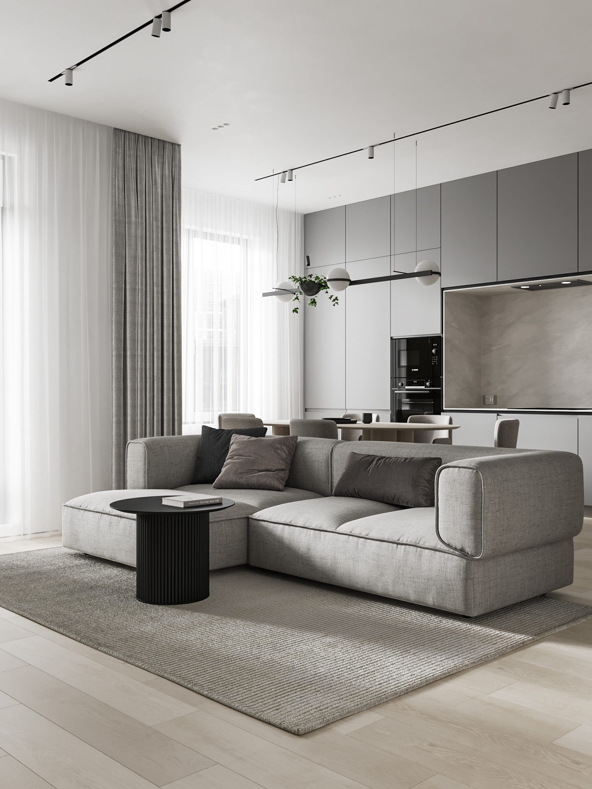
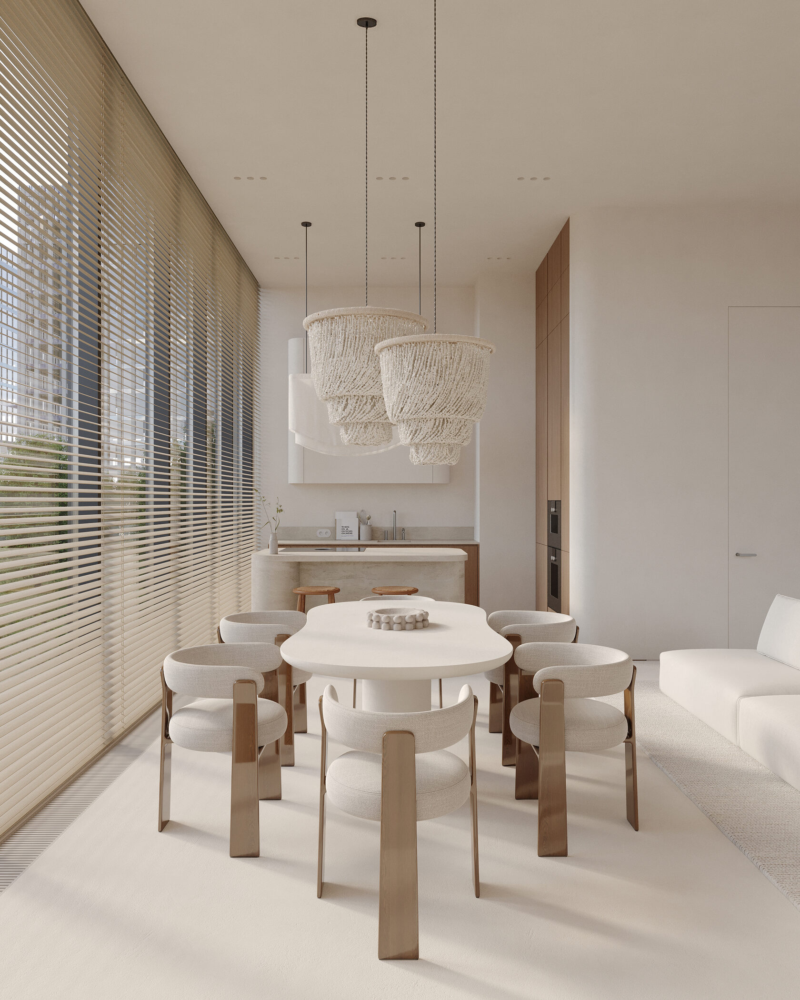
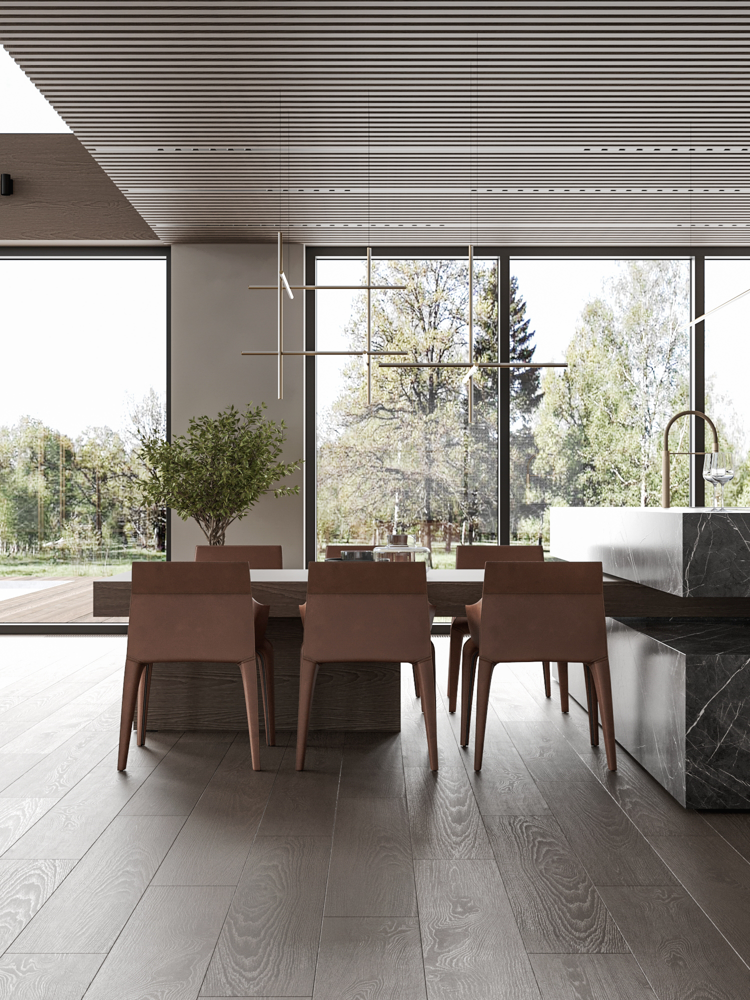

Дизайн интерьера часто ищут как набор красивых решений: цвет стен, диван, «стиль». На практике он нужен для другого — чтобы квартира или дом выдержали обычный день: готовку, отдых, хранение, сон и работу, и чтобы ремонт шёл по согласованным решениям, а не по догадкам на объекте.

В [Studio19.03](https://studio1903.ru/) с 2019 года проектируют и реализуют жилые и коммерческие интерьеры в Москве и других городах. На странице «О нас» студия формулирует это так: интерьер «не просто красота, а способ передать историю, эмоции и характер человека, который в нём живёт». Ниже — с чего начать дизайн интерьера, какие примеры уже есть в портфолио и как заказать проект.

## С чего начинается дизайн интерьера

Не со стиля. Стиль — способ собрать уже понятую задачу, а не точка старта. Сначала нужно ответить, кто будет жить в помещении, как им пользуются в обычный день и что должно произойти с планировкой.

В одной квартире на небольшой площади нужно вместить кухню, отдых, хранение и сон, не потеряв ощущение простора. В другой на 80 с небольшим метрах собирают современный интерьер с классическими элементами, двумя спальнями и гардеробной. В доме задача может быть совсем другой: единое пространство для встреч с друзьями и родственниками или лёгкий интерьер загородного дома. Все эти сценарии могут выглядеть «современными», но чертеж у них будет разным.

На старте полезно зафиксировать: сколько человек живёт сейчас и как сценарий может измениться; какие зоны обязательны, а какие можно совместить; нужна ли перепланировка; как помещение связано с окнами, мокрыми зонами и входом; какой ориентир по бюджету отделки. Ответы меняют план раньше, чем палитру.

Состав работы тоже стоит понять в начале. Дизайн интерьера в Studio19.03 — это не только визуализации. В [полный дизайн-проект](https://studio1903.ru/price) входят обмерный план и планировочные решения, 3D-визуализация всех помещений, рабочая документация и развёртки стен, мебель в 3D и спецификация материалов, оборудования и мебели. Что именно входит в альбом и чем полный проект отличается от планировочного, подробно разобрано в статье [«Дизайн-проект квартиры»](https://studio1903.ru/journal/dizajn-proekt-kvartiry). Если нужна только планировка, студия предлагает отдельный планировочный проект: обмерный план, план расстановки мебели с размерами и перепланировочный план в рамках действующих норм.

После утверждения проекта студия может сопровождать реализацию: ремонт по своей документации, авторский надзор и комплектацию. На сайте это описано как продолжение того же цикла — одна команда ведёт объект до завершения.

## Как студия делает дизайн интерьера

Путь работы описан на странице [«Этапы»](https://studio1903.ru/steps). Это восемь шагов: заявка и встреча, подготовка, планировка, 3D-концепция, визуализация остальных помещений, рабочая документация, спецификация, затем надзор и комплектация.

Для дизайна интерьера особенно важны первые шаги. Студия отвечает на заявку в течение рабочего дня, первая встреча — в студии на Нагатинской или на объекте. Готовый бриф не нужен: достаточно площади и телефона. Затем — договор, обмеры с фото- и видеофиксацией и техническое задание, которое заполняют вместе. Планировку делают в нескольких вариантах зонирования: мебель, перегородки, снос — в рамках действующих норм.

3D-концепцию студия обычно начинает с ключевого помещения, чаще с кухни-гостиной: стиль, материалы и свет утверждают до того, как визуализировать остальные комнаты и собирать рабочую документацию. Затем идут альбом чертежей для подрядчиков и спецификация с артикулами.

Руководитель студии Роман Ахмадуллин ведёт каждый проект лично — от обмеров до приёмки. Если на стройке возникает вопрос, по формулировке сайта он решает его сам, а не передаёт менеджеру. Архитектура, дизайн, строительство и комплектация собраны в одной команде, без передачи проекта на субподряд. При этом на объекте работают строительные бригады по документации студии, а студия контролирует подрядчиков, выезжает на надзор и ведёт комплектацию.

С 2019 года студия пишет о более чем ста реализованных объектах от чертежа до финала — в Москве и других городах. В открытом [портфолио](https://studio1903.ru/portfolio) опубликованы 18 проектов: квартиры, апартаменты и дома.

## Примеры дизайна интерьера в портфолио

Дизайн интерьера в портфолио Studio19.03 не сводится к одному типу квартиры. Ниже — несколько проектов, в которых на сайте прямо описаны задача и результат.

[FRENCH 64](https://studio1903.ru/french64) — квартира 64 м² в Москве, ЖК Cameo Moscow, 2024, современная классика. Задача была «уместить всё необходимое в компактные 64 м² и сохранить ощущение парижской квартиры». В решении — классические пропорции, высокие плинтуса, спокойная палитра и продуманное хранение. Результат на сайте сформулирован так: «Квартира кажется больше своей площади и собрана без компромиссов по эстетике». Срок реализации объекта — 8 месяцев.

[ROCHE 82](https://studio1903.ru/roche82) — квартира 82 м² в Москве, ЖК «Селигер Сити», 2024, современная классика. На главной студия описывает её как «современную квартиру с элементами французской классики». На 82 м² вместили кухню-гостиную, две спальни, два санузла и большую гардеробную. Результат: «Квартира, в которой комфортно каждый день — и через годы интерьер не устареет». Срок реализации — 8 месяцев.

В [SQUARE 29](https://studio1903.ru/square29), квартире 86 м² в ЖК «Царская Площадь», студия собирала пространство для одного человека, но с перспективой на семью с детьми: в результате появились большая кухня-гостиная, мастер-спальня, гардеробная и гостевая, которую позже можно превратить в детскую. Срок реализации — 10 месяцев.

[SLOW 19](https://studio1903.ru/slow19) — квартира 109 м² в Москве, ЖК «Событие», 2026, джапанди. Задача на сайте звучит так: «квартира в центре Москвы как оазис южного аутентичного дома». Основу интерьера составили песочные тона, натуральный камень, дерево и льняной текстиль; в решении названы натуральный лён, травертин, микроцемент и шпон дерева. Проект реализован командой Studio19.03 под ключ. Срок реализации — 12 месяцев.

Дизайн интерьера дома в портфолио тоже есть. [T-HOUSE 03](https://studio1903.ru/t-house03) — дом 460 м² в Москве, 2021. Его делали для пары, которая живёт на две страны: нужно было уютное пространство для тёплых встреч и шумных посиделок с друзьями и родственниками. В решении — единый материал пола на всех этажах, панорамный свет на лестнице и мягкие переходы между комнатами. Результат: «Дом читается цельно — от входа до мастер-спальни наверху». Срок реализации объекта — 24 месяца.

Компактные квартиры в портфолио тоже есть, и их логика другая. Как собрать жизнь на малой площади, уже разобрано в статье [«Дизайн однокомнатной квартиры»](https://studio1903.ru/journal/dizajn-odnokomnatnoj-kvartiry) — там примеры [DP-41](https://studio1903.ru/dp-41) и квартиры-студии [HP-52](https://studio1903.ru/hp-52). В [SAVIN HAUZ](https://studio1903.ru/savinhauz) на 38 м² студия предусмотрела кухню-гостиную с островом, полноценную спальню, рабочий стол вдоль окна, хранение и хозблок. Спальни как отдельный сценарий — в статье [«Дизайн спальни»](https://studio1903.ru/journal/dizajn-spalni).

Полный список объектов — в [портфолио](https://studio1903.ru/portfolio).

## Сколько стоит дизайн интерьера и как заказать

На странице [«Цены»](https://studio1903.ru/price) Studio19.03 публикует ориентиры по форматам работы. Это ориентиры, не финальный счёт: точный расчёт студия делает после заявки и отвечает в течение рабочего дня.

Планировочный проект — 1 000 ₽ / м².

Полный дизайн-проект — от 6 000 ₽ / м², со шкалой по площади:

- 50–100 м² — 8 000 ₽ / м²;
- 100–200 м² — 7 000 ₽ / м²;
- свыше 200 м² — 6 000 ₽ / м².

Отдельной ставки для площади меньше 50 м² на сайте нет: для такой квартиры сумму лучше запросить расчётом.

Авторский надзор — от 50 000 ₽ в месяц: еженедельные выезды, отчётность с фотофиксацией, проверка соответствия проекту, консультации прораба и подрядчиков, оперативные правки в чертежах.

Комплектация — по согласованию. В неё входят выезды в салоны, коммерческие предложения, корректировка смет под бюджет, контроль заказа, организация изготовления индивидуальных позиций и закупка декора. Все скидки и бонусы от поставщиков, по данным студии, остаются заказчику (от 5 до 15%).

Отдельно студия указывает, что работает с объектами, где бюджет отделки под ключ — от 200 000 ₽ за квадратный метр. Это ориентир по реализации, а не стоимость самого дизайн-проекта. Срок разработки альбома в днях или неделях на сайте не опубликован; сроки в карточках проектов относятся к реализации объекта целиком.

Чтобы начать, достаточно оставить заявку на сайте или написать в студию. Телефон +7 (966) 250-84-50, почта info@studio1903.ru. Студия находится в Москве, Нагатинская набережная, 10А, корп. Б. Первая встреча — в студии или на объекте.

:::faq
С чего начать дизайн интерьера?

Со сценария и планировки, а не с выбора стиля. Имеет смысл сразу понять, кто и как будет жить в помещении, нужна ли перепланировка, и что входит в работу бюро. У Studio19.03 можно начать с планировочного проекта или заказать полный дизайн-проект; состав альбома разобран в статье «Дизайн-проект квартиры».

Что входит в дизайн интерьера от Studio19.03?

В полный дизайн-проект — обмеры и планировочные решения, 3D-визуализация всех помещений, рабочая документация и развёртки, мебель в 3D и спецификация с артикулами. После утверждения проекта студия может сопровождать ремонт, авторский надзор и комплектацию до сдачи объекта.

Сколько стоит дизайн интерьера?

Планировочный проект — 1 000 ₽/м², полный дизайн-проект — от 6 000 ₽/м² (8 000 / 7 000 / 6 000 в зависимости от площади). Авторский надзор — от 50 000 ₽ в месяц, комплектация — по согласованию. Точный расчёт студия делает после заявки.

Делает ли студия только квартиры?

Нет. Studio19.03 проектирует и реализует жилые и коммерческие интерьеры. В открытом портфолио — квартиры, апартаменты и дома в Москве и других городах, в том числе в Казани. Отдельные коммерческие объекты в этих 18 карточках не опубликованы.

Нужен ли готовый бриф, чтобы заказать дизайн интерьера?

Нет. На сайте достаточно площади и телефона. Первая встреча — в студии на Нагатинской или на объекте. По заявке студия перезванивает в течение рабочего дня.
:::
