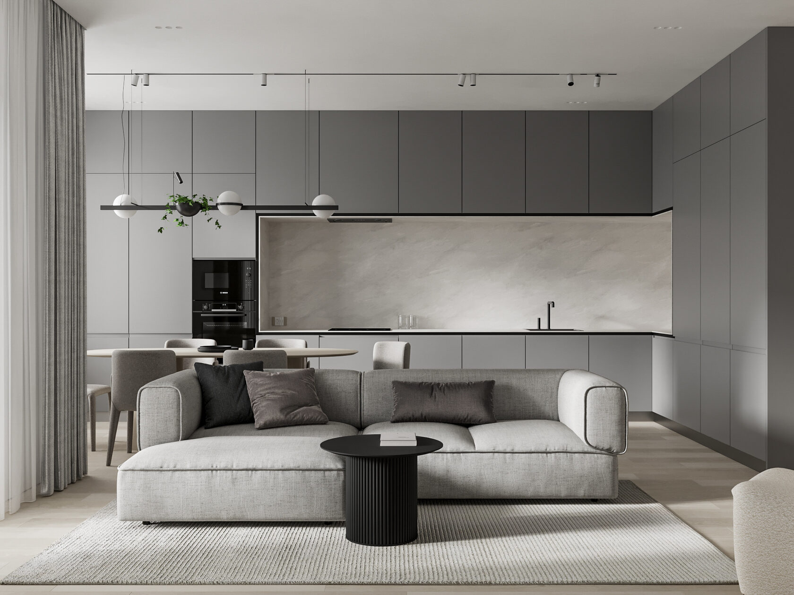
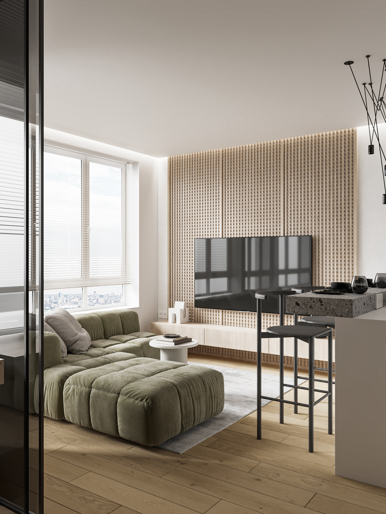
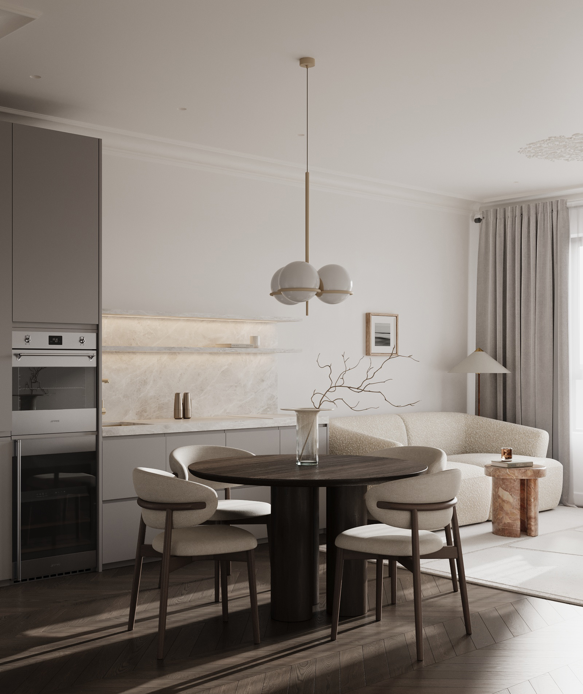
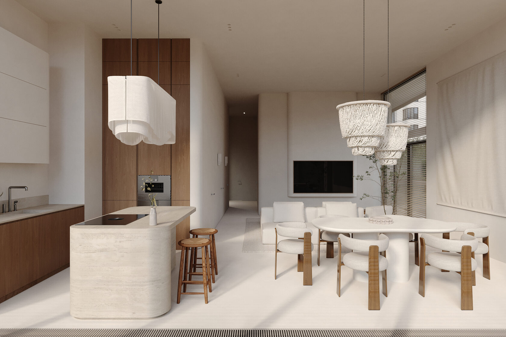
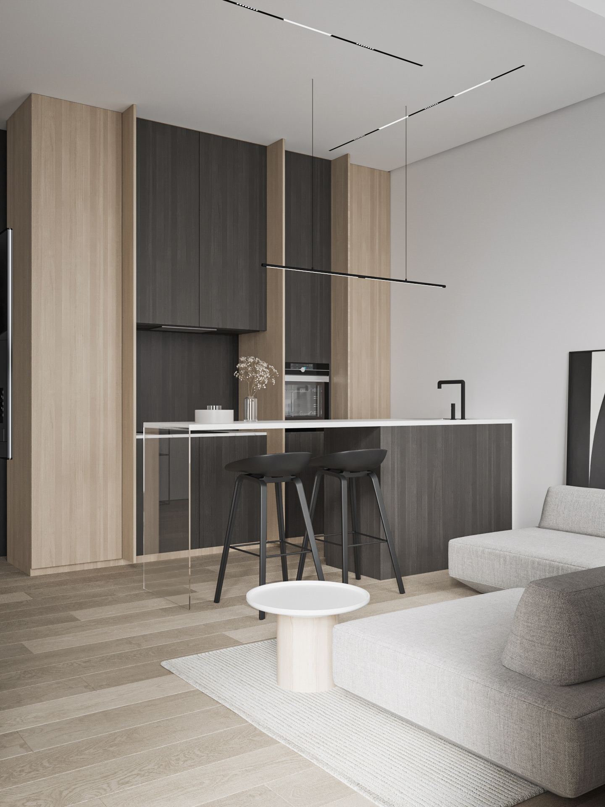

Дизайн кухни гостиной чаще всего начинают с картинки: красивые фасады, остров, большой диван. На практике это самое нагруженное помещение квартиры: здесь готовят, обедают, принимают гостей, смотрят кино и иногда работают. Если зоны не разведены на плане, кухня мешает отдыху, а диван перекрывает проход к холодильнику, и никакая отделка этого уже не исправит.

В [Studio19.03](https://studio1903.ru/) с 2019 года проектируют и реализуют жилые интерьеры в Москве и других городах. Кухня-гостиная для студии — ключевое помещение: 3D-концепцию обычно начинают именно с неё, утверждают стиль, материалы и свет, и только потом визуализируют остальные комнаты. Ниже — с чего начать дизайн кухни-гостиной, какие размеры заложить в план, какие решения видны в портфолио и как заказать проект.

## С чего начинается дизайн кухни-гостиной

Не с фасадов. Сначала нужно ответить, как помещением пользуются в обычный день. Сколько человек готовит и как часто. Нужен ли полноценный обеденный стол или достаточно острова с барными стульями. Где смотрят телевизор, где сидят гости и сколько их бывает. Нужна ли рабочая зона.

Ответы сразу меняют план. Если готовят каждый день, кухне нужна полноценная рабочая поверхность и мощная вытяжка, а диван лучше развернуть так, чтобы не смотреть в мойку. Если кухней пользуются редко, её можно спрятать в лаконичную стену шкафов, отдав больше места гостиной. Если часто собираются гости, главным становится обеденный стол и проходы вокруг него.

Состав работы тоже стоит понять в начале. Дизайн кухни-гостиной в Studio19.03 не делается отдельно от квартиры: в [полный дизайн-проект](https://studio1903.ru/price) входят обмерный план и планировочные решения, 3D-визуализация всех помещений, рабочая документация и развёртки стен, мебель в 3D и спецификация материалов, оборудования и мебели. Что именно входит в альбом, разобрано в статье [«Дизайн-проект квартиры»](https://studio1903.ru/journal/dizajn-proekt-kvartiry). Отдельного тарифа «только на кухню-гостиную» на сайте нет.

## Планировка и зонирование в дизайне кухни-гостиной

Кухня-гостиная — это обычно три зоны: кухня, столовая и гостиная. Задача планировки — развести их так, чтобы каждая работала и не мешала соседней.

**Кухня** — самая «техническая» зона: её привязывают к стоякам и вентиляции. Перенос мойки от стояка решают на этапе планировки, а не на объекте.

**Столовая** чаще всего становится буфером между кухней и гостиной: стол ставят так, чтобы с одной стороны было удобно подавать блюда, а с другой — пройти к дивану.

**Гостиная** — зона отдыха с диваном и телевизором. Её лучше относить от рабочей кухни, к окну или в дальнюю часть помещения.

Разделить зоны помогают не только стены. Остров или барная стойка, смена напольного покрытия, разный свет над каждой зоной, диван, поставленный спинкой к кухне, — всё это зонирует помещение, не делая его тесным. В Studio19.03 на этапе планировки готовят несколько вариантов зонирования — мебель, перегородки, снос — в рамках действующих норм. Если в квартире газовая плита, объединение кухни с жилой комнатой ограничено нормами: это тоже проверяют на этапе планировки, до начала ремонта.

## Эргономика кухни-гостиной: размеры и проходы

Красивая визуализация не отменяет сантиметры. Ниже — рабочие ориентиры по распространённым правилам планировки кухонь (рекомендации NKBA) и практике проектирования. Это памятка, не замена обмера и посадки на объекте.

**Рабочий треугольник.** Мойка, плита и холодильник — три точки, между которыми ходят чаще всего. Каждую сторону треугольника обычно держат в пределах примерно **1,2–2,7 м**, а сумму сторон — не больше **около 7,9 м**. Через треугольник не должен проходить основной маршрут к дивану или балкону.

**Проход в рабочей зоне.** Между столешницей и островом или противоположным рядом шкафов — ориентир около **105–110 см** для одного человека и около **120 см**, если готовят вдвоём.

**Проходы по гостиной.** Основной проход, где ходят, но не работают, — не меньше **около 90 см**.

**Остров и барная стойка.** Если за островом сидят, столешницу делают со свесом примерно **30–40 см** под колени, а барные стулья подбирают по высоте столешницы.

**Обеденный стол.** Вокруг стола нужно **80–90 см**, чтобы отодвинуть стул и сесть, и около **110 см**, чтобы пройти за сидящим. Подробно размеры стола на разное число людей разобраны в статье [«Эргономика обеденного стола»](https://studio1903.ru/journal/ergonomika-obedennogo-stola).

Итоговые размеры зависят от роста семьи, техники и того, сколько человек одновременно бывает в помещении. Поэтому в проекте их проверяют на плане расстановки мебели с размерами.

## Дизайн кухни-гостиной в проектах Studio19.03

В портфолио студии кухня-гостиная есть в квартирах разной площади — и решается по-разному.

[SAVIN HAUZ](https://studio1903.ru/savinhauz) — 38 м² для молодого человека из IT-сферы, который работает из дома. По описанию проекта, на этой площади предусмотрена кухня-гостиная с островом, полноценная спальня, большой рабочий стол вдоль окна и много хранения, в том числе хозблок. Остров здесь одновременно работает как кухонная поверхность и как граница с зоной отдыха.

[ROCHE 82](https://studio1903.ru/roche82) — современный интерьер с классическими элементами. На 82 м² вместили кухню-гостиную, две спальни, два санузла и большую гардеробную комнату. Кухня, круглый обеденный стол и зона отдыха собраны в одном пространстве.

[SQUARE 29](https://studio1903.ru/square29) — квартира 86 м² в ЖК «Царская Площадь» в спокойных тонах. Результат, как сказано в карточке проекта: большая кухня-гостиная, мастер-спальня, гардеробная и гостевая комната, которая в будущем должна превратиться в детскую.

[SLOW 19](https://studio1903.ru/slow19) — 109 м² в стиле джапанди: натуральный лён, травертин, микроцемент и шпон дерева. Среди материалов проекта — травертин на острове; кухня, обеденный стол и зона с телевизором здесь читаются как одно светлое пространство.

[HP-52](https://studio1903.ru/hp-52) — квартира-студия 52 м² для одного человека с зоной для работы из дома. Решение — трансформируемые зоны, встроенное хранение и монохромная база с одним тёплым акцентом; кухня с барной стойкой и диван стоят в одном объёме.

## Как заказать дизайн кухни-гостиной

Работа идёт по этапам, которые описаны на странице [«Этапы»](https://studio1903.ru/steps). Сначала заявка и встреча — в студии на Нагатинской или на объекте. Затем договор, обмеры с фото- и видеофиксацией и техническое задание, которое заполняют вместе. После этого — несколько вариантов планировки, 3D-концепция ключевого помещения (обычно как раз кухни-гостиной), визуализации остальных комнат, рабочая документация и спецификация с артикулами.

Если проект нужно довести до ремонта, студия сопровождает реализацию: бригады работают по документации Studio19.03, есть авторский надзор и комплектация. Руководитель студии Роман Ахмадуллин ведёт каждый проект лично, от обмеров до приёмки, и сам решает вопросы на стройке, не передавая их менеджеру. Как устроена работа над интерьером целиком — в статье [«Дизайн интерьера»](https://studio1903.ru/journal/dizajn-interera).

Готовый бриф не нужен: достаточно площади и телефона. По заявке студия отвечает в течение рабочего дня.

## Сколько стоит дизайн кухни-гостиной

На странице [«Цены»](https://studio1903.ru/price) Studio19.03 публикует ориентиры по форматам работы. Это стоимость проекта квартиры или дома, а не отдельная ставка за одно помещение.

Планировочный проект — 1 000 ₽ / м²: обмерный план, план расстановки мебели с размерами и перепланировочный план (снос и возведение перегородок). Для кухни-гостиной это уже ответ на главный вопрос — как развести зоны.

Полный дизайн-проект — от 6 000 ₽ / м², со шкалой по площади:

- 50–100 м² — 8 000 ₽ / м²;
- 100–200 м² — 7 000 ₽ / м²;
- свыше 200 м² — 6 000 ₽ / м².

Для квартир вроде SQUARE 29 (86 м²), ROCHE 82 (82 м²) и HP-52 (52 м²) в прайсе указано 8 000 ₽ / м², для SLOW 19 (109 м²) — 7 000 ₽ / м². Отдельной ставки для площади меньше 50 м² на сайте нет: для квартиры вроде SAVIN HAUZ (38 м²) сумму лучше запросить расчётом.

Авторский надзор — от 50 000 ₽ в месяц: еженедельные выезды, отчётность с фотофиксацией, проверка соответствия проекту, консультации прораба и подрядчиков, оперативные корректировки в чертежах. Комплектация — по согласованию; все скидки и бонусы от поставщиков остаются заказчику (от 5 до 15%).

Студия работает с объектами, где бюджет отделки под ключ — от 200 000 ₽ за квадратный метр. Это ориентир по реализации, а не стоимость самого проекта.

Написать можно на [studio1903.ru](https://studio1903.ru/). Телефон +7 (966) 250-84-50, почта info@studio1903.ru, студия в Москве, Нагатинская набережная, 10А, корп. Б.

:::faq
С чего начать дизайн кухни-гостиной?

Со сценария и планировки. Сначала фиксируют, кто и как готовит, где обедают и отдыхают, сколько бывает гостей. Затем делают обмеры и несколько вариантов зонирования. Фасады, столешницы и свет выбирают уже под утверждённый план.

Как зонировать кухню-гостиную без перегородок?

Островом или барной стойкой, сменой напольного покрытия, отдельным светом над каждой зоной и расстановкой мебели — например, диваном спинкой к кухне. Обеденный стол часто становится буфером между кухней и зоной отдыха.

Сколько места нужно для прохода на кухне?

Между столешницей и островом — ориентир около 105–110 см для одного человека и около 120 см, если готовят вдвоём. Основной проход по гостиной — не меньше около 90 см. Точные размеры проверяют на плане расстановки мебели.

Можно ли объединить кухню с гостиной, если плита газовая?

Объединение кухни с газовой плитой и жилой комнаты ограничено нормами. Возможность и способ решения проверяют на этапе планировки, до начала ремонта.

Сколько стоит дизайн кухни-гостиной?

Отдельного тарифа на одно помещение нет: проект делают для квартиры или дома целиком. Планировочный проект — 1 000 ₽ / м², полный дизайн-проект — от 6 000 ₽ / м² в зависимости от площади. Точный расчёт студия делает после заявки.
:::
