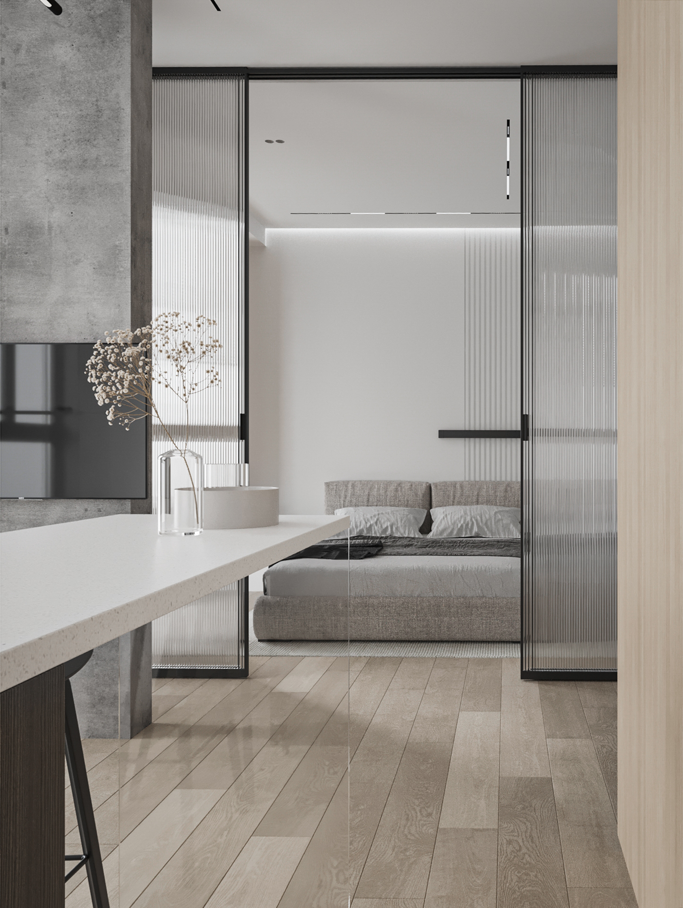
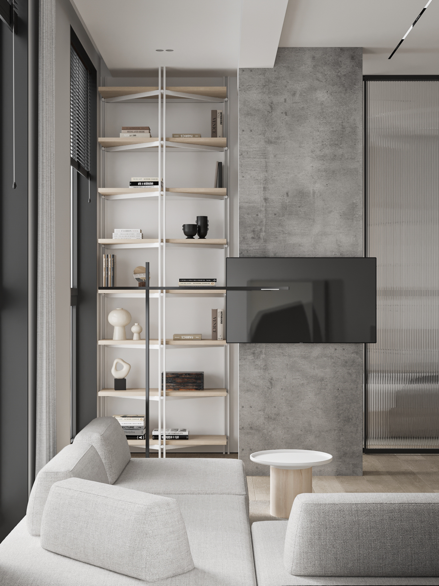
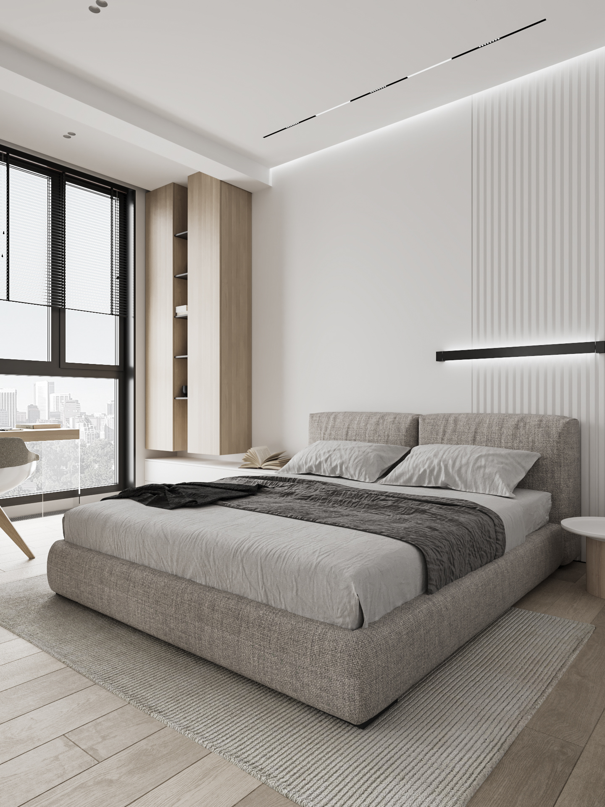
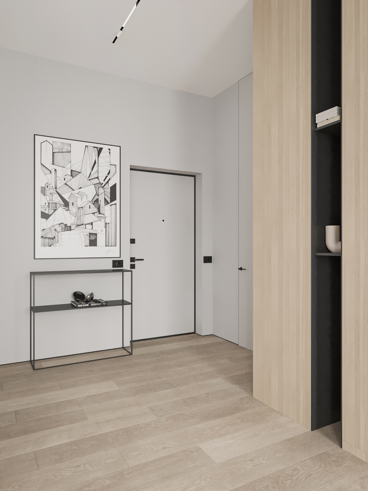

Дизайн квартиры студии часто начинают с поиска «компактной мебели» и картинки, где всё уже стоит на своих местах. На практике студия — это одно жилое пространство, в котором нужно собрать кухню, отдых, сон, хранение и иногда работу, не превратив квартиру в набор случайных зон. Если сначала не понять, как здесь живут, и не собрать планировку, проходы, стол и место для сна начнут мешать друг другу, а стиль уже ничего не исправит.

В [Studio19.03](https://studio1903.ru/) с 2019 года проектируют и реализуют жилые интерьеры в Москве и других городах. В открытом [портфолио](https://studio1903.ru/portfolio) опубликованы 18 проектов. Прямо как квартиру-студию студия описывает один из них — [HP-52](https://studio1903.ru/hp-52). Ниже — с чего начать дизайн квартиры студии, какое решение видно в этом проекте и как заказать работу.

Как студия подходит к жилью небольшой площади, которое сама называет однокомнатной квартирой, разобрано в статье [«Дизайн однокомнатной квартиры»](https://studio1903.ru/journal/dizajn-odnokomnatnoj-kvartiry): там основной пример — DP-41. Общий подход к квартире как жилью — в статье [«Дизайн квартиры»](https://studio1903.ru/journal/dizajn-kvartiry). Что входит в альбом, этапы и прайс — в статье [«Дизайн-проект квартиры»](https://studio1903.ru/journal/dizajn-proekt-kvartiry): отдельного тарифа «за студию» на сайте нет, те же форматы и та же шкала по площади.

## С чего начинается дизайн квартиры студии

Не с выбора дивана и не со стиля. Сначала нужно зафиксировать, как студией будут пользоваться, и собрать планировку.

На старте полезно понять: кто живёт в квартире сейчас и как сценарий может измениться; какие зоны обязательны, а какие можно совместить; нужна ли зона для работы из дома; как пространство связано с окнами, мокрыми зонами и входом; какой ориентир по бюджету отделки. В студии эти ответы влияют на план сильнее, чем палитра: от них зависят, где будет сон относительно кухни, куда встанет хранение и останется ли ощущение простора.

Дальше — тот же порядок, что на странице [«Этапы»](https://studio1903.ru/steps). После заявки идёт подготовка: договор, обмеры с фото- и видеофиксацией и техническое задание. Затем студия разрабатывает несколько вариантов зонирования — мебель, перегородки, снос — в рамках действующих норм. Стиль, материалы и свет утверждают уже на 3D-концепции: в Studio19.03 визуализируют ключевое помещение, обычно кухню-гостиную, и только после этого делают визуализации остальных зон. Каждый проект ведёт основатель студии Роман Ахмадуллин: от обмеров до приёмки объекта.

Готовый бриф не нужен: достаточно площади и телефона. Первая встреча — в студии на Нагатинской или на объекте.

## Дизайн квартиры студии в портфолио Studio19.03

В открытом портфолио Studio19.03 прямо как квартиру-студию описан один проект.

[HP-52](https://studio1903.ru/hp-52) — 52 м² в Москве, ЖК «Садовые Кварталы», 2021, современный минимализм. Задача на сайте сформулирована так: реализовать функциональную квартиру-студию для одного человека с зоной для работы из дома. В решении — трансформируемые зоны, встроенное хранение и монохромная база с одним тёплым акцентом. Результат, как он описан в карточке: 52 м² работают как полноценное жильё — без ощущения тесноты. Срок реализации — 9 месяцев.

Это не то же самое, что однокомнатная квартира в портфолио студии. [DP-41](https://studio1903.ru/dp-41) — 41 м² в ЖК Discovery Park — студия описывает иначе: «41 м² воспринимаются как полноценная однокомнатная квартира с характером». Путать эти две типологии не стоит: у них разная задача и разная планировка, хотя оба проекта — про небольшую площадь и ощущение простора. Разбор DP-41 — в статье [«Дизайн однокомнатной квартиры»](https://studio1903.ru/journal/dizajn-odnokomnatnoj-kvartiry).

Других проектов, которые на сайте названы квартирой-студией, в открытом портфолио нет. Формат работы при этом тот же, что для остальных квартир: планировка, проект, при необходимости надзор и комплектация. Студия пишет о более чем ста объектах с 2019 года; в открытом портфолио опубликованы 18 проектов.

## Сколько стоит дизайн квартиры студии и как заказать

Отдельной ставки «за студию» на сайте нет. Дизайн квартиры студии заказывают в тех же форматах, что и любую другую квартиру. Актуальные цены — на странице [«Цены»](https://studio1903.ru/price).

Планировочный проект — 1 000 ₽ / м².

Полный дизайн-проект — от 6 000 ₽ / м², со шкалой по площади:

- 50–100 м² — 8 000 ₽ / м²;
- 100–200 м² — 7 000 ₽ / м²;
- свыше 200 м² — 6 000 ₽ / м².

Отдельной ставки для площади меньше 50 м² на сайте нет, её лучше запросить расчётом. HP-52 (52 м²) относится к шкале 50–100 м², в прайсе для неё указано 8 000 ₽ / м².

Авторский надзор — от 50 000 ₽ в месяц: еженедельные выезды, отчётность с фотофиксацией, проверка соответствия проекту, консультации прораба и подрядчиков, оперативные правки в чертежах.

Комплектация — по согласованию. В неё входят выезды в салоны, коммерческие предложения, корректировка смет под бюджет, контроль заказа, организация изготовления индивидуальных позиций и закупка декора. Все скидки и бонусы от поставщиков, по данным студии, остаются заказчику (от 5 до 15%).

На странице [«Этапы»](https://studio1903.ru/steps) студия указывает, что работает с объектами, где бюджет отделки под ключ — от 200 000 ₽ за квадратный метр. Это ориентир по реализации, а не цена дизайн-проекта.

Чтобы заказать дизайн квартиры студии, достаточно оставить заявку на сайте или написать в студию. Первая встреча — в студии на Нагатинской набережной, 10А, корп. Б или на объекте. Телефон: +7 (966) 250-84-50, почта: info@studio1903.ru. По заявке студия перезванивает в течение рабочего дня. Контакты также собраны на странице [«Контакты»](https://studio1903.ru/contacts).

:::faq
С чего начать дизайн квартиры студии?

Со сценария и планировки. Сначала фиксируют, кто живёт в студии, какие зоны нужны, есть ли работа из дома, как пространство связано с окнами и входом, и какой ориентир по бюджету отделки. Затем делают обмеры с фото- и видеофиксацией, заполняют техническое задание и разрабатывают несколько вариантов зонирования в рамках действующих норм. Стиль, материалы и свет утверждают уже на 3D-концепции — обычно кухни-гостиной — и только после плана.

Чем дизайн квартиры студии отличается от дизайна однокомнатной квартиры?

Это связанные, но разные задачи. В портфолио Studio19.03 квартирой-студией назван проект HP-52 на 52 м²: функциональное жильё для одного человека с зоной для работы из дома и трансформируемыми зонами. DP-41 на 41 м² студия описывает как полноценную однокомнатную квартиру. Форматы и прайс на сайте те же; отличие — в планировке и в том, как на сайте названа типология. Разбор однокомнатной квартиры — в отдельной статье журнала.

Есть ли в портфолио другие примеры дизайна квартиры студии?

В открытом портфолио прямо как квартира-студия описан проект HP-52 в ЖК «Садовые Кварталы». Других проектов с такой формулировкой на сайте нет. Всего в портфолио опубликованы 18 проектов; студия пишет о более чем ста объектах с 2019 года.

Сколько стоит дизайн квартиры студии?

Отдельной ставки «за студию» нет. Планировочный проект — 1 000 ₽ / м², полный дизайн-проект — от 6 000 ₽ / м² в зависимости от площади: 8 000 ₽ / м² при 50–100 м², 7 000 ₽ / м² при 100–200 м² и 6 000 ₽ / м² свыше 200 м². Для HP-52 (52 м²) в этой шкале указано 8 000 ₽ / м². Ставки для площади меньше 50 м² на сайте нет — её запрашивают расчётом. Авторский надзор — от 50 000 ₽ в месяц, комплектация — по согласованию.

Можно ли заказать дизайн только кухни или только зоны сна в студии?

Отдельного тарифа на одну зону или одно помещение на сайте нет. Полный дизайн-проект делают для объекта целиком: визуализируют все помещения и выпускают рабочую документацию на весь объект. Если на старте нужна только планировка, есть отдельный формат — планировочный проект.
:::
