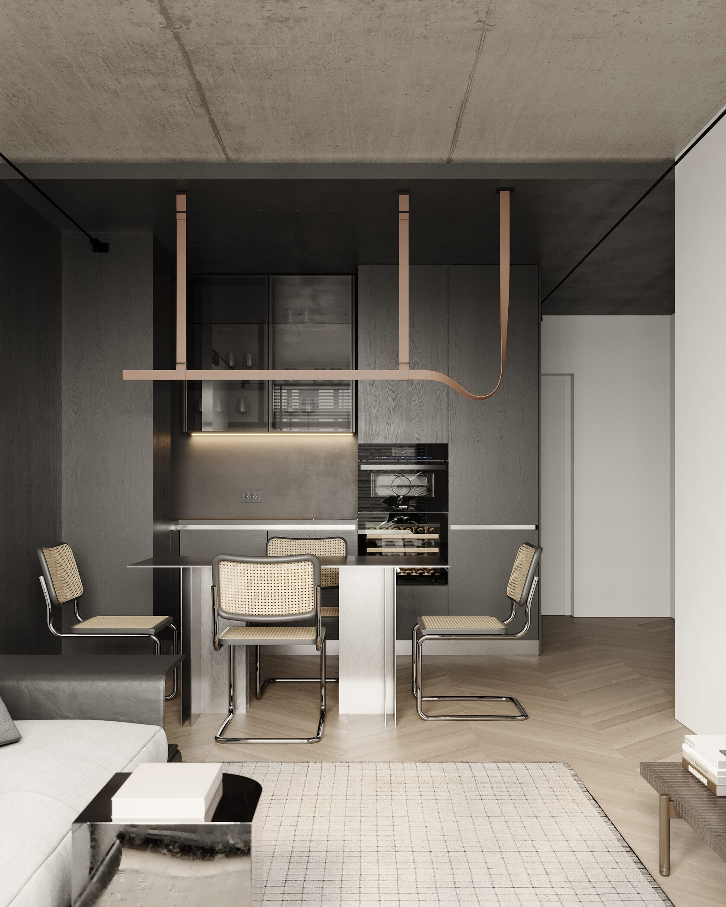
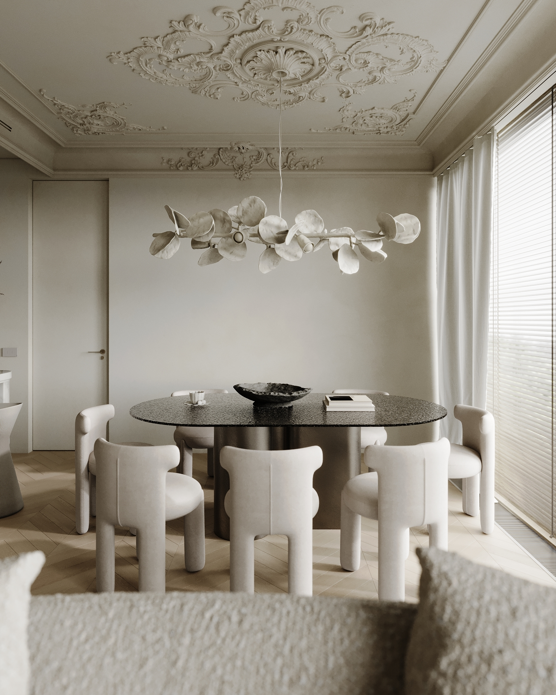
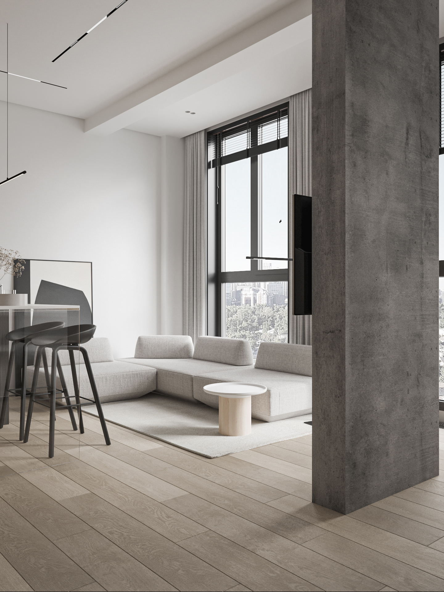
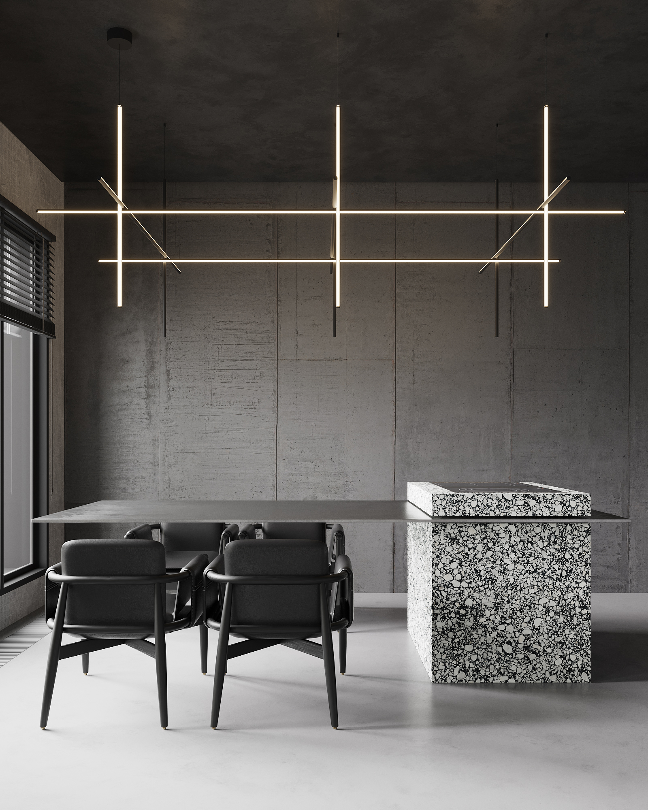

Дизайн квартиры в современном стиле чаще всего начинают с картинки: светлые стены, низкий диван, «как в журнале». На практике современный вид не существует отдельно от того, как квартирой пользуются каждый день. Если сначала не собрать сценарий и не развести помещения на плане, выбранный стиль останется настроением рендера, а проходы, хранение и свет придётся подгонять уже на стройке.

В [Studio19.03](https://studio1903.ru/) с 2019 года проектируют и реализуют жилые интерьеры в Москве и других городах. Стиль в студии не ставят первым шагом: 3D-концепцию обычно начинают с кухни-гостиной и утверждают стиль, материалы и свет уже после планировки, и только потом визуализируют остальные помещения. Ниже — с чего начать дизайн квартиры в современном стиле, какие решения видны в портфолио и как заказать проект.

Этот текст — про квартиру, в которой современный характер собирают из сценария, плана и конкретных материалов. Общий подход к интерьеру, в том числе в домах, разобран в статье [«Дизайн интерьера»](https://studio1903.ru/journal/dizajn-interera). Как устроена квартира как жильё целиком — в статье [«Дизайн квартиры»](https://studio1903.ru/journal/dizajn-kvartiry). Что входит в альбом, этапы и прайс — в статье [«Дизайн-проект квартиры»](https://studio1903.ru/journal/dizajn-proekt-kvartiry).

## С чего начинается дизайн квартиры в современном стиле

Не со стиля. Стиль — способ собрать уже понятую задачу, а не точка старта. Сначала нужно ответить, кто будет жить в квартире, как ей пользуются в обычный день и что должно произойти с планировкой.

На старте полезно зафиксировать: сколько человек живёт сейчас и как сценарий может измениться; какие зоны обязательны, а какие можно совместить; нужна ли перепланировка; как квартира связана с окнами, мокрыми зонами и входом; какой ориентир по бюджету отделки. На странице [«Этапы»](https://studio1903.ru/steps) студия указывает, что работает с объектами, где бюджет отделки под ключ — от 200 000 ₽ за квадратный метр. Это ориентир по реализации, а не стоимость самого проекта.

Только после этого выбирают, каким будет современный характер пространства. В портфолио Studio19.03 у квартир стоят разные формулировки: современный минимализм, современная классика, современный лофт. Это не один рецепт «светлых стен и чёрных профилей», а разные задачи, у которых общим остаётся порядок работы: сначала план, затем стиль.

На этапе планировки студия делает несколько вариантов зонирования: мебель, перегородки, снос — в рамках действующих норм. Варианты смотрят после обмеров, а не «на глаз» по планировке застройщика.

## Дизайн квартиры в современном стиле в портфолио

Имеет смысл смотреть не общую «современную» картинку, а близкий по задаче объект: площадь, состав помещений и то, как стиль назван в карточке проекта. В открытом портфолио Studio19.03 — 18 проектов: квартиры, апартаменты и дома в Москве и других городах, в том числе в Казани. На сайте студия пишет, что с 2019 года реализовала более ста объектов от чертежа до финала.

Среди квартир, например:

В [LEVEL-P](https://studio1903.ru/levelp) на 50 м² в ЖК Level Причальный студия делала стильный интерьер с элементами ретро для человека, который ведёт активный образ жизни. В карточке решение названо смешением современного стиля со стилем 70-х годов, а результат — «цельное восприятие проекта — от холла до приватных пространств». Стиль проекта на сайте — современный минимализм.

В [FRENCH 64](https://studio1903.ru/french64) задача была другой: уместить всё необходимое в компактные 64 м² и сохранить ощущение парижской квартиры. Стиль карточки — современная классика. Решение студии — классические пропорции, высокие плинтуса, спокойная палитра и продуманное хранение. В результате, по формулировке карточки, квартира кажется больше своей площади.

В [HP-52](https://studio1903.ru/hp-52) на 52 м² в ЖК «Садовые Кварталы» проектировали функциональную квартиру-студию для одного человека с зоной для работы из дома. Стиль — современный минимализм: трансформируемые зоны, встроенное хранение и монохромная база с одним тёплым акцентом. Результат, как написано на сайте: 52 м² работают как полноценное жильё — без ощущения тесноты. Как собрать жизнь на малой площади, отдельно разобрано в статье [«Дизайн однокомнатной квартиры»](https://studio1903.ru/journal/dizajn-odnokomnatnoj-kvartiry).

В [DARQ HOUSE](https://studio1903.ru/darqhouse) на 71 м² в ЖК D1 стояла задача сохранить индустриальный характер пространства и добавить уровень комфорта для жизни. Стиль проекта — современный лофт. Решение карточки: открытые коммуникации как декор, тёплый деревянный баланс и слоистый свет. Результат студия формулирует так: «Лофт без холода — жилой и собранный, с характером».

Есть и пересечение современной классики с более просторной планировкой. В [ROCHE 82](https://studio1903.ru/roche82) на 82 м² задачу сформулировали как «собрать современный интерьер с классическими элементами и декором» и вместили кухню-гостиную, две спальни, два санузла и большую гардеробную.

Полный список — в [портфолио](https://studio1903.ru/portfolio). Если нужен не только проект, но и реализация, это стоит обсудить на первой встрече: студия сопровождает ремонт, авторский надзор и комплектацию до сдачи объекта.

## Сколько стоит дизайн квартиры в современном стиле и как заказать

Отдельного тарифа «современный стиль» на сайте нет. Дизайн квартиры в современном стиле заказывают как планировочный или полный дизайн-проект квартиры целиком: визуализируют все помещения и выпускают рабочую документацию на весь объект.

На странице [«Цены»](https://studio1903.ru/price) Studio19.03 публикует ориентиры по форматам работы. Это ориентиры, не финальный счёт: точный расчёт студия делает после заявки и отвечает в течение рабочего дня.

Планировочный проект — 1 000 ₽ / м².

Полный дизайн-проект — от 6 000 ₽ / м², со шкалой по площади:

- 50–100 м² — 8 000 ₽ / м²;
- 100–200 м² — 7 000 ₽ / м²;
- свыше 200 м² — 6 000 ₽ / м².

Отдельной ставки для площади меньше 50 м² на сайте нет, её лучше запросить расчётом. В шкалу 50–100 м² попадают, например, LEVEL-P (50 м²) и HP-52 (52 м²) — в прайсе для этого диапазона указано 8 000 ₽ / м². FRENCH 64 (64 м²) и DARQ HOUSE (71 м²) относятся к той же шкале. Для площади меньше 50 м² точную сумму запрашивают отдельно.

Авторский надзор — от 50 000 ₽ в месяц: еженедельные выезды, отчётность с фотофиксацией, проверка соответствия проекту, консультации прораба и подрядчиков, оперативные правки в чертежах.

Комплектация — по согласованию. В неё входят выезды в салоны, коммерческие предложения, корректировка смет под бюджет, контроль заказа, организация изготовления индивидуальных позиций и закупка декора. Все скидки и бонусы от поставщиков, по данным студии, остаются заказчику (от 5 до 15%).

Путь работы на странице [«Этапы»](https://studio1903.ru/steps) описан в восьми шагах: заявка и встреча, подготовка с обмерами и ТЗ, планировка, 3D-концепция ключевого помещения (обычно кухни-гостиной), визуализация остальных комнат, рабочая документация, спецификация с артикулами, затем надзор и комплектация. Руководитель студии Роман Ахмадуллин ведёт каждый проект лично — от обмеров до приёмки.

Готовый бриф не нужен: на сайте достаточно площади и телефона. Первая встреча — в студии на Нагатинской или на объекте. Заявку можно оставить на [странице контактов](https://studio1903.ru/contacts): студия перезванивает в течение рабочего дня.

Написать можно на [studio1903.ru](https://studio1903.ru/). Телефон +7 (966) 250-84-50, почта info@studio1903.ru, студия в Москве, Нагатинская набережная, 10А, корп. Б.

:::faq
С чего начать дизайн квартиры в современном стиле?

Со сценария и планировки. Сначала фиксируют, кто живёт в квартире сейчас и как сценарий может измениться, какие зоны обязательны, нужна ли перепланировка и какой ориентир по бюджету отделки. Затем делают обмеры и несколько вариантов зонирования. Стиль, материалы и свет утверждают уже на 3D-концепции — обычно кухни-гостиной — и только после плана.

Обязательно ли современный стиль — это минимализм?

Нет. В портфолио Studio19.03 у квартир встречаются разные формулировки: современный минимализм, современная классика, современный лофт. В LEVEL-P современный минимализм смешан со стилем 70-х, в FRENCH 64 — современная классика с ощущением парижской квартиры, в DARQ HOUSE — современный лофт без ощущения холода. Общим остаётся порядок: сначала план, затем стиль, а не наоборот.

Можно ли заказать дизайн только одной комнаты в современном стиле?

Отдельного тарифа на одно помещение на сайте нет. Полный дизайн-проект делают для квартиры целиком: визуализируют все помещения и выпускают рабочую документацию на весь объект. Если на старте нужна только планировка, есть отдельный формат — планировочный проект.

Сколько стоит дизайн квартиры в современном стиле?

Отдельной ставки «за современный стиль» нет. Планировочный проект — 1 000 ₽ / м², полный дизайн-проект — от 6 000 ₽ / м² в зависимости от площади: 8 000 ₽ / м² при 50–100 м², 7 000 ₽ / м² при 100–200 м² и 6 000 ₽ / м² свыше 200 м². Ставки для площади меньше 50 м² на сайте нет — её запрашивают расчётом. Авторский надзор — от 50 000 ₽ в месяц, комплектация — по согласованию.

Делает ли студия дизайн квартиры в современном стиле только в Москве?

Нет. Studio19.03 проектирует и реализует жилые интерьеры в Москве и других городах. В открытом портфолио — квартиры, апартаменты и дома, в том числе объекты в Казани. Первая встреча — в студии на Нагатинской или на объекте.
:::
