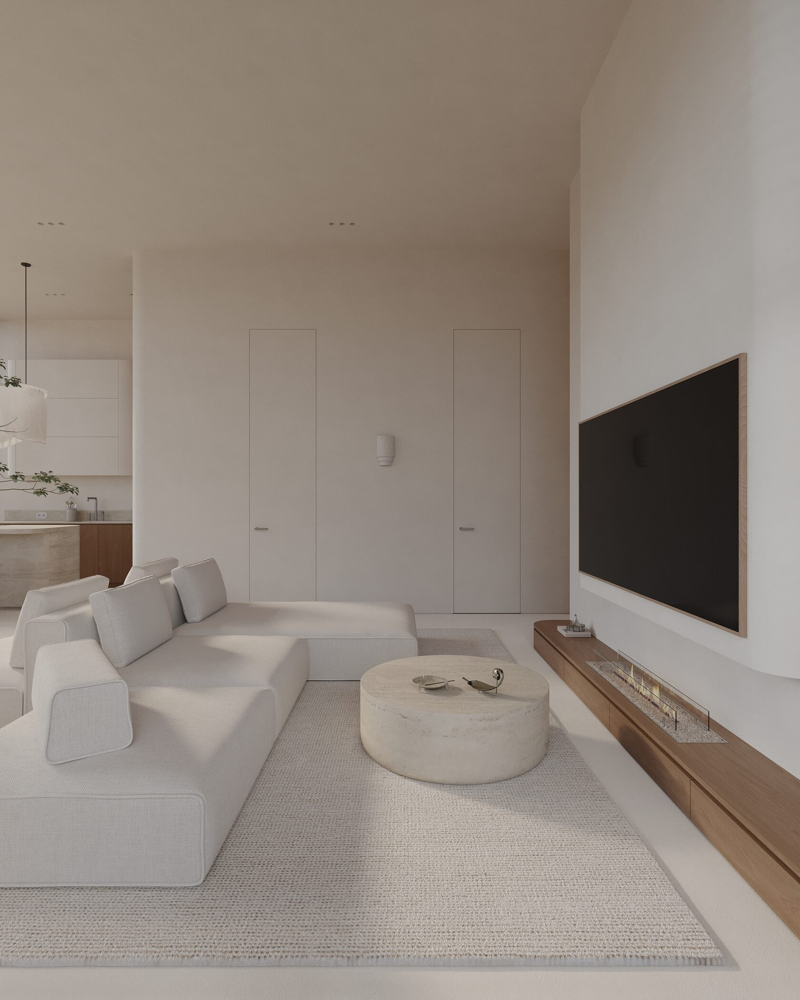
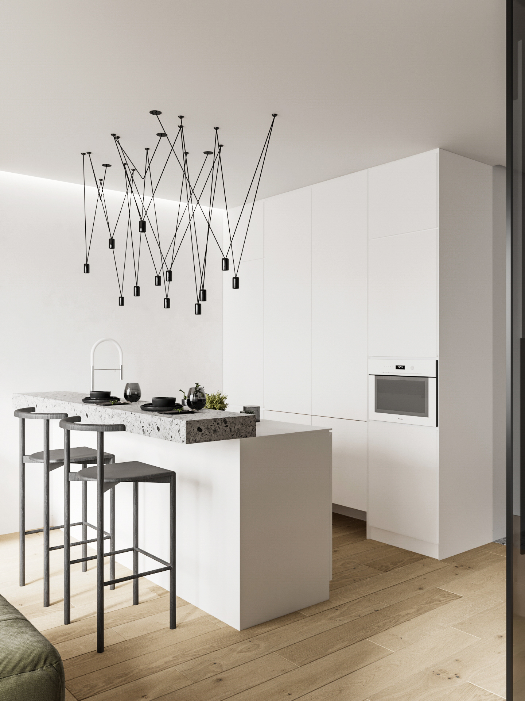
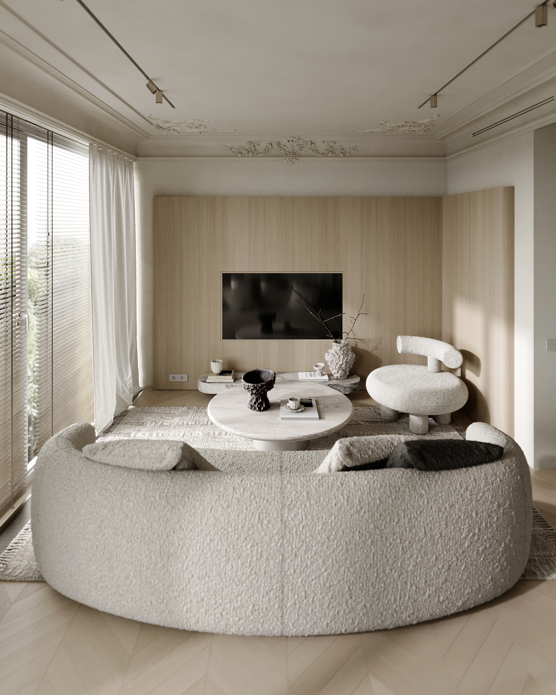
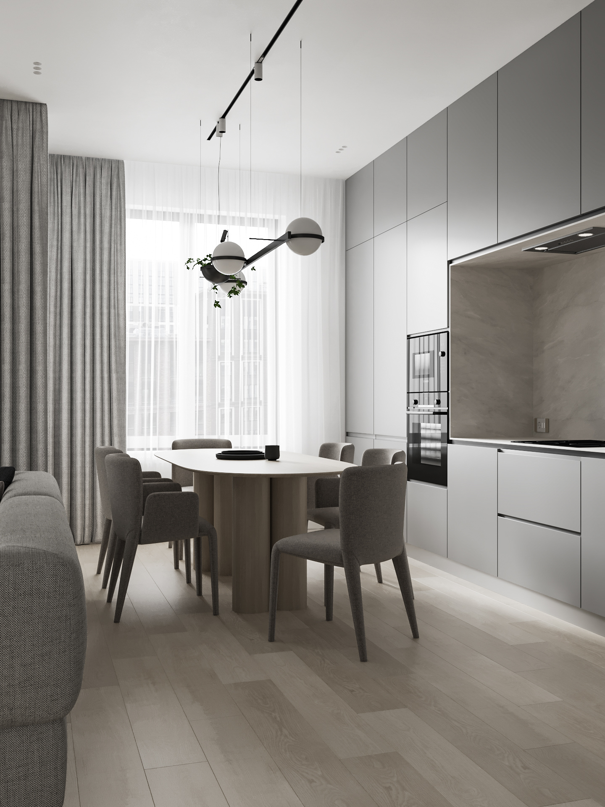

Дизайн квартиры чаще всего начинают с картинки: цвет стен, диван, «стиль как в журнале». На практике квартира — это связанный набор зон, которыми пользуются каждый день: готовка, отдых, хранение, сон, иногда работа из дома. Если сначала не собрать сценарий и не развести помещения на плане, красивая отделка не спасёт тесный проход, нехватку шкафов и комнаты, которые мешают друг другу.

В [Studio19.03](https://studio1903.ru/) с 2019 года проектируют и реализуют жилые интерьеры в Москве и других городах. Квартиру студия проектирует целиком: 3D-концепцию обычно начинают с кухни-гостиной, утверждают стиль, материалы и свет и только потом визуализируют остальные помещения. Ниже — с чего начать дизайн квартиры, как подойти к планировке разных площадей, какие решения видны в портфолио и как заказать проект.

Этот текст — про квартиру как жильё: сценарий, состав помещений и связь зон. Общий подход к интерьеру, в том числе в домах, разобран в статье [«Дизайн интерьера»](https://studio1903.ru/journal/dizajn-interera). Что входит в альбом, этапы и прайс — в статье [«Дизайн-проект квартиры»](https://studio1903.ru/journal/dizajn-proekt-kvartiry).

## С чего начинается дизайн квартиры

Не со стиля. Стиль — способ собрать уже понятую задачу, а не точка старта. Сначала нужно ответить, кто будет жить в квартире, как ей пользуются в обычный день и что должно произойти с планировкой.

В одной квартире на 38 м² нужно вместить кухню-гостиную, спальню, рабочее место и хранение. В другой на 82 м² собирают кухню-гостиную, две спальни, два санузла и большую гардеробную. В третьей комнату заранее закладывают так, чтобы позже она могла стать детской. Все эти сценарии могут выглядеть спокойными и современными, но чертёж у них будет разным.

На старте полезно зафиксировать: сколько человек живёт сейчас и как сценарий может измениться; какие зоны обязательны, а какие можно совместить; нужна ли перепланировка; как квартира связана с окнами, мокрыми зонами и входом; какой ориентир по бюджету отделки. На странице «Этапы» студия указывает, что работает с объектами, где бюджет отделки под ключ — от 200 000 ₽ за квадратный метр. Это ориентир по реализации, а не стоимость самого проекта.

Состав работы тоже стоит понять в начале. Дизайн квартиры в Studio19.03 не делается «по одной комнате»: в [полный дизайн-проект](https://studio1903.ru/price) входят обмерный план и планировочные решения, 3D-визуализация всех помещений, рабочая документация и развёртки стен, мебель в 3D и спецификация материалов, оборудования и мебели. Что именно входит в альбом, разобрано в статье [«Дизайн-проект квартиры»](https://studio1903.ru/journal/dizajn-proekt-kvartiry). Отдельного тарифа на одно помещение на сайте нет.

## Планировка в дизайне квартиры

На практике дизайн квартиры почти всегда начинается с планировки. Ошибка в зонировании дороже, чем неудачный цвет стены: если кухня, проход, место для сна и хранение мешают друг другу, это сложно «закрыть» декором.

Логика плана зависит от площади и сценария, а не от модного приёма.

В компактной квартире задача — вместить нужные зоны, не потеряв ощущение простора. В [SAVIN HAUZ](https://studio1903.ru/savinhauz) на 38 м² студия предусмотрела кухню-гостиную с островом, полноценную спальню, большой рабочий стол вдоль окна, хранение и хозблок. Как собрать жизнь на малой площади, отдельно разобрано в статье [«Дизайн однокомнатной квартиры»](https://studio1903.ru/journal/dizajn-odnokomnatnoj-kvartiry) — там примеры [DP-41](https://studio1903.ru/dp-41) на 41 м² и квартиры-студии [HP-52](https://studio1903.ru/hp-52).

На средней площади чаще появляется запас на отдельные комнаты и гардеробную, но его легко потерять, если сначала не зафиксировать состав помещений. В [ROCHE 82](https://studio1903.ru/roche82) на 82 м² вместили кухню-гостиную, две спальни, два санузла и большую гардеробную. В [SQUARE 29](https://studio1903.ru/square29) на 86 м² собрали большую кухню-гостиную, мастер-спальню, гардеробную и гостевую комнату, которую в будущем можно превратить в детскую: квартиру проектировали для одного человека, но с перспективой семьи.

В более просторной квартире задача может быть уже не «уместить всё», а собрать цельный характер пространства. В [SLOW 19](https://studio1903.ru/slow19) на 109 м² студия описывает интерьер как «оазис южного аутентичного дома»: песочные тона, натуральный камень, дерево и льняной текстиль, в решении — натуральный лён, травертин, микроцемент и шпон дерева. Проект реализован командой Studio19.03 под ключ.

Отдельно стоит решить, какие помещения остаются изолированными, а какие можно объединить. Если кухня входит в кухню-гостиную, нужны и рабочие зоны кухни, и связь со столом и диваном — это разобрано в статьях [«Дизайн интерьера кухни»](https://studio1903.ru/journal/dizajn-interera-kuhni) и [«Дизайн кухни-гостиной»](https://studio1903.ru/journal/dizajn-kuhni-gostinoj). Спальня, ванная и детская как отдельные сценарии — в статьях [«Дизайн спальни»](https://studio1903.ru/journal/dizajn-spalni), [«Дизайн ванной комнаты»](https://studio1903.ru/journal/dizajn-vannoj-komnaty) и [«Дизайн детской комнаты»](https://studio1903.ru/journal/dizajn-detskoj-komnaty).

На этапе планировки студия делает несколько вариантов зонирования: мебель, перегородки, снос — в рамках действующих норм. Варианты смотрят после обмеров, а не «на глаз» по планировке застройщика.

## Примеры дизайна квартиры в портфолио

Имеет смысл смотреть не только эффектный кадр, а близкий по задаче объект: площадь, тип жилья, город, состав помещений. В открытом портфолио Studio19.03 — 18 проектов: квартиры, апартаменты и дома в Москве и других городах, в том числе в Казани. На сайте студия пишет, что с 2019 года реализовала более ста объектов от чертежа до финала.

Среди квартир, например:

В [FRENCH 64](https://studio1903.ru/french64) задача была уместить всё необходимое в компактные 64 м² и сохранить ощущение парижской квартиры. Решение студии — классические пропорции, высокие плинтуса, спокойная палитра и продуманное хранение. В результате, по формулировке карточки, квартира кажется больше своей площади.

[SQUARE 29](https://studio1903.ru/square29) в ЖК «Царская Площадь» — квартира в спокойных тонах для молодой девушки, с запасом на будущую семью: большая кухня-гостиная, мастер-спальня, гардеробная и гостевая, которую можно переделать в детскую.

Полный список — в [портфолио](https://studio1903.ru/portfolio). Если нужен не только проект, но и реализация, это стоит обсудить на первой встрече: студия сопровождает ремонт, авторский надзор и комплектацию до сдачи объекта.

## Сколько стоит дизайн квартиры и как заказать

На странице [«Цены»](https://studio1903.ru/price) Studio19.03 публикует ориентиры по форматам работы. Это ориентиры, не финальный счёт: точный расчёт студия делает после заявки и отвечает в течение рабочего дня.

Планировочный проект — 1 000 ₽ / м².

Полный дизайн-проект — от 6 000 ₽ / м², со шкалой по площади:

- 50–100 м² — 8 000 ₽ / м²;
- 100–200 м² — 7 000 ₽ / м²;
- свыше 200 м² — 6 000 ₽ / м².

Отдельной ставки для площади меньше 50 м² на сайте нет, её лучше запросить расчётом.

Авторский надзор — от 50 000 ₽ в месяц: еженедельные выезды, отчётность с фотофиксацией, проверка соответствия проекту, консультации прораба и подрядчиков, оперативные правки в чертежах.

Комплектация — по согласованию. В неё входят выезды в салоны, коммерческие предложения, корректировка смет под бюджет, контроль заказа, организация изготовления индивидуальных позиций и закупка декора. Все скидки и бонусы от поставщиков, по данным студии, остаются заказчику (от 5 до 15%).

Путь работы на странице [«Этапы»](https://studio1903.ru/steps) описан в восьми шагах: заявка и встреча, подготовка с обмерами и ТЗ, планировка, 3D-концепция ключевого помещения (обычно кухни-гостиной), визуализация остальных комнат, рабочая документация, спецификация с артикулами, затем надзор и комплектация. Руководитель студии Роман Ахмадуллин ведёт каждый проект лично — от обмеров до приёмки.

Готовый бриф не нужен: на сайте достаточно площади и телефона. Первая встреча — в студии на Нагатинской или на объекте. Заявку можно оставить на [странице контактов](https://studio1903.ru/contacts): студия перезванивает в течение рабочего дня.

Написать можно на [studio1903.ru](https://studio1903.ru/). Телефон +7 (966) 250-84-50, почта info@studio1903.ru, студия в Москве, Нагатинская набережная, 10А, корп. Б.

:::faq
С чего начать дизайн квартиры?

Со сценария и планировки. Сначала фиксируют, кто живёт в квартире сейчас и как сценарий может измениться, какие зоны обязательны, нужна ли перепланировка и какой ориентир по бюджету отделки. Затем делают обмеры и несколько вариантов зонирования. Стиль, материалы и цвет выбирают уже под утверждённый план.

Чем дизайн квартиры отличается от дизайн-проекта квартиры?

Дизайн квартиры — про то, как жильё работает целиком: сценарий, состав помещений, связи между кухней, комнатами, хранением и санузлами. Дизайн-проект квартиры — это пакет документов, по которому можно строить и закупать: обмеры, планировки, 3D, рабочие чертежи и спецификация. В Studio19.03 одно вырастает из другого: сначала сценарий и план, затем полный альбом. Состав альбома разобран в статье [«Дизайн-проект квартиры»](https://studio1903.ru/journal/dizajn-proekt-kvartiry).

Можно ли заказать дизайн только одной комнаты?

Отдельного тарифа на одно помещение на сайте нет. Полный дизайн-проект делают для квартиры целиком: визуализируют все помещения и выпускают рабочую документацию на весь объект. Если на старте нужна только планировка, есть отдельный формат — планировочный проект.

Сколько стоит дизайн квартиры?

Планировочный проект — 1 000 ₽ / м², полный дизайн-проект — от 6 000 ₽ / м² в зависимости от площади: 8 000 ₽ / м² при 50–100 м², 7 000 ₽ / м² при 100–200 м² и 6 000 ₽ / м² свыше 200 м². Ставки для площади меньше 50 м² на сайте нет — её запрашивают расчётом. Авторский надзор — от 50 000 ₽ в месяц, комплектация — по согласованию.

Делает ли студия дизайн квартиры только в Москве?

Нет. Studio19.03 проектирует и реализует жилые интерьеры в Москве и других городах. В открытом портфолио — квартиры, апартаменты и дома, в том числе объекты в Казани. Первая встреча — в студии на Нагатинской или на объекте.
:::
