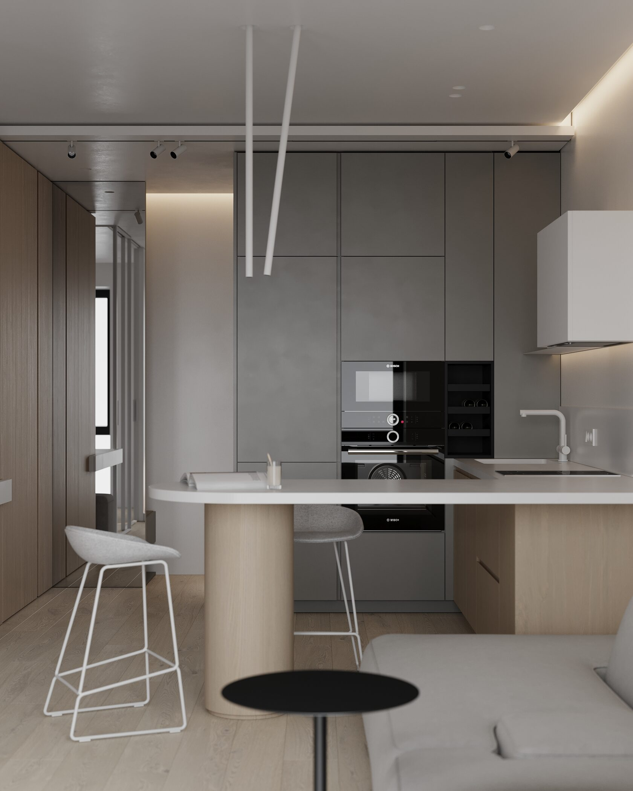
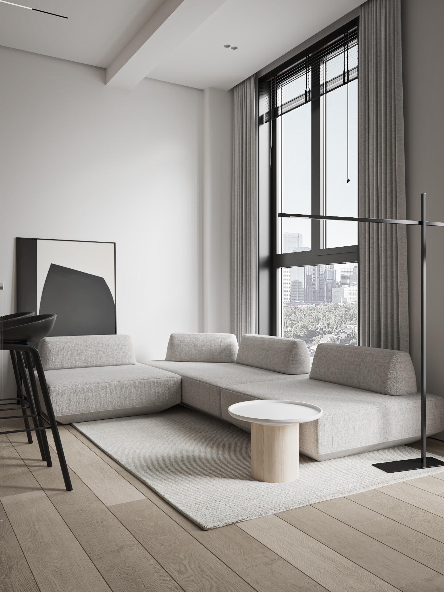
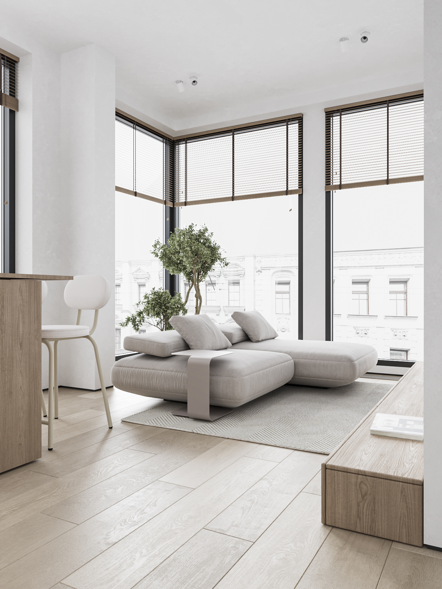

Дизайн однокомнатной квартиры нужен не для того, чтобы «уместить всё как получится», а чтобы на небольшой площади появились понятные зоны: кухня, отдых, хранение и сон — без ощущения тесноты. В [Studio19.03](https://studio1903.ru/) с 2019 года проектируют и реализуют жилые интерьеры в Москве и других городах. В портфолио есть проект, который студия сама описывает как полноценную однокомнатную квартиру, и отдельная квартира-студия. Ниже — с чего начать, какие примеры уже опубликованы и сколько стоит работа по открытому прайсу.

## Что даёт дизайн однокомнатной квартиры

На практике дизайн однокомнатной квартиры почти всегда начинается с планировки. На малой площади ошибка в зонировании дороже, чем неудачный цвет стены: если проход, кухня и место для сна мешают друг другу, это сложно «закрыть» декором.

Имеет смысл сразу проверить, что входит в работу бюро: обмеры, варианты планировки, визуализации, рабочие чертежи и спецификация с артикулами. Состав полного дизайн-проекта Studio19.03 и этапы работы подробно разобраны в статье [«Дизайн-проект квартиры»](https://studio1903.ru/journal/dizajn-proekt-kvartiry). Кратко: в [полный дизайн-проект](https://studio1903.ru/price) входят обмерный план и планировочные решения, 3D-визуализация всех помещений, рабочая документация и развёртки стен, мебель в 3D и спецификация материалов, оборудования и мебели.

Если на старте нужна только планировка, студия предлагает отдельный планировочный проект: обмерный план, план расстановки мебели с размерами и перепланировочный план (снос и возведение перегородок). Перепланировку студия готовит в рамках действующих норм.

После утверждения проекта Studio19.03 может сопровождать реализацию: ремонт по своей документации, авторский надзор и комплектацию. На сайте это описано как продолжение того же цикла — одна команда ведёт объект до завершения.

## Как студия делает дизайн однокомнатной квартиры

Путь работы описан на странице [«Этапы»](https://studio1903.ru/steps). Для однокомнатной квартиры особенно важны первые шаги: встреча, обмеры и несколько вариантов зонирования — мебель, перегородки, снос — до того, как утверждают стиль и материалы.

3D-концепцию студия обычно начинает с ключевого помещения, чаще кухни-гостиной: стиль, материалы и свет согласовывают, прежде чем визуализировать остальные помещения и собирать рабочую документацию. Затем идут альбом чертежей для подрядчиков и спецификация с артикулами.

Руководитель студии Роман Ахмадуллин ведёт каждый проект лично — от обмеров до приёмки. Если на стройке возникает вопрос, по формулировке сайта он решает его сам, а не передаёт менеджеру.

Готовый бриф не нужен: достаточно площади и телефона. Первая встреча — в студии на Нагатинской или на объекте. По заявке студия перезванивает в течение рабочего дня.

## Примеры дизайна однокомнатной квартиры в портфолио

В открытом [портфолио](https://studio1903.ru/portfolio) Studio19.03 — 18 проектов: квартиры, апартаменты и дома в Москве и других городах, в том числе в Казани. На сайте студия пишет, что с 2019 года реализовала более ста объектов от чертежа до финала.

Прямо как однокомнатную студия описывает [DP-41](https://studio1903.ru/dp-41): квартира 41 м² в Москве, ЖК Discovery Park, 2021, современный минимализм. Задача была «выжать максимум из маленькой площади и не потерять ощущение простора». В решении — единый визуальный поток, зеркала в нужных точках и мебель по индивидуальным размерам. Результат на сайте сформулирован так: «41 м² воспринимаются как полноценная однокомнатная квартира с характером». Срок реализации объекта — 7 месяцев.

Отдельно в портфолио есть квартира-студия: [HP-52](https://studio1903.ru/hp-52), 52 м² в Москве, ЖК «Садовые Кварталы», 2021, современный минимализм. Задача — «реализовать функциональную квартиру-студию для одного человека с зоной для работы из дома». В решении — трансформируемые зоны, встроенное хранение и монохромная база с одним тёплым акцентом. Результат: «52 м² работают как полноценное жилье — без ощущения тесноты». Срок реализации — 9 месяцев.

Среди других компактных квартир, без указания «однокомнатная» в карточке, например:

- [PLAY HAUZ](https://studio1903.ru/playhauz) — 38 м² в Москве, ЖК Play, современный минимализм: светлое пространство для молодого человека, который съезжает от родителей; в результате — «уютное и функциональное пространство, для комфортного проживания одного или двух человек»;
- [SAVIN HAUZ](https://studio1903.ru/savinhauz) — 38 м² в Казани, ЖК Savin House: на этой площади студия предусмотрела кухню-гостиную с островом, полноценную спальню, рабочий стол вдоль окна, хранение и хозблок.

Число комнат у этих двух проектов на сайте не названо, поэтому в тексте мы не подписываем их как однокомнатные. Полный список объектов — в портфолио.

Если нужен не только дизайн однокомнатной квартиры, но и реализация, это стоит обсудить на первой встрече: студия сопровождает ремонт, надзор и комплектацию до сдачи объекта.

## Сколько стоит дизайн однокомнатной квартиры

На странице [«Цены»](https://studio1903.ru/price) Studio19.03 публикует ориентиры по форматам работы.

Планировочный проект — 1 000 ₽ / м².

Полный дизайн-проект — от 6 000 ₽ / м², со шкалой по площади:

- 50–100 м² — 8 000 ₽ / м²;
- 100–200 м² — 7 000 ₽ / м²;
- свыше 200 м² — 6 000 ₽ / м².

Отдельной ставки для площади меньше 50 м² на сайте нет. Для квартиры вроде DP-41 (41 м²) точную сумму лучше запросить расчётом: на сайте отвечают в течение рабочего дня. Для площади 50–100 м², куда попадает HP-52 (52 м²), в прайсе указано 8 000 ₽ / м².

Авторский надзор — от 50 000 ₽ в месяц: еженедельные выезды, отчётность с фотофиксацией, проверка соответствия проекту, консультации прораба и подрядчиков, оперативные правки в чертежах.

Комплектация — по согласованию. В неё входят выезды в салоны, коммерческие предложения, корректировка смет под бюджет, контроль заказа, организация изготовления индивидуальных позиций и закупка декора. Все скидки и бонусы от поставщиков, по данным студии, остаются заказчику (от 5 до 15%).

Отдельно студия указывает, что работает с объектами, где бюджет отделки под ключ — от 200 000 ₽ за квадратный метр. Это ориентир по реализации, а не стоимость самого дизайн-проекта. Срок разработки альбома в днях или неделях на сайте не опубликован; сроки в карточках проектов относятся к реализации объекта целиком.

:::faq
С чего начать дизайн однокомнатной квартиры?

С планировки и обмеров: сначала зоны и проходы, потом стиль и материалы. В Studio19.03 готовый бриф не нужен — достаточно площади и телефона. Первая встреча проходит в студии на Нагатинской или на объекте.

Есть ли в портфолио Studio19.03 дизайн однокомнатной квартиры?

Да. Проект [DP-41](https://studio1903.ru/dp-41) студия описывает как полноценную однокомнатную квартиру на 41 м² в ЖК Discovery Park. Отдельно опубликован проект квартиры-студии [HP-52](https://studio1903.ru/hp-52) на 52 м² в ЖК «Садовые Кварталы».

Сколько стоит дизайн однокомнатной квартиры в Studio19.03?

Полный дизайн-проект — от 6 000 ₽ / м². В опубликованной шкале 50–100 м² стоят 8 000 ₽ / м², 100–200 м² — 7 000 ₽ / м², свыше 200 м² — 6 000 ₽ / м². Отдельной ставки для площади меньше 50 м² на сайте нет, её лучше запросить расчётом. Планировочный проект — 1 000 ₽ / м². Актуальные ориентиры — на [странице «Цены»](https://studio1903.ru/price).

Можно ли заказать только проект, без ремонта?

На сайте полный дизайн-проект и сопровождение реализации описаны как отдельные форматы. Ремонт, авторский надзор и комплектация предлагаются как продолжение цикла. Что именно нужно в вашем случае, лучше согласовать на встрече.

Где находится студия и как начать работу?

Студия в Москве, ул. Нагатинская набережная, 10А, корп. Б. Телефон +7 (966) 250-84-50, почта info@studio1903.ru. Заявку можно оставить на [странице контактов](https://studio1903.ru/contacts): студия перезванивает в течение рабочего дня.
:::
