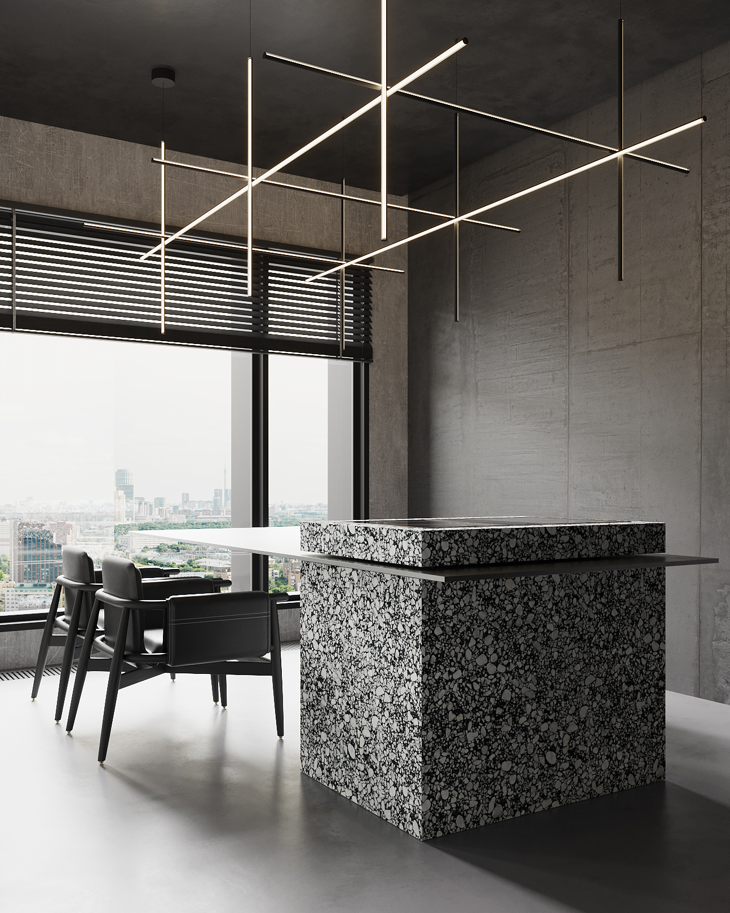
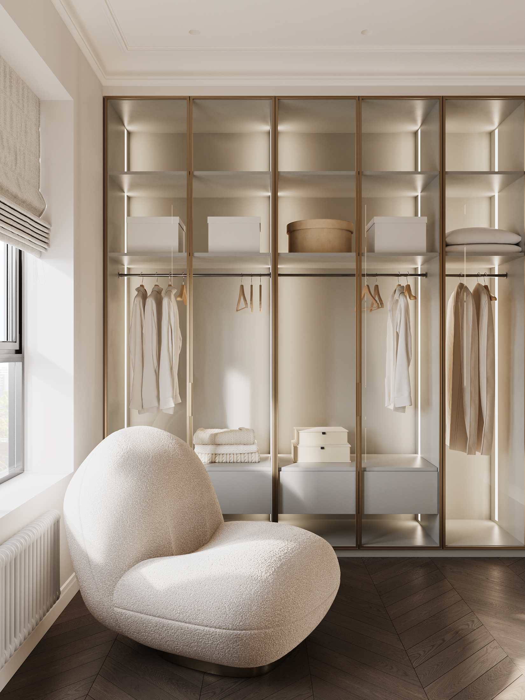
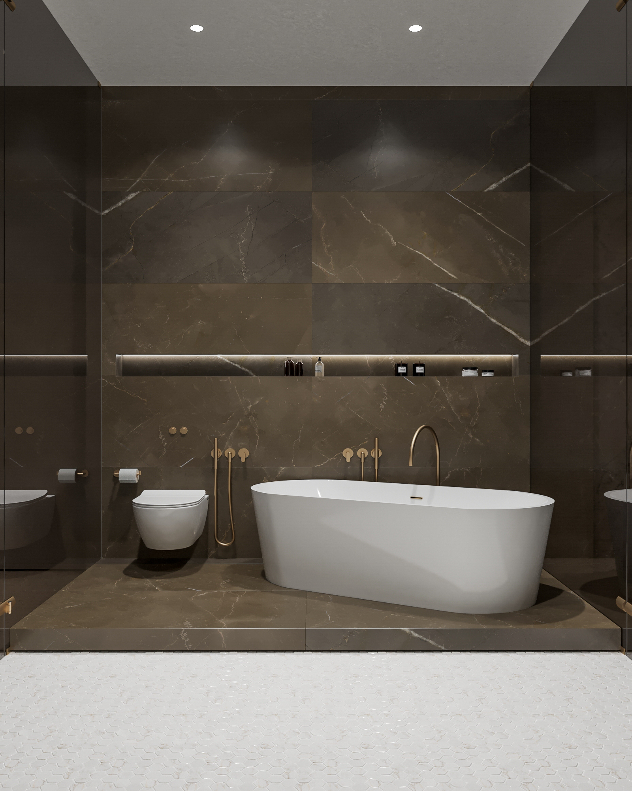
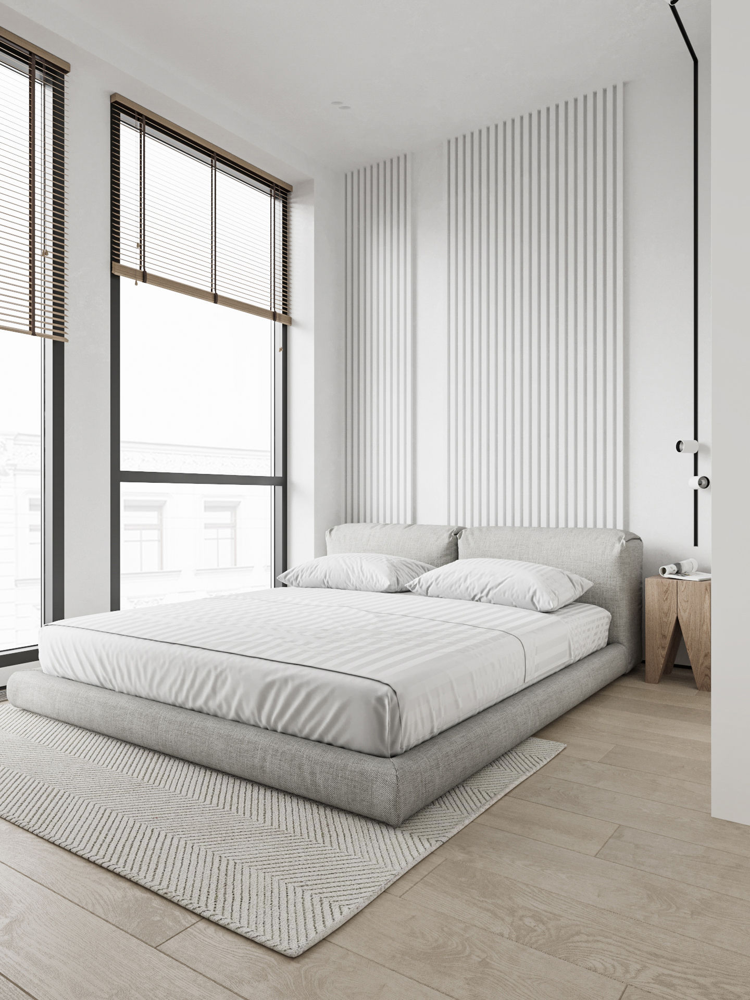

Дизайн-проект квартиры под ключ — формулировка, за которой в разных компаниях стоит разный объём работ: где-то это только альбом чертежей, где-то ещё и стройка с закупками. Поэтому до договора стоит выяснить, что именно входит в «ключ»: проект, ремонт, авторский надзор, комплектация — и кто за каждую часть отвечает.

В [Studio19.03](https://studio1903.ru/) это один цикл: на главной студия пишет, что проект, ремонт, надзор и комплектация — не отдельные договоры с разными исполнителями, а одна команда ведёт объект до завершения. С 2019 года студия проектирует и реализует интерьеры в Москве и других городах; в открытом [портфолио](https://studio1903.ru/portfolio) — 18 проектов, а на сайте говорится о более чем ста объектах от чертежа до финала. Ниже — как устроен дизайн-проект квартиры под ключ в Studio19.03, что считается отдельно и как его заказать.

Если нужен только состав альбома и прайс на проект, их разбирает статья [«Дизайн-проект квартиры»](https://studio1903.ru/journal/dizajn-proekt-kvartiry). Общий подход к интерьеру — в статье [«Дизайн интерьера»](https://studio1903.ru/journal/dizajn-interera), а о самой студии и порядке работы — в статье [«Студия дизайна интерьера»](https://studio1903.ru/journal/studiya-dizajna-interera).

## Что значит дизайн-проект квартиры под ключ

«Под ключ» нигде не закреплено как единый стандарт, поэтому его полезно разложить на четыре части:

- проект: планировка, визуализации, рабочая документация, спецификация;
- ремонт по этому проекту;
- авторский надзор: сверка стройки с чертежами;
- комплектация: сметы, закупки, контроль заказа материалов и мебели.

Перед договором имеет смысл спросить у любой компании: кто делает каждую часть; один это договор или несколько; кто отвечает, если на объекте сделали иначе, чем в чертежах; кто считает смету и ведёт закупки.

Как это сформулировано у Studio19.03. Архитектура, дизайн и строительство собраны в одной студии, без передачи на субподряд. Строительные бригады, как написано на сайте, работают по документации студии — без вольных интерпретаций на объекте. Каждый проект ведёт руководитель студии Роман Ахмадуллин: от обмеров до приёмки объекта. Если на стройке возникает вопрос, по его словам на сайте, он решает его сам, а не передаёт менеджеру.

## Из чего состоит дизайн-проект квартиры под ключ в Studio19.03

Первая часть — проект. По странице [«Цены»](https://studio1903.ru/price), полный дизайн-проект включает:

- обмерный план и планировочные решения;
- 3D-визуализацию всех помещений;
- рабочую документацию и развёртки стен;
- мебель в 3D;
- спецификацию материалов, оборудования и мебели.

Путь до него на странице [«Этапы»](https://studio1903.ru/steps) описан так: заявка и встреча; подготовка (договор, обмеры с фото- и видеофиксацией, техническое задание); планировка с несколькими вариантами зонирования; 3D-концепция ключевого помещения, обычно кухни-гостиной; визуализация остальных помещений; рабочая документация; спецификация с артикулами. Это семь шагов проекта. Восьмой — реализация.

Вторая часть — реализация. На сайте она разложена на три направления:

- ремонт: бригады работают по документации студии;
- авторский надзор: еженедельные выезды, отчётность с фотофиксацией, проверка соответствия проекту, консультации прораба и подрядчиков, оперативные правки в чертежах. На главной формулировка короче: отклонения — в чертежи, а не в отчёты, которые никто не читает;
- комплектация: выезды в салоны, коммерческие предложения, корректировка смет под бюджет проекта, контроль заказа, изготовление индивидуальных позиций, закупка декора.

Как это отражено в портфолио. В карточке [ROCHE 82](https://studio1903.ru/roche82) написано, что команда студии вела объект от планировки до комплектации. В карточках [FRENCH 64](https://studio1903.ru/french64), [LEVEL-M](https://studio1903.ru/levelm) и [LEVEL-P](https://studio1903.ru/levelp) состав работ перечислен так: планировочное решение, дизайн-проект, авторский надзор и комплектация.

## Сколько стоит дизайн-проект квартиры под ключ

На сайте опубликованы ставки по форматам, а не одна цена «под ключ».

Планировочный проект — 1 000 ₽ / м²: обмерный план, расстановка мебели с размерами и перепланировочный план.

Полный дизайн-проект — от 6 000 ₽ / м², со шкалой по площади:

- 50–100 м² — 8 000 ₽ / м²;
- 100–200 м² — 7 000 ₽ / м²;
- свыше 200 м² — 6 000 ₽ / м².

Для площади меньше 50 м² отдельной ставки на сайте нет — её запрашивают расчётом.

Авторский надзор — от 50 000 ₽ в месяц. Комплектация — по согласованию; все скидки и бонусы от поставщиков, по данным студии, остаются заказчику (от 5 до 15%).

Цена полного дизайн-проекта на странице «Цены» описывает состав проекта, перечисленный выше. В этом перечне строительных работ нет, и отдельной ставки на них на странице нет. На странице «Этапы» студия указывает ориентир по реализации: она работает с объектами, где бюджет отделки под ключ — от 200 000 ₽ за квадратный метр. Это порог по бюджету отделки, а не цена проекта и не итоговая смета.

Сколько это занимает по времени, лучше смотреть на реальных объектах. В карточках портфолио указан срок реализации: у квартир он составляет от 6 до 12 месяцев (например, LEVEL-P — 6, PLAY HAUZ — 7, ROCHE 82 — 8, DARQ HOUSE — 9, TITUL 70 — 10, SLOW 19 — 12). Что именно входит в срок, уточняйте на встрече: в карточках это не расшифровано.

Точную сумму по вашей площади и составу работ студия считает расчётом: на сайте обещают ответить в течение рабочего дня.

## Как заказать дизайн-проект квартиры под ключ

Готовый бриф не нужен: по формулировке студии, достаточно площади и телефона — остальное обсудят лично. Оставьте заявку на сайте или позвоните: +7 (966) 250-84-50. Студия перезвонит в течение рабочего дня, ответит на вопросы и договорится о встрече в студии на Нагатинской набережной, 10А, корп. Б или на объекте. Почта: info@studio1903.ru. Контакты собраны на странице [«Контакты»](https://studio1903.ru/contacts).

На встрече стоит прямо уточнить: что входит в договор на проект, а что — в реализацию; как будут считаться ремонт и комплектация; кто на стройке отвечает за решения и правки в чертежах. Ответы лучше зафиксировать в договоре: на шаге «Подготовка» студия подписывает договор, делает обмеры с фото- и видеофиксацией и вместе с вами заполняет техническое задание.

:::faq
Что значит «дизайн-проект квартиры под ключ» в Studio19.03?

Это единый цикл: проект, ремонт по документации студии, авторский надзор и комплектация. На сайте студия пишет, что это не отдельные договоры с разными исполнителями, а одна команда, которая ведёт объект до завершения. Архитектура, дизайн и строительство собраны в одной студии, без передачи на субподряд.

Входит ли ремонт в стоимость дизайн-проекта?

На странице «Цены» полный дизайн-проект — от 6 000 ₽ / м². В него входят обмеры и планировочные решения, 3D-визуализация всех помещений, рабочая документация, мебель в 3D и спецификация. Строительных работ в этом перечне нет, отдельной ставки на них на странице тоже нет — их стоимость лучше уточнять расчётом на встрече.

Сколько стоит дизайн-проект квартиры под ключ?

Единой цены «под ключ» на сайте нет. Опубликованы ставки по форматам: планировочный проект — 1 000 ₽ / м², полный дизайн-проект — от 6 000 ₽ / м² (8 000 ₽ при 50–100 м², 7 000 ₽ при 100–200 м², 6 000 ₽ свыше 200 м²), авторский надзор — от 50 000 ₽ в месяц, комплектация — по согласованию. Для площади меньше 50 м² ставку запрашивают расчётом.

С какого бюджета отделки студия работает?

На странице «Этапы» студия указывает, что работает с объектами, где бюджет отделки под ключ — от 200 000 ₽ за квадратный метр. Это ориентир по реализации, а не цена дизайн-проекта.

Сколько времени занимает проект под ключ?

В карточках портфолио указан срок реализации. У квартир он от 6 до 12 месяцев: например, LEVEL-P — 6 месяцев, ROCHE 82 — 8, TITUL 70 — 10, SLOW 19 — 12. У домов — от 11 до 24 месяцев. Что именно входит в этот срок, в карточках не расшифровано, поэтому уточняйте на встрече.

Кто ведёт объект на стройке?

Руководитель студии Роман Ахмадуллин. На сайте он пишет, что ведёт каждый проект лично: от обмеров до приёмки объекта, а вопросы на стройке решает сам, а не передаёт менеджеру. Еженедельные выезды и фотофиксацию обеспечивает авторский надзор.
:::
