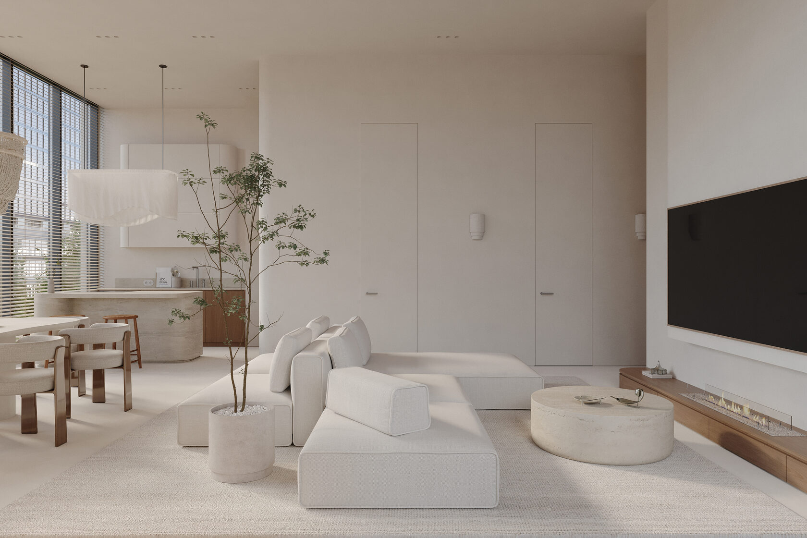
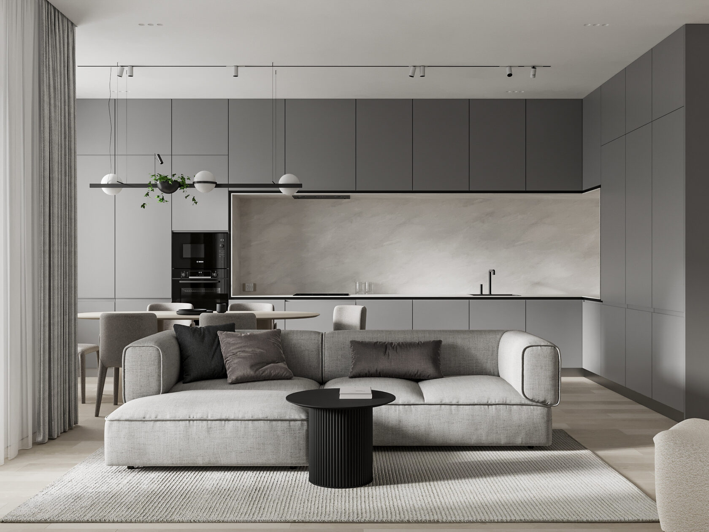
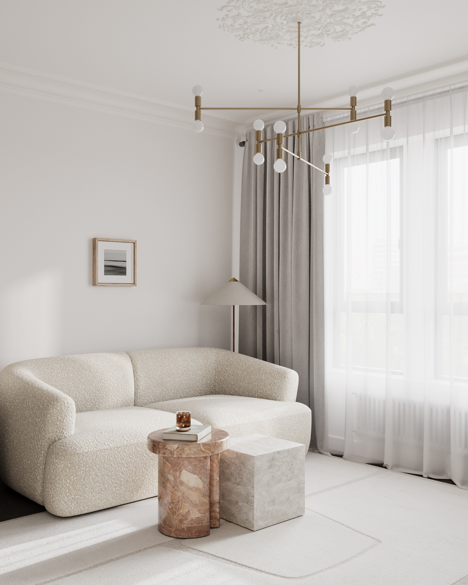
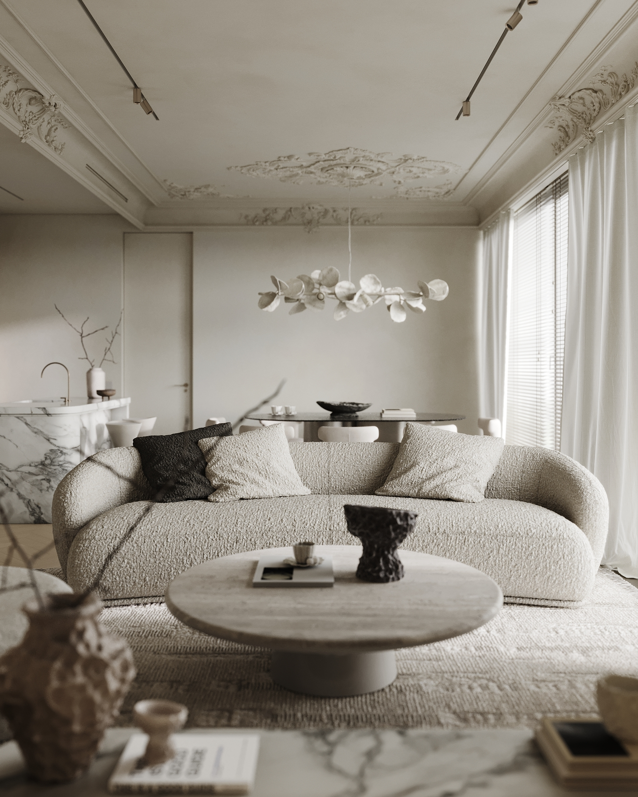

Дизайн-проект квартиры нужен не для красивых картинок в папке, а чтобы ремонт шёл по согласованным решениям: планировке, материалам, свету и мебели. В [Studio19.03](https://studio1903.ru/) полный дизайн-проект включает обмеры и планировочные решения, 3D-визуализацию всех помещений, рабочую документацию, мебель в 3D и спецификацию с артикулами. Ниже — что входит в работу, как устроены этапы и сколько это стоит по открытому прайсу студии.

## Что входит в дизайн-проект квартиры

В общем виде дизайн-проект квартиры — это пакет документов, по которому можно строить и закупать, а не только выбирать стиль. Состав у разных бюро отличается, поэтому смотрите перечень работ, а не одно слово «проект» в коммерческом предложении.

На практике стоит отдельно проверить, есть ли обмеры, варианты планировки, визуализации всех комнат, рабочие чертежи и спецификация с артикулами. Без чертежей и спецификации красивая картинка слабо защищает от расхождений на стройке.

В Studio19.03 [полный дизайн-проект](https://studio1903.ru/price) включает:

- обмерный план и планировочные решения;
- 3D-визуализацию всех помещений;
- рабочую документацию и развёртки стен;
- мебель в 3D;
- спецификацию материалов, оборудования и мебели.

Отдельно студия предлагает планировочный проект: обмерный план, план расстановки мебели с размерами и перепланировочный план (снос и возведение перегородок). Это более узкий формат, если на старте нужна только планировка.

После утверждения проекта студия может сопровождать реализацию: ремонт по своей документации, авторский надзор и комплектацию. На сайте это описано как продолжение того же цикла — одна команда ведёт объект до завершения.

## Сколько стоит дизайн-проект квартиры

На странице [«Цены»](https://studio1903.ru/price) Studio19.03 публикует ориентиры по форматам работы.

Планировочный проект — 1 000 ₽ / м².

Полный дизайн-проект — от 6 000 ₽ / м², со шкалой по площади:

- 50–100 м² — 8 000 ₽ / м²;
- 100–200 м² — 7 000 ₽ / м²;
- свыше 200 м² — 6 000 ₽ / м².

Авторский надзор — от 50 000 ₽ в месяц: еженедельные выезды, отчётность с фотофиксацией, проверка соответствия проекту, консультации прораба и подрядчиков, оперативные правки в чертежах.

Комплектация — по согласованию. В неё входят выезды в салоны, коммерческие предложения, корректировка смет под бюджет, контроль заказа, организация изготовления индивидуальных позиций и закупка декора. Все скидки и бонусы от поставщиков, по данным студии, остаются заказчику (от 5 до 15%).

Отдельно студия указывает, что работает с объектами, где бюджет отделки под ключ — от 200 000 ₽ за квадратный метр. Это ориентир по реализации, а не стоимость самого дизайн-проекта.

Точную сумму по вашей площади лучше запросить расчётом: на сайте отвечают в течение рабочего дня.

## Как создают дизайн-проект квартиры: этапы работы

На странице [«Этапы»](https://studio1903.ru/steps) путь описан в восьми шагах.

1. Заявка и встреча. Заявку можно оставить на сайте или связаться удобным способом. Студия отвечает на вопросы и договаривается о встрече в студии на Нагатинской или на объекте. Готовый бриф не нужен: достаточно площади и телефона.
2. Подготовка. Договор, обмеры с фото- и видеофиксацией, техническое задание заполняют вместе.
3. Планировка. Несколько вариантов зонирования: мебель, перегородки, снос — в рамках действующих норм.
4. 3D-концепция. Визуализация ключевого помещения, обычно кухни-гостиной. Стиль, материалы и свет утверждают до того, как двигаться дальше.
5. 3D-визуализация остальных помещений.
6. Рабочая документация. Альбом чертежей для подрядчиков: развёртки стен, мебель в 3D, узлы и привязки.
7. Спецификация. Полный список отделочных материалов, оборудования, освещения и мебели с артикулами.
8. Надзор и комплектация. Еженедельные выезды, отчётность с фотофиксацией, подбор в салонах, контроль закупок и изготовления индивидуальных позиций.

Руководитель студии Роман Ахмадуллин ведёт каждый проект лично — от обмеров до приёмки. Если на стройке возникает вопрос, по формулировке сайта он решает его сам, а не передаёт менеджеру.

## Портфолио: на что смотреть, заказывая дизайн-проект квартиры

Имеет смысл смотреть не только эффектный кадр, а близкий по задаче объект: площадь, тип жилья, город, стиль. В открытом [портфолио](https://studio1903.ru/portfolio) Studio19.03 — 18 проектов: квартиры, апартаменты и дома в Москве и других городах, в том числе в Казани. На сайте студия пишет, что с 2019 года реализовала более ста объектов от чертежа до финала.

Среди квартир в Москве, например:

- [ROCHE 82](https://studio1903.ru/roche82) — 82 м² в ЖК «Селигер Сити», современная классика: кухня-гостиная, две спальни, два санузла и большая гардеробная;
- [SLOW 19](https://studio1903.ru/slow19) — 109 м² в ЖК «Событие», стиль джапанди;
- [FRENCH 64](https://studio1903.ru/french64) — 64 м² в ЖК Cameo Moscow, современная классика;
- [SQUARE 29](https://studio1903.ru/square29) — 86 м² в ЖК «Царская Площадь».

Полный список — в портфолио. Если нужен не только проект, но и реализация, это стоит обсудить на первой встрече: студия сопровождает ремонт, надзор и комплектацию до сдачи объекта.

:::faq
Что такое дизайн-проект квартиры и чем он отличается от планировки?

Планировочный проект в Studio19.03 — это обмеры, расстановка мебели и план перепланировки. Полный дизайн-проект квартиры добавляет 3D всех помещений, рабочую документацию, мебель в 3D и спецификацию с артикулами.

Сколько стоит дизайн-проект квартиры в Studio19.03?

Полный дизайн-проект — от 6 000 ₽ / м²: 8 000 ₽ / м² при площади 50–100 м², 7 000 ₽ / м² при 100–200 м² и 6 000 ₽ / м² свыше 200 м². Планировочный проект — 1 000 ₽ / м². Актуальные ориентиры — на [странице «Цены»](https://studio1903.ru/price).

Можно ли заказать только проект, без ремонта?

На сайте полный дизайн-проект и сопровождение реализации описаны как отдельные форматы: у проекта свой состав и прайс, а ремонт, авторский надзор и комплектация предлагаются как продолжение цикла. Что именно нужно в вашем случае, лучше согласовать на встрече.

Где находится студия и как начать работу над дизайн-проектом квартиры?

Студия в Москве, ул. Нагатинская набережная, 10А, корп. Б. Телефон +7 (966) 250-84-50, почта info@studio1903.ru. Первая встреча — в студии или на объекте. Заявку можно оставить на [странице контактов](https://studio1903.ru/contacts): студия перезванивает в течение рабочего дня.
:::
