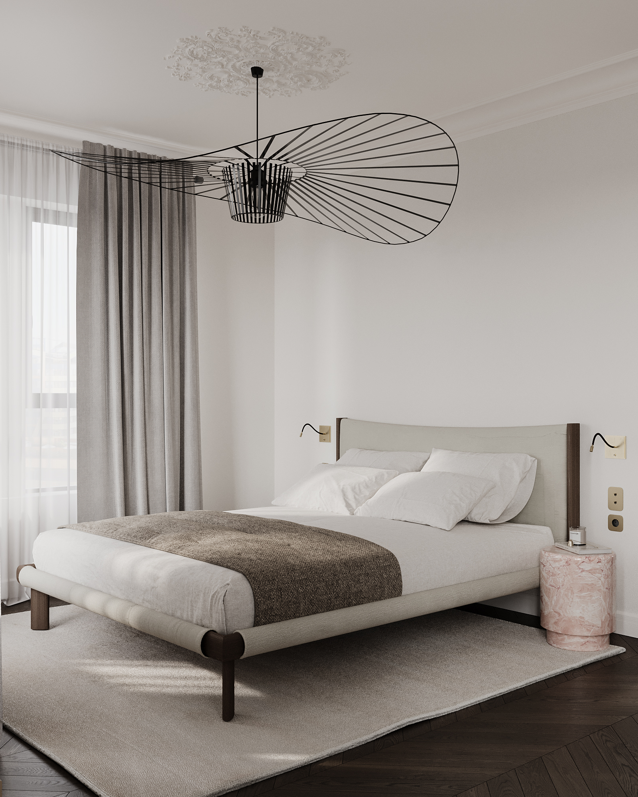
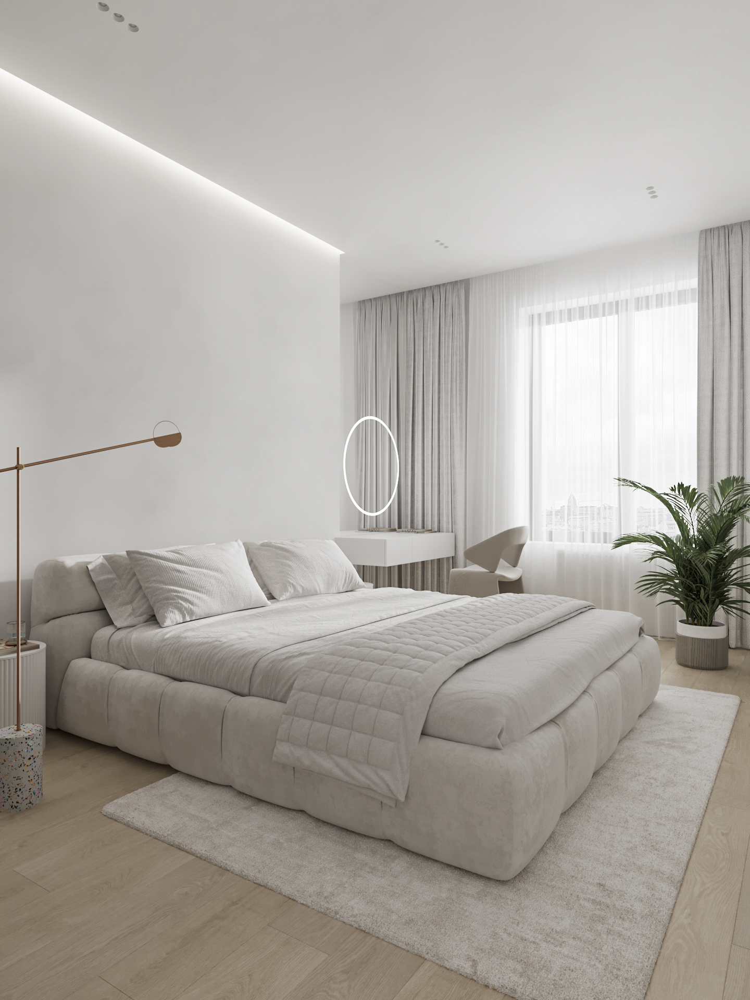
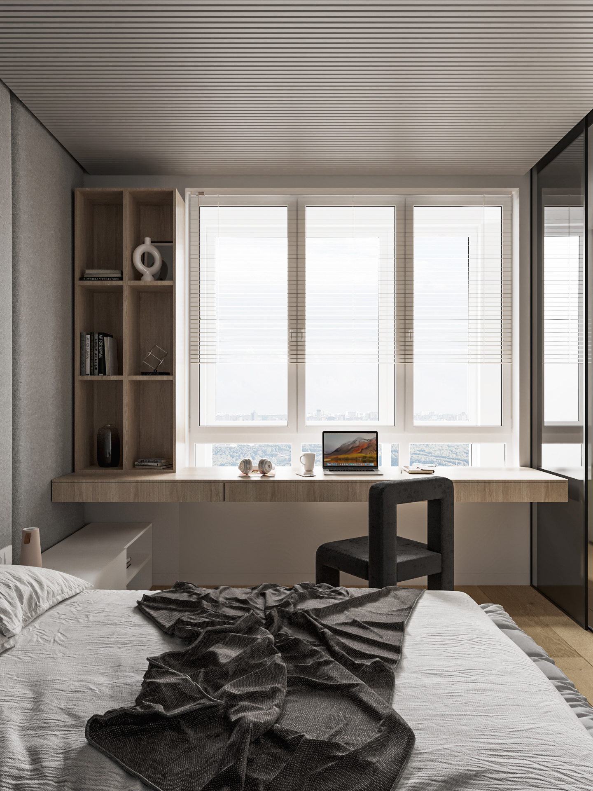
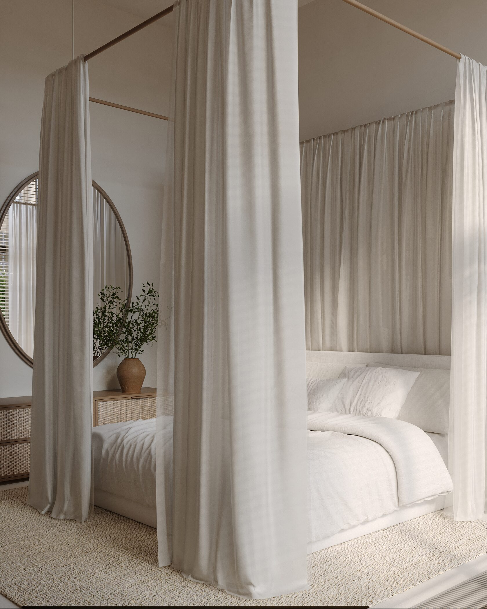
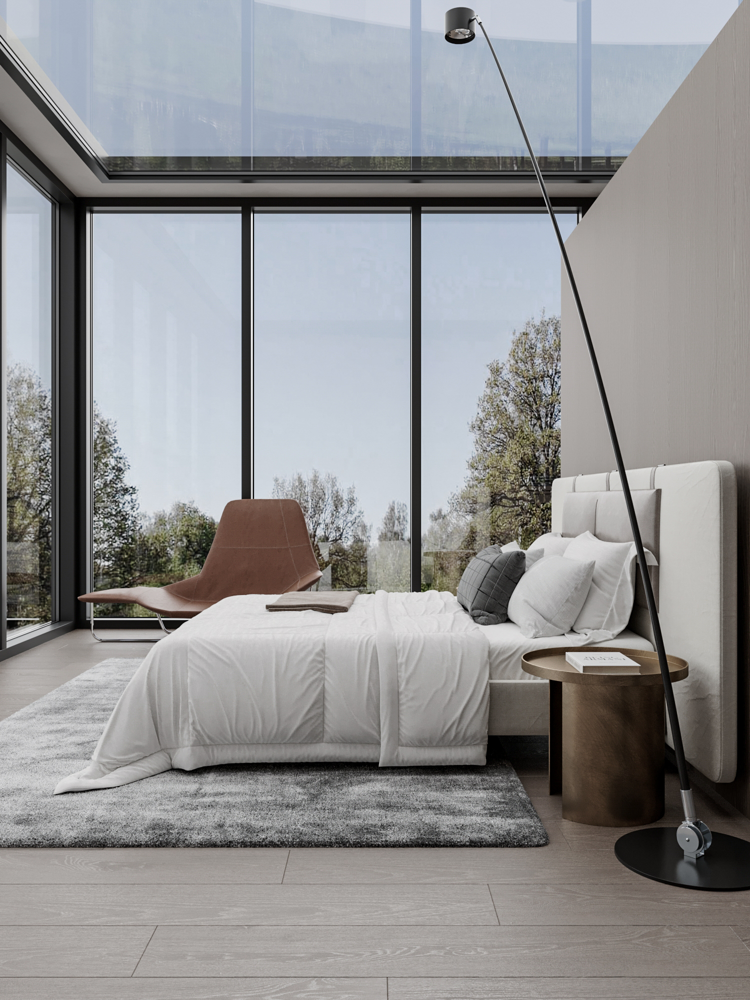

Дизайн спальни часто начинают с кровати и оттенка стен. В жизни комната должна выдержать обычный день: сон, утро, хранение, иногда работу или чтение — и остаться тихой, когда остальная квартира ещё живёт своим ритмом. Если сценарий не собран, красивая картинка быстро расходится с тем, как комнатой пользуются.

В [Studio19.03](https://studio1903.ru/) с 2019 года проектируют и реализуют жилые интерьеры в Москве и других городах. 3D-концепцию студия обычно начинает с ключевого помещения, чаще с кухни-гостиной: стиль, материалы и свет утверждают до того, как визуализировать остальные комнаты, в том числе спальню. Ниже — с чего начать дизайн спальни, какие решения видны в [портфолио](https://studio1903.ru/portfolio) и как заказать проект.

## С чего начинается дизайн спальни

Не со стиля. Стиль — способ собрать уже понятую задачу, а не точка старта. Сначала нужно ответить, что комната делает чаще всего и для кого.

В одной квартире спальня — только место для сна, и всё лишнее лучше убрать из виду. В другой здесь читают, работают или оставляют гардероб. В третьей на небольшой площади нужна полноценная спальня рядом с кухней-гостиной, без ощущения, что кровать стоит в проходе. Планировка, свет и хранение в этих случаях будут разными, даже если все три интерьера назовут современными.

На старте полезно зафиксировать: сколько человек пользуется комнатой; нужна ли отдельная гардеробная или встроенные шкафы; есть ли работа или чтение в кровати; как спальня связана с ванной, гардеробом и остальной квартирой; что должно быть скрыто — одежда, чемоданы, техника, документы.

Ответы меняют чертёж. В проекте [SQUARE 29](https://studio1903.ru/square29) студия собирала пространство для одного человека, но с перспективой на семью с детьми: в результате появились большая кухня-гостиная, мастер-спальня, гардеробная и гостевая, которую позже можно превратить в детскую. В [ROCHE 82](https://studio1903.ru/roche82) на 82 м² вместили кухню-гостиную, две спальни, два санузла и большую гардеробную. В [SAVIN HAUZ](https://studio1903.ru/savinhauz), квартире 38 м², студия предусмотрела кухню-гостиную с островом, полноценную спальню, рабочий стол вдоль окна, хранение и хозблок. Это не «разные стили ради стиля», а разные сценарии, из которых вырастает дизайн спальни.

Сначала — роли комнаты, потом расстановка, уже затем материалы.

## Планировка в дизайне спальни

Дизайн спальни в квартире почти никогда не равен отдельной «комнате из каталога». Она связана с окнами, проходами, гардеробной и санузлом. Ошибка на плане дороже неудачного покрывала: если кровать стоит на пути к шкафу, а утренний свет бьёт в глаза, декор это не скроет.

Поэтому планировку мы разбираем раньше, чем цвет стен. На странице [«Этапы»](https://studio1903.ru/steps) у Studio19.03 это отдельный шаг: несколько вариантов зонирования — мебель, перегородки, снос — в рамках действующих норм. Для спальни здесь обычно решаются четыре вопроса.

**Где стоит кровать и куда смотрят.** У изголовья нужна стена или продуманная опора, а не случайный проход. Важно, как комната открывается от двери и что видно из кровати: окно, шкаф, пустая стена.

**Как обходят мебель.** Вокруг кровати должны остаться понятные проходы к окну, шкафу и выходу. Если путь режет комнату пополам, спальня будет казаться тесной даже при достаточной площади.

**Где хранение.** Открытые вешалки и чемоданы быстро забирают спокойствие. В ROCHE 82 большая гардеробная заложена в планировку вместе с двумя спальнями. В SQUARE 29 мастер-спальня соседствует с гардеробной. На малой площади хранение чаще встраивают в стены: в SAVIN HAUZ на 38 м² полноценная спальня собрана вместе с рабочим столом вдоль окна и большим объёмом хранения.

**Какой свет нужен утром и вечером.** Одна люстра делает комнату плоской. В проекте нужны сценарии: приглушённый вечерний свет, чтение, утренний свет от окна. На этапе 3D-концепции студия утверждает стиль, материалы и свет, прежде чем визуализировать остальные помещения.

Если кухня и гостиная уже задали материалы, дизайн спальни лучше собирать как продолжение той же истории, а не как второй ремонт в одной квартире. Пол, палитра и свет могут быть спокойнее, чем в общей зоне, но они не должны спорить с ней.

## Примеры дизайна спальни в портфолио

В открытом [портфолио](https://studio1903.ru/portfolio) Studio19.03 — 18 проектов: квартиры, апартаменты и дома в Москве и других городах, в том числе в Казани. На сайте студия пишет, что с 2019 года реализовала более ста объектов от чертежа до финала. Кадры ниже — визуализации из галерей проектов; подписываем их как интерьеры студии, а не как фото готового ремонта.

В [ROCHE 82](https://studio1903.ru/roche82) — квартира 82 м² в Москве, ЖК «Селигер Сити», 2024, современная классика. Задача была «собрать современный интерьер с классическими элементами и декором». В решении на этой площади появились кухня-гостиная, две спальни, два санузла и большая гардеробная. Срок реализации объекта — 8 месяцев.

В [SQUARE 29](https://studio1903.ru/square29) — квартира 86 м² в Москве, ЖК «Царская Площадь», 2021, современный минимализм. Квартиру собирали «в спокойных тонах для молодой девушки», с расчётом на будущее проживание семьи с детьми. В результате — большая кухня-гостиная, мастер-спальня, гардеробная и гостевая, которую «с легкостью в будущем должна превратиться в детскую». Срок реализации — 10 месяцев.

На компактной площади дизайн спальни не равен уменьшенной копии большой мастер-спальни. В [SAVIN HAUZ](https://studio1903.ru/savinhauz) — квартира 38 м² в Казани, ЖК Savin House, 2021, современный минимализм. На сайте результат сформулирован так: на 38 м² предусмотрены кухня-гостиная с островом, полноценная спальня, большой рабочий стол вдоль окна, хранение и хозблок. Срок реализации — 7 месяцев.

В проекте [SLOW 19](https://studio1903.ru/slow19) — квартира 109 м² в Москве, ЖК «Событие», 2026, джапанди. Основа интерьера, по описанию студии, — песочные тона, натуральный камень, дерево и льняной текстиль; в решении названы натуральный лён, травертин, микроцемент и шпон дерева. Результат студия формулирует как «дом как место восстановления — без декоративного шума». Спальня в этой квартире собрана в той же спокойной палитре. Срок реализации объекта — 12 месяцев. Проект реализован командой Studio19.03 под ключ.

В доме [T-HOUSE 03](https://studio1903.ru/t-house03) — 460 м² в Москве, 2021 — студия писала, что дом «читается цельно — от входа до мастер-спальни наверху». Для пары, которая живёт на две страны, важны были тёплые встречи и единый характер пространства: общий материал пола на всех этажах, панорамный свет на лестнице и мягкие переходы между комнатами. Срок реализации — 24 месяца.

Полный список объектов — в портфолио. Если нужен не только дизайн спальни, но и реализация, это стоит обсудить на первой встрече: студия сопровождает ремонт, надзор и комплектацию до сдачи объекта.

## Как заказать дизайн спальни в Studio19.03

Путь работы описан на странице [«Этапы»](https://studio1903.ru/steps). Для спальни особенно важны первые шаги. На встрече обсуждаем, как живёт семья и что комната должна уметь. Затем делаем обмеры и несколько вариантов зонирования. Когда планировка утверждена, собираем 3D ключевого помещения — обычно кухни-гостиной — и только после этого визуализируем остальные комнаты, в том числе спальню, выпускаем альбом чертежей и спецификацию с артикулами.

Состав полного дизайн-проекта и общие этапы подробнее разобраны в статье [«Дизайн-проект квартиры»](https://studio1903.ru/journal/dizajn-proekt-kvartiry). Кратко: в [полный дизайн-проект](https://studio1903.ru/price) входят обмерный план и планировочные решения, 3D-визуализация всех помещений, рабочая документация и развёртки стен, мебель в 3D и спецификация материалов, оборудования и мебели.

Имеет смысл думать о квартире целиком: спальня связана с гардеробной, санузлом и светом остальных помещений. Отдельного тарифа «только на спальню» на сайте нет. У Studio19.03 можно начать с планировочного проекта или заказать полный дизайн-проект.

Если проект нужно довести до ремонта, студия может сопровождать реализацию: бригады работают по документации Studio19.03, есть авторский надзор и комплектация. На сайте это описано как один цикл — одна команда ведёт объект до завершения. Руководитель студии Роман Ахмадуллин ведёт каждый проект лично, от обмеров до приёмки, и сам разбирает вопросы на стройке, не передавая их менеджеру.

Готовый бриф не нужен: достаточно площади и телефона. Первая встреча — в студии на Нагатинской или на объекте. По заявке студия перезванивает в течение рабочего дня.

## Сколько стоит дизайн спальни

На странице [«Цены»](https://studio1903.ru/price) Studio19.03 публикует ориентиры по форматам работы. Это стоимость дизайн-проекта квартиры или дома, а не отдельная ставка за одну комнату.

Планировочный проект — 1 000 ₽ / м²: обмерный план, план расстановки мебели с размерами и перепланировочный план (снос и возведение перегородок). Перепланировку студия готовит в рамках действующих норм.

Полный дизайн-проект — от 6 000 ₽ / м², со шкалой по площади:

- 50–100 м² — 8 000 ₽ / м²;
- 100–200 м² — 7 000 ₽ / м²;
- свыше 200 м² — 6 000 ₽ / м².

Отдельной ставки для площади меньше 50 м² на сайте нет. Для квартиры вроде SAVIN HAUZ (38 м²) точную сумму лучше запросить расчётом: на сайте отвечают в течение рабочего дня. Для площади 50–100 м², куда попадают ROCHE 82 (82 м²) и SQUARE 29 (86 м²), в прайсе указано 8 000 ₽ / м². SLOW 19 (109 м²) попадает в диапазон 100–200 м² — 7 000 ₽ / м². T-HOUSE 03 (460 м²) — свыше 200 м², 6 000 ₽ / м².

Авторский надзор — от 50 000 ₽ в месяц: еженедельные выезды, отчётность с фотофиксацией, проверка соответствия проекту, консультации прораба и подрядчиков, оперативные правки в чертежах.

Комплектация — по согласованию. В неё входят выезды в салоны, коммерческие предложения, корректировка смет под бюджет, контроль заказа, организация изготовления индивидуальных позиций и закупка декора. Все скидки и бонусы от поставщиков, по данным студии, остаются заказчику (от 5 до 15%).

Отдельно студия указывает, что работает с объектами, где бюджет отделки под ключ — от 200 000 ₽ за квадратный метр. Это ориентир по реализации, а не стоимость самого дизайн-проекта. Срок разработки альбома в днях или неделях на сайте не опубликован; сроки в карточках проектов относятся к реализации объекта целиком.

Если нужен проект под конкретную квартиру, написать можно на [studio1903.ru](https://studio1903.ru/).

:::faq
С чего начать дизайн спальни, если ремонт ещё не начался?

С сценария и планировки. Сначала фиксируют, как комнатой будут пользоваться, делают обмеры и варианты расстановки. Цвет стен, кровать и свет логично выбирать уже по утверждённому плану — иначе вещи приходится вписывать в случайно сложившееся пространство.

Можно ли сделать дизайн спальни в небольшой квартире?

Да, если не переносить в неё интерьер большой отдельной мастер-спальни. На малой площади решают проходы, встроенное хранение и спокойную связь с соседними зонами. В портфолио студии такой пример — SAVIN HAUZ на 38 м², где сразу заложена полноценная спальня вместе с кухней-гостиной и рабочим столом.

Нужен ли отдельный проект только на спальню?

Имеет смысл думать о квартире целиком: спальня связана с гардеробной, санузлом и светом остальных помещений. У Studio19.03 можно начать с планировочного проекта или заказать полный дизайн-проект. Состав работы и ориентиры по форматам опубликованы на странице «Цены»; точный расчёт студия делает после заявки. Отдельного тарифа «только спальня» на сайте нет.

Чем дизайн спальни в квартире с двумя спальнями отличается от компактной планировки?

В квартире вроде ROCHE 82 или SQUARE 29 сразу решают, где мастер-спальня, где вторая или гостевая комната и как к ним примыкает гардероб. На малой площади, как в SAVIN HAUZ, важнее вписать полноценную спальню, не потеряв кухню-гостиную, стол и хранение. В обоих случаях начинают с плана, а не с декора.
:::
