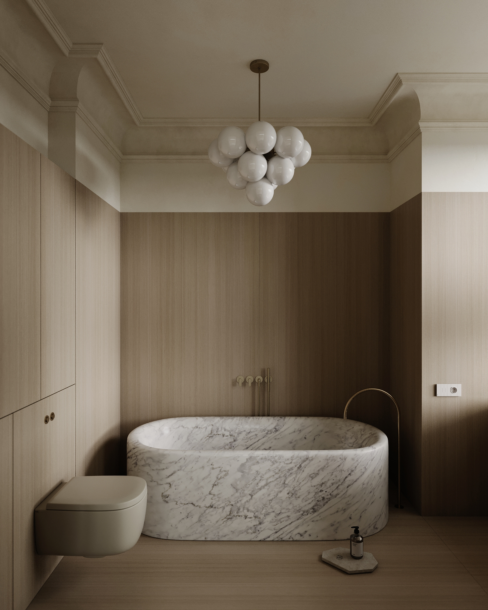
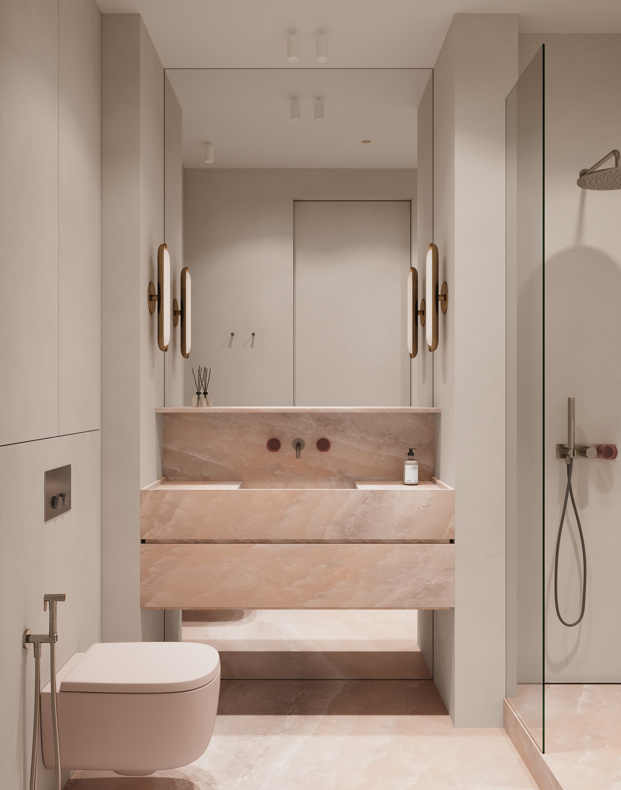
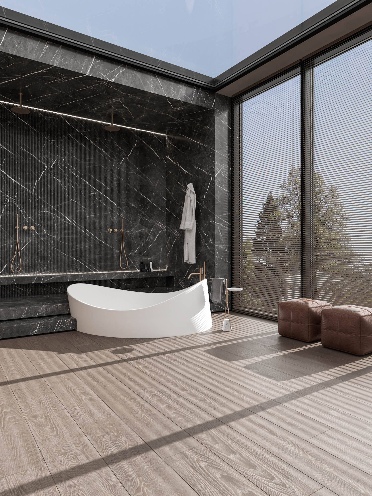
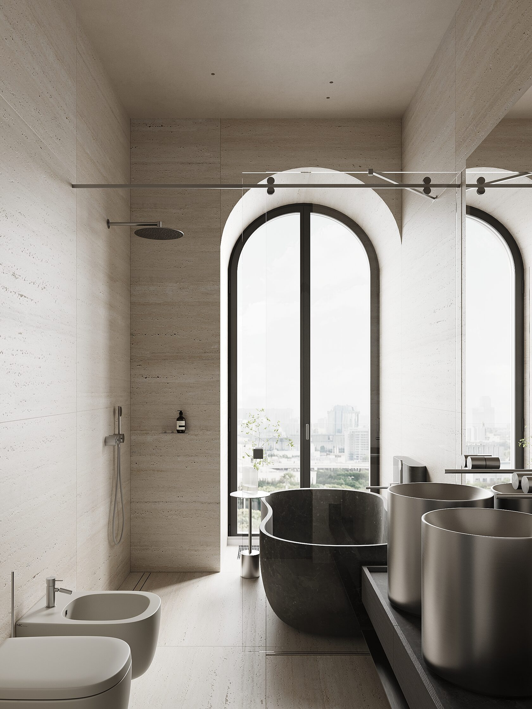
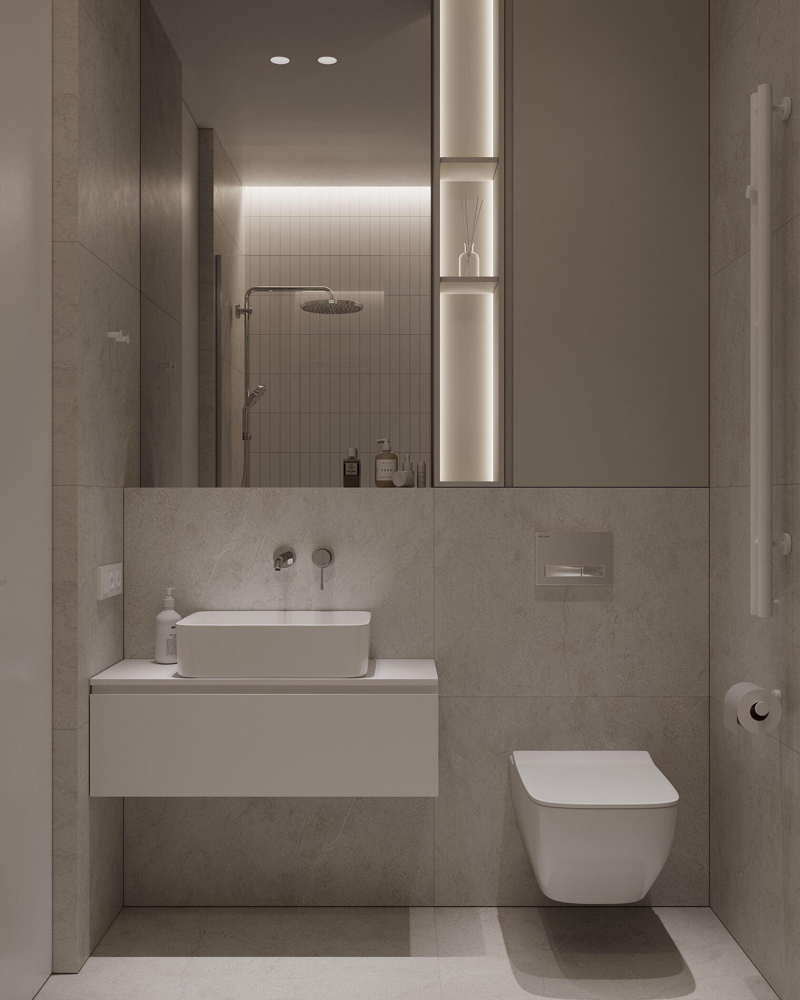

Дизайн ванной комнаты часто начинают с плитки, смесителя и «красивой картинки». На практике помещение должно выдержать обычный день: умывание, душ или ванну, хранение, иногда стирку — и остаться удобным в проходах, а не только на визуализации. Если сценарий и размеры не собраны, отделка уже не спасёт тесноту перед унитазом или раковину на неверной высоте.

В [Studio19.03](https://studio1903.ru/) с 2019 года проектируют и реализуют жилые интерьеры в Москве и других городах. 3D-концепцию студия обычно начинает с ключевого помещения, чаще с кухни-гостиной: стиль и материалы утверждают до того, как визуализировать остальные комнаты, в том числе ванную. Ниже — с чего начать дизайн ванной комнаты, какие ориентиры по высотам и проходам стоит заложить в план, какие решения видны в портфолио и как заказать проект.

## С чего начинается дизайн ванной комнаты

Не с плитки. Плитка и смеситель собирают уже понятую задачу, а не заменяют её. Сначала нужно ответить, кто пользуется помещением, что в нём происходит чаще — душ, ванна или и то и другое, — сколько хранения нужно и как ванная связана со спальней и мокрыми стояками.

В одной квартире на компактной площади важно уместить всё необходимое, не потеряв проход. В другой на 80 с небольшим метрах сразу решают два санузла рядом со спальнями и гардеробной. В доме появляется больше свободы для ванны, душа и света, но и здесь размеры считают от человека, а не «побольше, чтобы точно хватило». Все эти сценарии могут выглядеть современными, но чертёж у них будет разным.

На старте полезно зафиксировать: сколько человек пользуется ванной в обычный день и утром одновременно; нужна ли ванна, достаточно ли душа или нужны оба; где хранить запас полотенец, бытовую химию и, если нужно, стиральную машину; как помещение связано со спальней, гардеробной и стояками; будет ли отдельный гостевой санузел. Ответы меняют план раньше, чем цвет плитки.

Состав работы тоже стоит понять в начале. Дизайн ванной комнаты в Studio19.03 не существует отдельно от квартиры или дома: в [полный дизайн-проект](https://studio1903.ru/price) входят обмерный план и планировочные решения, 3D-визуализация всех помещений, рабочая документация и развёртки стен, мебель в 3D и спецификация материалов, оборудования и мебели. Что именно входит в альбом, подробно разобрано в статье [«Дизайн-проект квартиры»](https://studio1903.ru/journal/dizajn-proekt-kvartiry). С чего начать работу над интерьером целиком — в статье [«Дизайн интерьера»](https://studio1903.ru/journal/dizajn-interera). Отдельного тарифа «только на ванную» на сайте нет.

## Планировка и эргономика в дизайне ванной комнаты

Красивая картинка не отменяет миллиметры. Ниже — рабочие ориентиры, а не один «единственно верный» размер. Высоты установки сверены со сводом правил СП 73.13330.2016 (актуализированная редакция СНиП 3.05.01-85), размеры поддонов, душевой сетки и ряд планировочных правил — с Э. Нойфертом («Строительное проектирование» / *Bauentwurfslehre*). Проходы перед приборами даны как принятые эргономические вилки: где практика даёт диапазон, вилка остаётся и здесь. Это памятка для планировки, не замена обмера и посадки на объекте. Итоговые отметки зависят от роста семьи, типа раковины (накладная чаша поднимает верхний край) и того, нужен ли проход мимо сидящего или достаточно подойти к прибору.

Высота умывальника в жилых зданиях по СП 73.13330.2016 — **80 см до верха борта**, с допуском ±2 см для отдельно стоящего прибора. Если у умывальника и ванны общий смеситель, тот же свод поднимает умывальник до **85 см**. Накладную чашу считают так, чтобы верхний край оставался в этой зоне, а не уезжал выше из-за тумбы.

Борт ванны по тому же своду — **60 см** от чистого пола. У Нойферта высота самой ванны зависит от типа: **64 см** с ножками и **51 см** без ножек. Расстояние от продольной оси ванны до стены — не менее **45 см**.

Душевые поддоны у Нойферта приведены как **80 × 80, 90 × 90 и 100 × 100 см**. Для повседневного душа спокойнее ориентироваться на 90 × 90 см, а не на узкий минимум. Высота душевой сетки у Нойферта — **1,9 м**; высота смесителя душа от пола по СП 73.13330.2016 — **120 см**. Если поддон есть, до верха борта в жилых зданиях свод указывает **40 см**; встроенный в пол поддон или трап считают отдельно, по выбранной конструкции.

Перед унитазом оставляют не меньше около **60 см**, комфортнее **70–75 см**. Перед умывальником — ориентир около **70 см**. Перед ванной и у входа в душ — обычно **70–90 см**, чтобы раздеться, поставить ноги и не задеть дверь или стекло. Высоту сиденья унитаза свод не фиксирует: её задаёт сам прибор, распространённый ориентир — около **40–45 см**.

Двойной умывальник шириной **1,2 м** у Нойферта неудобен, если умываются одновременно. Лучше два отдельных умывальника с местом между ними; по СП расстояние между осями — не менее **65 см**. Окно, если оно есть над ванной, Нойферт рекомендует ставить не ниже **1,3 м** от ванны.

Для небольших квартир Нойферт считает достаточным душевую; в квартирах большей площади — полностью оборудованный санузел с ванной, душем, двумя умывальниками и биде, если это соответствует сценарию. Унитаз в ванной удобен, особенно если в квартире или доме есть ещё одна отдельная уборная. Связь ванной со спальней лучше закладывать сразу: об этом же — в статье [«Дизайн спальни»](https://studio1903.ru/journal/dizajn-spalni). Площадь самой ванной зависит от набора приборов и необходимых свободных проходов, а не от «красивой картинки» заранее выбранного формата.

## Примеры дизайна ванной комнаты в портфолио Studio19.03

В портфолио эти решения уже собраны в разных сценариях — от компактной квартиры до дома.

В [FRENCH 64](https://studio1903.ru/french64) на 64 м² в ЖК Cameo Moscow нужно было уместить всё необходимое и сохранить ощущение парижской квартиры. Ванная здесь с отдельно стоящей ванной и встроенным хранением: на малой площади важны и проход, и то, чтобы шкафы не съели место перед приборами.

В [ROCHE 82](https://studio1903.ru/roche82) на 82 м² в ЖК «Селигер Сити» собирали современный интерьер с классическими элементами. На этой площади вместили кухню-гостиную, две спальни, два санузла и большую гардеробную. Два санузла здесь не декор, а ответ на сценарий: утром и вечером помещением пользуются из разных комнат, и проходы не сходятся в одну точку.

В доме свобода другая. В [T-HOUSE 03](https://studio1903.ru/t-house03) на 460 м² дом читается цельно — от входа до мастер-спальни наверху. Ванная здесь с ванной, душевой зоной и дневным светом: места достаточно и для обхода, и для того, чтобы ванна не стояла в проходе.

В апартаментах [BRODSKY-19](https://studio1903.ru/brodsky-19) на 106 м² в ЖК «Бродский» интерьер делали для семьи с ребёнком. Ванная собрана у окна: ванна, душ, два умывальника, унитаз и биде. Такой набор ближе к «полностью оборудованному» санузлу, о котором пишет Нойферт для большей площади, — но только потому, что вокруг приборов остаётся место пользоваться ими, а не смотреть на них с порога.

На совсем компактной площади набор короче, и это не недостаток проекта. В [DP-41](https://studio1903.ru/dp-41) на 41 м² в ЖК Discovery Park задача была выжать максимум из маленькой площади и не потерять ощущение простора: 41 м² должны восприниматься как полноценная однокомнатная квартира. В санузле здесь душ, раковина и унитаз — без попытки втиснуть ванну туда, где не останется прохода. Как в целом собирают такую квартиру — в статье [«Дизайн однокомнатной квартиры»](https://studio1903.ru/journal/dizajn-odnokomnatnoj-kvartiry).

## Как заказать дизайн ванной комнаты

Путь работы описан на странице [«Этапы»](https://studio1903.ru/steps). Для ванной особенно важны первые шаги: на встрече обсуждают, как живёт семья и что помещение должно уметь, затем делают обмеры и несколько вариантов зонирования. Мокрые зоны, стояки и перепланировку студия готовит в рамках действующих норм. Когда планировка утверждена, собирают 3D ключевого помещения — обычно кухни-гостиной — и только после этого визуализируют остальные комнаты, в том числе ванную, выпускают альбом чертежей и спецификацию с артикулами.

Имеет смысл думать о квартире или доме целиком: ванная связана со спальней, гардеробной, стояками и светом остальных помещений. У Studio19.03 можно начать с планировочного проекта или заказать полный дизайн-проект.

Если проект нужно довести до ремонта, студия может сопровождать реализацию: бригады работают по документации Studio19.03, есть авторский надзор и комплектация. На сайте это описано как один цикл — одна команда ведёт объект до завершения. Руководитель студии Роман Ахмадуллин ведёт каждый проект лично, от обмеров до приёмки, и сам разбирает вопросы на стройке, не передавая их менеджеру.

Готовый бриф не нужен: достаточно площади и телефона. Первая встреча — в студии на Нагатинской или на объекте. По заявке студия перезванивает в течение рабочего дня.

## Сколько стоит дизайн ванной комнаты

На странице [«Цены»](https://studio1903.ru/price) Studio19.03 публикует ориентиры по форматам работы. Это стоимость дизайн-проекта квартиры или дома, а не отдельная ставка за одну комнату.

Планировочный проект — 1 000 ₽ / м²: обмерный план, план расстановки мебели с размерами и перепланировочный план (снос и возведение перегородок).

Полный дизайн-проект — от 6 000 ₽ / м², со шкалой по площади:

- 50–100 м² — 8 000 ₽ / м²;
- 100–200 м² — 7 000 ₽ / м²;
- свыше 200 м² — 6 000 ₽ / м².

Отдельной ставки для площади меньше 50 м² на сайте нет. Для квартиры вроде DP-41 (41 м²) точную сумму лучше запросить расчётом: на сайте отвечают в течение рабочего дня. Для площади 50–100 м², куда попадают FRENCH 64 (64 м²) и ROCHE 82 (82 м²), в прайсе указано 8 000 ₽ / м². BRODSKY-19 (106 м²) попадает в диапазон 100–200 м² — 7 000 ₽ / м². T-HOUSE 03 (460 м²) — свыше 200 м², 6 000 ₽ / м².

Авторский надзор — от 50 000 ₽ в месяц: еженедельные выезды, отчётность с фотофиксацией, проверка соответствия проекту, консультации прораба и подрядчиков, оперативные правки в чертежах.

Комплектация — по согласованию. В неё входят выезды в салоны, коммерческие предложения, корректировка смет под бюджет, контроль заказа, организация изготовления индивидуальных позиций и закупка декора. Все скидки и бонусы от поставщиков, по данным студии, остаются заказчику (от 5 до 15%).

Отдельно студия указывает, что работает с объектами, где бюджет отделки под ключ — от 200 000 ₽ за квадратный метр. Это ориентир по реализации, а не стоимость самого дизайн-проекта. Срок разработки альбома в днях или неделях на сайте не опубликован; сроки в карточках проектов относятся к реализации объекта целиком.

Если нужен проект под конкретную квартиру, написать можно на [studio1903.ru](https://studio1903.ru/). Телефон +7 (966) 250-84-50, почта info@studio1903.ru, студия в Москве, Нагатинская набережная, 10А, корп. Б.

:::faq
С чего начать дизайн ванной комнаты, если ремонт ещё не начался?

Со сценария и планировки. Сначала фиксируют, как помещением будут пользоваться, делают обмеры и варианты расстановки приборов с проходами и высотами. Плитку, смесители и свет логично выбирать уже по утверждённому плану — иначе вещи приходится вписывать в случайно сложившееся пространство.

Какая высота у раковины и унитаза?

Умывальник в жилых зданиях обычно ставят на 80 см до верха борта (по СП 73.13330.2016, допуск ±2 см). Если смеситель общий с ванной — 85 см. Высоту сиденья унитаза свод не нормирует, распространённый ориентир — около 40–45 см.

Сколько места оставлять перед унитазом, раковиной и душем?

Перед унитазом — не меньше около 60 см, комфортнее 70–75 см. Перед умывальником — ориентир около 70 см. Перед ванной и у входа в душ — обычно 70–90 см. Это рабочие ориентиры, точную посадку проверяют на плане и на объекте.

Нужна ли ванна, или достаточно душа?

Зависит от сценария, а не от «правильной картинки». В компактной квартире, как в DP-41, часто достаточно душа, чтобы сохранить проходы. В большей квартире или доме можно заложить и ванну, и душ, как в T-HOUSE 03 или BRODSKY-19, если вокруг приборов остаётся место ими пользоваться.

Нужен ли отдельный проект только на ванную?

Имеет смысл думать о квартире или доме целиком: ванная связана со спальней, стояками и планировкой остальных помещений. У Studio19.03 можно начать с планировочного проекта или заказать полный дизайн-проект. Отдельного тарифа «только ванная» на сайте нет. Точный расчёт студия делает после заявки.
:::
