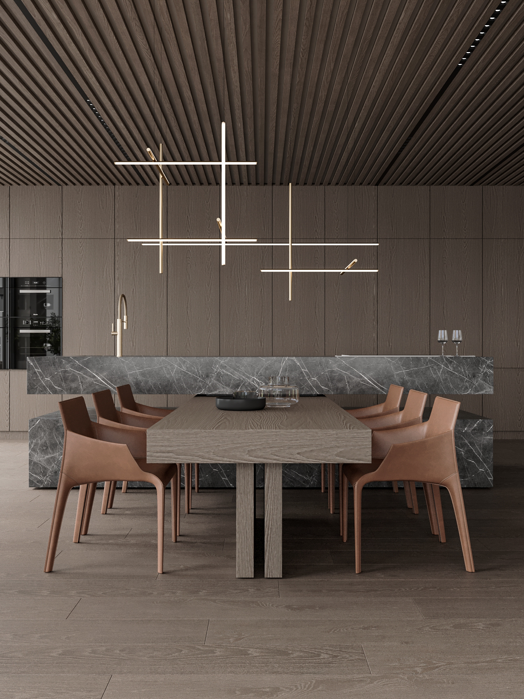
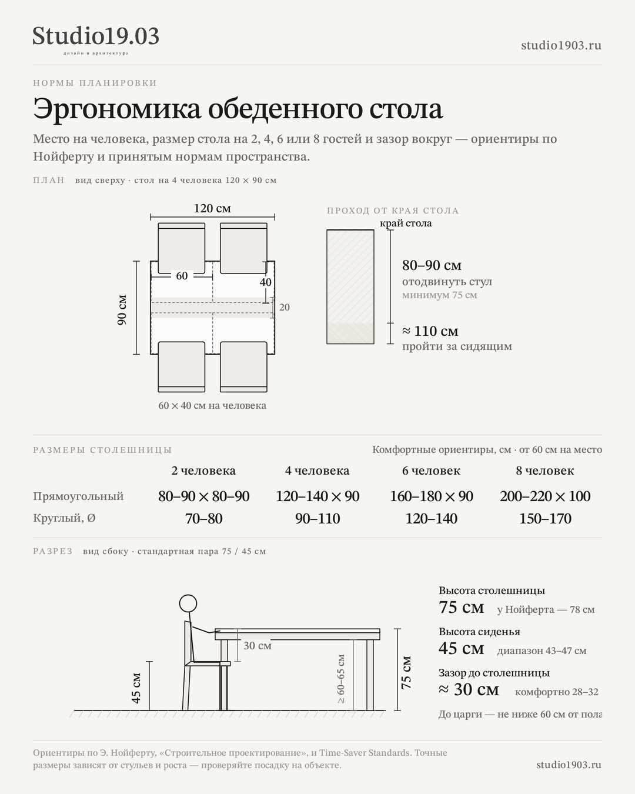
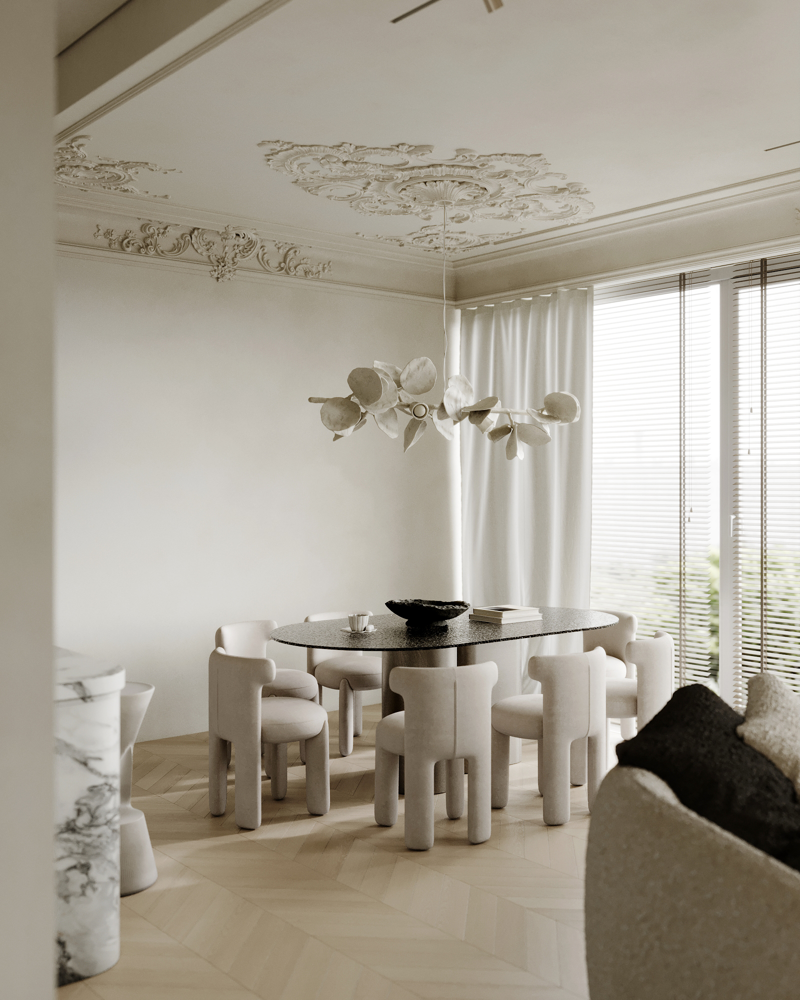
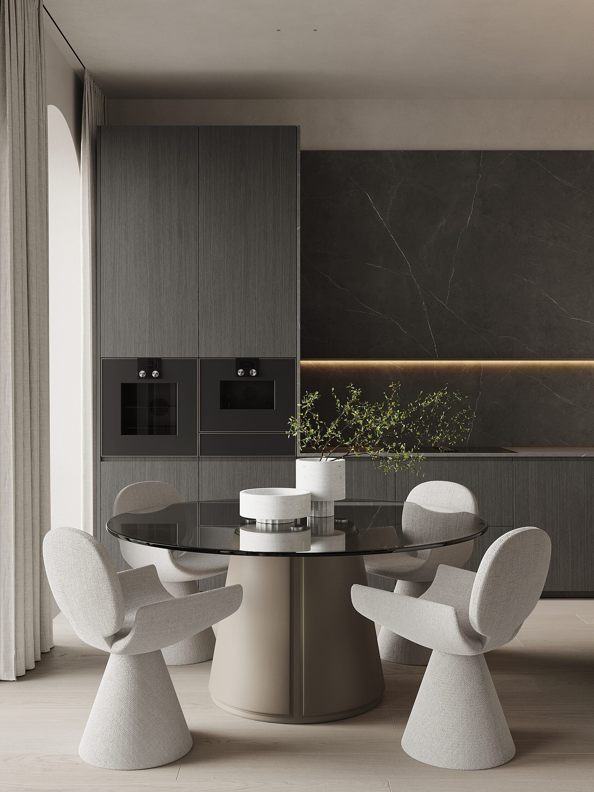

Эргономика обеденного стола часто сводится к одному числу вроде «стол на четверых». На практике важнее другое: сколько места нужно одному человеку, какой размер столешницы получается на 2, 4, 6 или 8 гостей, можно ли отодвинуть стул и пройти за спинами, и на какой высоте стоят столешница и сиденье.

Ниже — рабочие ориентиры, а не один «единственно верный» миллиметр. Цифры сверены с Э. Нойфертом («Строительное проектирование» / *Bauentwurfslehre*) и справочником Time-Saver Standards: где источники дают вилку, вилка остаётся и здесь. Это памятка для планировки, не замена обмера и посадки на объекте. Итоговые размеры зависят от стула (с подлокотниками место шире), роста семьи и того, нужен ли проход за спинами или достаточно отодвинуть стул у стены.

В портфолио [Studio19.03](https://studio1903.ru/) эти решения уже собраны в разных сценариях: отдельная столовая в доме [T-HOUSE 03](https://studio1903.ru/t-house03), стол в компактной кухне-гостиной [FRENCH 64](https://studio1903.ru/french64) и круглая столовая зона в апартаментах [BRODSKY-19](https://studio1903.ru/brodsky-19).

## Что такое эргономика обеденного стола

Эргономика обеденного стола — это не стиль столешницы и не «стол побольше, чтобы точно хватило». Это набор связанных размеров: модуль места на человека, длина и ширина или диаметр столешницы, зазор, чтобы сесть, проход за сидящим, высота стола и стула, свободная высота до царги.

Если выкинуть одно звено, картинка на визуализации может остаться красивой, а за столом будет тесно. Стол, который формально «на восьмерых», бесполезен, если за спинами нельзя пройти с блюдом или стул упирается в стену. Поэтому в [Studio19.03](https://studio1903.ru/) размер стола считают вместе с планировкой комнаты, а не отдельно от неё.

## Эргономика обеденного стола: место на одного человека

Базовый модуль, от которого считают столешницу, — **60 × 40 см** на человека: примерно 60 см по фронту и 40 см в глубину на прибор. Посередине стола оставляют полосу около **20 см** под общую посуду.

У Нойферта длина стола на одно место — **55–70 см**: при стульях считают **65 см**, при креслах — **70 см**. Ширина стола в том же источнике дана широкой вилкой 55–110 см. Распространённая цитата Нойферта уточняет «идеальную» ширину как **80–85 см**: зоны прибора 30–40 см при этом слегка заходят на центральную полосу, поэтому 40 + 20 + 40 не складывают в жёсткие 100 см. Time-Saver Standards даёт по фронту около 24″ ≈ 610 мм как комфортную посадку и 22″ при более плотной.

В этой статье для прямоугольных столов дальше используем понятный модуль **60 см на место**, а ширину — как комфортный ориентир **80–90 / 90 / 100 см**, а не узкий минимум.

## Размеры стола на 2, 4, 6 и 8 человек

Прямоугольные длины посчитаны от 60 см на место (плюс 10–20 см, если сажают по торцам, как у Нойферта). Круглые диаметры — по формуле Нойферта с местом 60–70 см, округлённые до удобных вилок.

- на двоих: прямоугольный 80–90 × 80–90 см, круглый диаметром 70–80 см;
- на четверых: прямоугольный 120–140 × 90 см, круглый диаметром 90–110 см;
- на шестерых: прямоугольный 160–180 × 90 см, круглый диаметром 120–140 см;
- на восьмерых: прямоугольный 200–220 × 100 см, круглый диаметром 150–170 см.

Для двоих напротив друг друга круг по формуле получается слишком маленьким, поэтому здесь стоит практический минимум 70–80 см, а не «голый» расчёт. Для восьмерых формула даёт примерно 166–178 см в диаметре; на карточке ближе к **150–170 см**, иначе центр стола уже неудобно доставать. Ширина 100 см у прямоугольного стола на восьмерых — из той же логики общей зоны посередине.

Таблицу заводских размеров столов у Нойферта (DIN 4563: 70×100, 80×110, 90×120 и дальше) не стоит выдавать за «стол на N человек»: это линейка изготовления, а не вместимость.

## Проходы вокруг обеденного стола

Эргономика обеденного стола ломается не только из-за короткой столешницы, но и из-за того, что вокруг неё не осталось воздуха. От края стола считают так:

- **80–90 см**, чтобы отодвинуть стул и сесть; комфортный ориентир, минимум около **75 см**;
- **≈ 110 см**, чтобы пройти за сидящим и подать блюда;
- около **60 см** — только протиснуться, без полноценного стула. На это нельзя опираться как на основной проход.

Цифры собраны из Time-Saver Standards (32″ ≈ 81 см на стул и посадку, 38″ ≈ 97 см на стул и проход, 42″ ≈ 107 см на подачу за спиной, 24″ ≈ 61 см чтобы протиснуться) и распространённой практики планировки около 750–900 мм и 1100 мм. «107 см» и «110 см» — одна величина, округлённая.

Если стол стоит у стены и за спинами ходить не нужно, достаточно места, чтобы отодвинуть стул. Если это столовая в доме, где ходят с блюдами, закладывают больший проход. В [T-HOUSE 03](https://studio1903.ru/t-house03) столовая собрана как место для встреч с друзьями и родственниками: здесь важны и длина стола, и свободный обход.

## Высота столешницы, сиденья и царги

Самая частая современная связка — **столешница 75 см**, **сиденье 45 см**, зазор между ними **около 30 см** (комфортно 28–32 см). У Нойферта в таблице столов для столовых высота указана как **78 см**; в цитатах *Architect's Data* обеденный стол — 0,75 м, стул — 0,40–0,45 м. Поэтому 75 см — рабочий стандарт, а не отмена нофертовских 78 см.

Свободная высота до нижней кромки царги — **не ниже 60 см** от пола, комфортно **около 65 см**. Если царга опущена ниже, колени упираются в подстолье, даже когда столешница стоит на «правильных» 75 см.

## Как выбрать обеденный стол под комнату

Сначала считают, сколько человек сидит в обычный день и сколько бывает в «гостевой» вечер. Затем измеряют не только нишу под столешницу, но и проходы: 80–90 см на посадку и, если нужно, около 110 см за спинами. Форму стола подбирают после этого, а не наоборот.

В компактной квартире стол чаще стоит в кухне-гостиной и не должен съедать проход к дивану и кухне. В проекте [FRENCH 64](https://studio1903.ru/french64) на 64 м² в ЖК Cameo Moscow нужно было уместить всё необходимое и сохранить ощущение простора: столовая зона здесь часть общего помещения, а не отдельный зал. Для такой комнаты спокойнее смотреть стол на 4–6 мест и проверять, что стулья отодвигаются.

Круглый стол на четверых хорошо собирает посадку без торцов и часто легче обходится в квадратном фрагменте комнаты. В апартаментах [BRODSKY-19](https://studio1903.ru/brodsky-19) на 106 м² в ЖК «Бродский» столовая зона собрана вокруг круглого стола на четыре места — рядом с кухней, без ощущения, что стол перегородил комнату. Интерьер здесь делали для семьи с ребёнком: важны были спокойная посадка и собранный силуэт, а не максимальное число стульев.

В доме сценарий другой. В [T-HOUSE 03](https://studio1903.ru/t-house03) на 460 м² задача была создать уютное пространство для встреч с друзьями и родственниками. Длинный прямоугольный стол на большую компанию здесь уместен именно потому, что вокруг него остаётся проход и столовая не делит дом на узкий коридор.

Стул с подлокотниками просит больше места по фронту, чем стул без них. Это стоит закладывать сразу, а не обнаруживать после покупки комплекта.

## Типичные ошибки в эргономике обеденного стола

**Считают только столешницу.** В план ставят «стол 180 см», а 80–90 см на стул забывают. В комнате визуально «всё входит», сесть уже нельзя.

**Берут стол на восьмерых для двоих–четверых в обычный день.** Гостевой сценарий важен, но если он редкий, большой стол каждый день мешает пройти и отодвинуть стул. Иногда лучше устойчивые 4–6 мест и понятный проход, чем формальная вместимость.

**Путают линейку изготовления с вместимостью.** Размер из каталога или таблицы DIN не равен «столу на N человек». Считать нужно от места 60×40 см и проходов.

**Не проверяют царгу и высоту стула.** Столешница 75 см не спасёт, если до подстолья меньше 60 см или зазор между сиденьем и столом далёк от 30 см.

**Ставят большой прямоугольный стол в узкую кухню-гостиную.** В небольшой квартире, как в FRENCH 64, стол — часть общего пространства. Он не должен перекрывать путь от кухни к мягкой зоне.

Эти решения в Studio19.03 появляются уже на планировке, а не на объекте, когда мебель уже куплена. В полный [дизайн-проект](https://studio1903.ru/journal/dizajn-proekt-kvartiry) входят обмеры и планировочные решения, 3D-визуализация, рабочая документация, мебель в 3D и спецификация с артикулами. С чего начать работу над интерьером целиком — в статье [«Дизайн интерьера»](https://studio1903.ru/journal/dizajn-interera). Планировочный проект — 1 000 ₽/м², полный дизайн-проект — от 6 000 ₽/м². Чтобы обсудить стол и проходы в конкретной комнате, достаточно оставить заявку: телефон +7 (966) 250-84-50, почта info@studio1903.ru, студия в Москве, Нагатинская набережная, 10А, корп. Б.

:::faq
Какое место нужно одному человеку за обеденным столом?

Ориентир — 60 × 40 см на человека и около 20 см по центру стола под общую посуду. У Нойферта по фронту вилка 55–70 см: 65 см при стульях, 70 см при креслах.

Какой размер обеденного стола нужен на 4 и на 6 человек?

Для четверых прямоугольный стол обычно 120–140 × 90 см, круглый — диаметром 90–110 см. Для шестерых — 160–180 × 90 см или круг 120–140 см. Это комфортные ориентиры, а не единственный допустимый размер.

Сколько места оставлять вокруг стола?

Чтобы отодвинуть стул и сесть — 80–90 см от края стола (минимум около 75 см). Чтобы пройти за сидящим — около 110 см. Протиснуться можно примерно на 60 см, но это не основной проход.

Какая высота у обеденного стола и стула?

Чаще всего столешница 75 см, сиденье 45 см, зазор около 30 см. У Нойферта в таблице столов для столовых встречается 78 см. Царга — не ниже 60 см от пола, комфортно около 65 см.

Нужна ли отдельная столовая, чтобы соблюсти эргономику обеденного стола?

Нет. В квартире стол часто стоит в кухне-гостиной, как в FRENCH 64 или BRODSKY-19. Тогда ещё важнее проверить проходы. Отдельная столовая, как в T-HOUSE 03, просто даёт больше свободы для большого стола и обхода.

Можно ли заказать у Studio19.03 только расстановку стола, без полного проекта?

Да. Можно начать с планировочного проекта за 1 000 ₽/м² или заказать полный дизайн-проект — от 6 000 ₽/м². Точный расчёт студия делает после заявки.
:::
