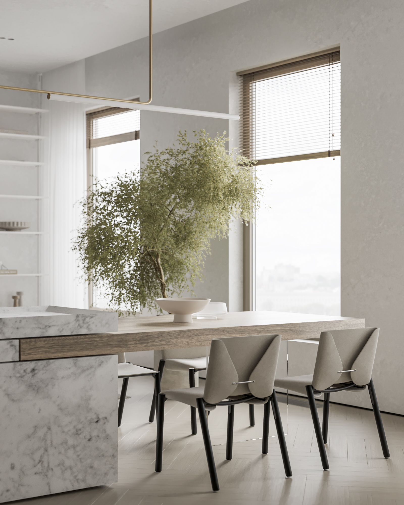
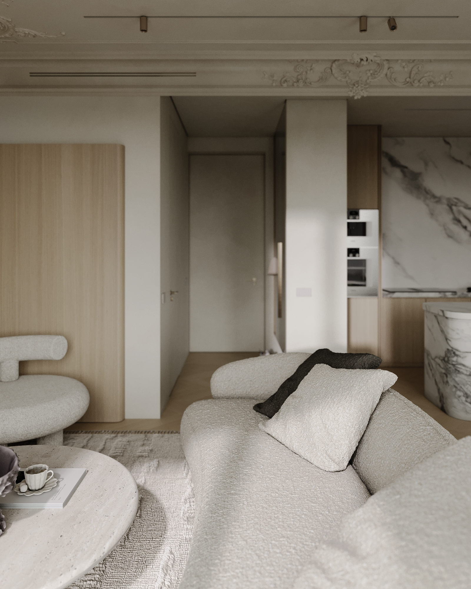
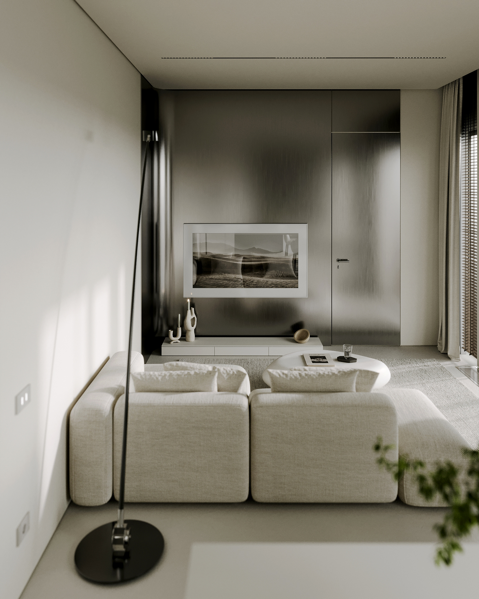
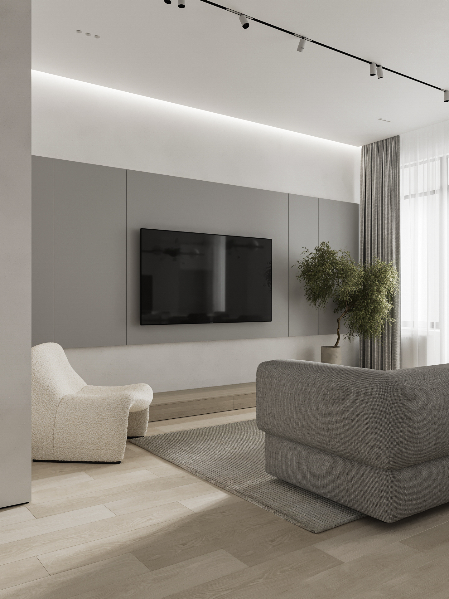

Студия дизайна интерьера нужна не для того, чтобы подобрать цвет стен по картинке. На практике это работа с целым объектом: как живут в квартире или доме, какая планировка возможна, какой альбом уйдёт на стройку и кто будет сопровождать реализацию. Если начать со стиля и референсов, не собрав сценарий и план, ремонт пойдёт по догадкам на объекте.

[Studio19.03](https://studio1903.ru/) — студия дизайна интерьера в Москве. С 2019 года она проектирует и реализует интерьеры в Москве и других городах. В открытом [портфолио](https://studio1903.ru/portfolio) опубликованы 18 проектов: квартиры, апартаменты и дома; на сайте студия пишет о более чем ста объектах от чертежа до финала. Ниже — с чего начать работу со студией дизайна интерьера, как устроен процесс в Studio19.03 и как заказать проект.

Общий подход к интерьеру разобран в статье [«Дизайн интерьера»](https://studio1903.ru/journal/dizajn-interera). Что входит в альбом, этапы и прайс — в статье [«Дизайн-проект квартиры»](https://studio1903.ru/journal/dizajn-proekt-kvartiry). Как устроена квартира как жильё — в статье [«Дизайн квартиры»](https://studio1903.ru/journal/dizajn-kvartiry).

## С чего начинается работа со студией дизайна интерьера

Не со стиля и не с готового брифа. Сначала нужно понять, как объектом будут пользоваться, и собрать планировку.

На старте полезно зафиксировать: сколько человек живёт сейчас и как сценарий может измениться; какие зоны обязательны, а какие можно совместить; нужна ли перепланировка; как помещение связано с окнами, мокрыми зонами и входом; какой ориентир по бюджету отделки. Готовый бриф не нужен: достаточно площади и телефона — остальное студия обсуждает лично.

Дальше — порядок, описанный на странице [«Этапы»](https://studio1903.ru/steps). После заявки и встречи идёт подготовка: договор, обмеры с фото- и видеофиксацией и техническое задание. Затем студия разрабатывает несколько вариантов зонирования — мебель, перегородки, снос — в рамках действующих норм. Стиль, материалы и свет утверждают уже на 3D-концепции: визуализируют ключевое помещение, обычно кухню-гостиную, и только после этого делают визуализации остальных помещений, рабочую документацию и спецификацию с артикулами.

Каждый проект ведёт руководитель студии Роман Ахмадуллин: от обмеров до приёмки объекта. Если на стройке возникает вопрос, по формулировке сайта он решает его сам, а не передаёт менеджеру. Первая встреча — в студии на Нагатинской или на объекте.

## Студия дизайна интерьера Studio19.03: проекты и подход

В открытом портфолио Studio19.03 — 18 проектов в Москве и других городах, в том числе в Казани. Это квартиры, апартаменты и дома разной площади и с разными задачами. Отдельного «одного стиля на все объекты» в карточках нет: у каждого проекта своя формулировка задачи.

[TITUL 70](https://studio1903.ru/titul70) — квартира 70 м² в Москве, ЖК «Титул», 2022, элегантный минимализм. [FRENCH 64](https://studio1903.ru/french64) — квартира 64 м² в Москве, ЖК Cameo Moscow, 2024. [LEVEL-M](https://studio1903.ru/levelm) — квартира 49 м² в Москве, ЖК Level Мичуринский, 2024, современный минимализм. [SQUARE 29](https://studio1903.ru/square29) — квартира 86 м² в Москве, ЖК «Царская Площадь», 2021, современный минимализм.

На главной студия формулирует цикл так: проект, ремонт, надзор и комплектация — не отдельные договоры с разными исполнителями; одна команда ведёт объект до завершения. Архитектура, дизайн и строительство собраны в одной студии, без передачи на субподряд. Строительные бригады работают по документации студии — без вольных интерпретаций на объекте.

Отдельные коммерческие объекты в этих 18 карточках не опубликованы, хотя на сайте студия пишет, что создаёт жилые и коммерческие интерьеры. Форматы работы при этом те же: планировочный проект, полный дизайн-проект, при необходимости авторский надзор и комплектация.

## Сколько стоит работа студии дизайна интерьера и как заказать

Актуальные цены — на странице [«Цены»](https://studio1903.ru/price). Отдельной ставки «за бренд» или «за встречу» на сайте нет: считают по формату и площади.

Планировочный проект — 1 000 ₽ / м²: обмерный план, расстановка мебели с размерами и перепланировочный план.

Полный дизайн-проект — от 6 000 ₽ / м², со шкалой по площади:

- 50–100 м² — 8 000 ₽ / м²;
- 100–200 м² — 7 000 ₽ / м²;
- свыше 200 м² — 6 000 ₽ / м².

Отдельной ставки для площади меньше 50 м² на сайте нет, её лучше запросить расчётом. В шкалу 50–100 м² попадают, например, TITUL 70 (70 м²), FRENCH 64 (64 м²) и SQUARE 29 (86 м²) — в прайсе для этого диапазона указано 8 000 ₽ / м². LEVEL-M — 49 м², то есть меньше 50 м²: для такой площади точную сумму запрашивают отдельно.

Авторский надзор — от 50 000 ₽ в месяц: еженедельные выезды, отчётность с фотофиксацией, проверка соответствия проекту, консультации прораба и подрядчиков, оперативные правки в чертежах.

Комплектация — по согласованию. В неё входят выезды в салоны, коммерческие предложения, корректировка смет под бюджет, контроль заказа, организация изготовления индивидуальных позиций и закупка декора. Все скидки и бонусы от поставщиков, по данным студии, остаются заказчику (от 5 до 15%).

На странице [«Этапы»](https://studio1903.ru/steps) студия указывает, что работает с объектами, где бюджет отделки под ключ — от 200 000 ₽ за квадратный метр. Это ориентир по реализации, а не цена дизайн-проекта.

Чтобы заказать работу, достаточно оставить заявку на сайте или написать в студию. Первая встреча — в студии на Нагатинской набережной, 10А, корп. Б или на объекте. Телефон: +7 (966) 250-84-50, почта: info@studio1903.ru. По заявке студия перезванивает в течение рабочего дня. Контакты также собраны на странице [«Контакты»](https://studio1903.ru/contacts).

:::faq
С чего начать работу со студией дизайна интерьера?

Со сценария и планировки. Сначала фиксируют, как живут в помещении, какие зоны нужны, нужна ли перепланировка и какой ориентир по бюджету отделки. В Studio19.03 готовый бриф не нужен — достаточно площади и телефона. Затем делают обмеры с фото- и видеофиксацией, заполняют техническое задание и разрабатывают несколько вариантов зонирования в рамках действующих норм. Стиль, материалы и свет утверждают уже на 3D-концепции — обычно кухни-гостиной — и только после плана.

Где находится студия дизайна интерьера Studio19.03 и в каких городах она работает?

Студия в Москве, ул. Нагатинская набережная, 10А, корп. Б. С 2019 года она проектирует и реализует интерьеры в Москве и других городах, в том числе в Казани. Первая встреча — в студии на Нагатинской или на объекте. Телефон +7 (966) 250-84-50, почта info@studio1903.ru. По заявке студия перезванивает в течение рабочего дня.

Что входит в работу студии дизайна интерьера?

На сайте описаны отдельные форматы: планировочный проект, полный дизайн-проект, авторский надзор и комплектация. Полный проект включает обмеры и планировку, 3D-визуализацию всех помещений, рабочую документацию и спецификацию. Ремонт, надзор и комплектация предлагаются как продолжение цикла, а не как обязательная часть альбома. Что именно нужно в вашем случае, лучше согласовать на встрече.

Сколько стоит заказать проект в студии дизайна интерьера?

Планировочный проект — 1 000 ₽ / м², полный дизайн-проект — от 6 000 ₽ / м² в зависимости от площади: 8 000 ₽ / м² при 50–100 м², 7 000 ₽ / м² при 100–200 м² и 6 000 ₽ / м² свыше 200 м². Ставки для площади меньше 50 м² на сайте нет — её запрашивают расчётом. Авторский надзор — от 50 000 ₽ в месяц, комплектация — по согласованию. Актуальные ориентиры — на странице «Цены».

Можно ли заказать у студии только планировку или только дизайн одной комнаты?

Отдельного тарифа на одно помещение на сайте нет. Полный дизайн-проект делают для объекта целиком: визуализируют все помещения и выпускают рабочую документацию на весь объект. Если на старте нужна только планировка, есть отдельный формат — планировочный проект.
:::
